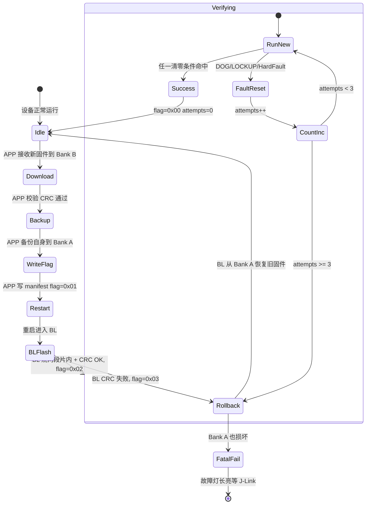

# nRF52811 外置 Flash 双备份 DFU 与极简 Bootloader 设计方案

> **版本**: v4 — 极限榨取 80KB APP 布局，统一兼容已部署设备与新批次
>
> **修订历史**:
> - v1: 初版 76KB APP 设计（存在 MBR Params/UICR 多处致命冲突）
> - v2: 保守版（保持片内布局完全不动，不扩 APP）
> - v3: 64KB APP 版（FDS 物理迁移到 BL 之上）
> - v4: **当前版本** — 64KB 代码 + 16KB rodata 扩展 = 80KB 极限榨取
>
> **核心调研结论**:
> 1. 当前 Nordic BL 在 nRF52811 上实际是被迫 single-bank，砖机风险高（[nrf_dfu_utils.c:119-220](../SDK/17.1.0_ddde560/components/libraries/bootloader/dfu/nrf_dfu_utils.c#L119-L220) 的 `nrf_dfu_cache_prepare` 自动降级）
> 2. **UICR 技术上可改但对 BL 跳转无效**：UICR 不是 OTP（[nrf52811_bitfields.h:2166-2173](../SDK/17.1.0_ddde560/modules/nrfx/mdk/nrf52811_bitfields.h#L2166-L2173) `ERASEUICR` 寄存器可擦除整个 UICR，Nordic 自己的代码也在写 UICR），但 MBR 优先读 `MBR_BOOTLOADER_ADDR (0xFF8)` 在 MBR 物理代码区，该值已由 [nrf_bootloader_info.c:64-73](../SDK/17.1.0_ddde560/components/libraries/bootloader/nrf_bootloader_info.c#L64-L73) 写为 0x29000 且擦除它会破坏 MBR 代码本身，因此改 UICR.NRFFW[0] **对 MBR 跳转无效**；详见第 9.1 节
> 3. **MBR Params 页 (0x2E000) 和 BL Settings 页 (0x2F000) 在极简 BL 场景下完全是死区**：MBR 仅在 `SD_MBR_COMMAND_COPY_BL` 和 `SD_MBR_COMMAND_VECTOR_TABLE_BASE_SET` 时使用 MBR Params；只要极简 BL 不调这两个命令、APP 不调 `sd_mbr_command()`，这两页可作 APP 常量数据
> 4. **FDS 物理地址由 SDK 运行时 `flash_end_addr() = BOOTLOADER_ADDRESS - FDS_PHY_PAGES_RESERVED × 4KB` 计算**（[fds.c:1659-1684](../SDK/17.1.0_ddde560/components/libraries/fds/fds.c#L1659-L1684)）；要让 FDS 落在 0x2A000，需 patch fds.c 硬编码 2 行

---

## 0. 方案目标与适用范围

### 0.1 双重核心问题

#### A. APP 空间已触顶（最紧迫）

- APP 实际占用 ~55KB（[_build/nrf52811_xxaa.map](../_build/nrf52811_xxaa.map) section 总和 56400 字节）
- 链接脚本上限 56KB（[gcc_nrf52.ld:11](../SDK/17.1.0_ddde560/gcc_nrf52.ld#L11) `FLASH LENGTH=0xE000`）
- **剩余仅 944 字节**，新增任何字体/功能都触顶

#### B. 当前 DFU 实际是被迫 single-bank，砖机风险高

- 配置层声明 dual-bank（`NRF_DFU_SINGLE_BANK_APP_UPDATES = 0`）
- nRF52811 物理空间不足：Bank 1 起始 = `0x27000` > DFU 区上限 `0x26000`
- `nrf_dfu_cache_prepare()` 自动进入 Pass 1：**invalidate Bank 0 后用 0x19000 作 Bank 1**
- 接收期间旧 APP 被擦除，断电/校验失败均直接砖机
- 设备失联 30~60 秒（BL 蓝牙重连）

### 0.2 方案目标（最大化版）

| 目标 | 优先级 | 实现方式 |
| :--- | :---: | :--- |
| **APP 扩展到 64KB 代码 + 16KB 常量 = 80KB** | 🔴 P0 | FDS 迁移 + 极简 BL + 回收 MBR Params/BL Settings |
| 消除升级砖机风险 | 🔴 P0 | APP 接收 + 外置 Flash 暂存 + 极简 BL 烧写 |
| 支持自动回滚 | 🔴 P0 | 外置 Flash Bank A 保留稳定固件 |
| 已部署 + 新批次统一布局 | 🔴 P0 | UICR 不动，0xFF8 不动，仅 Flash 内部重新规划 |
| 保留 BLE 配对数据 | 🟠 P1 | FDS 物理整页搬家 |
| 设备失联 < 5 秒 | 🟠 P1 | APP 全程接收，仅最后烧片内时离线 |

### 0.3 适用范围

- ✅ **已部署设备** — 通过过渡 OTA + FDS 迁移升级
- ✅ **未量产新批次** — 工厂直接烧目标布局

### 0.4 已确认决策

| 项 | 选择 | 理由 |
|:---|:---:|:---|
| APP 代码区 | 64KB (0x19000-0x29000) | 受 0xFF8 锁定的 BL 地址限制 |
| APP rodata 扩展区 | 16KB (0x2C000-0x30000) | 回收 MBR Params + BL Settings + Reserved |
| FDS 位置 | 0x2A000-0x2C000 | patch fds.c 硬编码 |
| BLE 安全 | SEC_JUST_WORKS | 无需密码配对 |
| 版本控制 | 支持任意降级 | 仅记录版本号不强制顺序 |
| FDS 备份加密 | 完成后立即擦除（C 方案） | 攻击窗口仅升级期间几秒 |
| 用户升级体验 | 一次操作目标（2C 方案） | 网页改动最小化 B：弹窗提示用户点第二次 |
| Nordic DFU 回退 | 不保留 | 迁移 APP 自带完整 OTA 能力 |
| UICR 修改 | **完全不动** | 已部署设备 0xFF8 已锁，改 UICR 无效；新批次也走相同布局 |

---

## 1. 内存空间布局（80KB 极限版）

### 1.1 片内 Flash (192KB) 目标布局

| 区域 | 地址 | 大小 | 用途 | 变更 |
| :--- | :---: | :---: | :--- | :--- |
| **MBR** | `0x00000-0x01000` | 4KB | SoftDevice 引导 + 末尾 0xFF8/0xFFC | ❄ 物理不动 |
| **SoftDevice S112** | `0x01000-0x19000` | 96KB | BLE 协议栈 | ❄ 物理不动 |
| **APP .text + 主 .rodata** | `0x19000-0x29000` | **64KB** | APP 代码 + 必要常量 | ✦ 比现状 +8KB |
| **极简 Bootloader** | `0x29000-0x2A000` | 4KB | 搬运 + 极简 SPI/NVMC | ✦ 协议彻底重构 |
| **FDS** | `0x2A000-0x2C000` | 8KB（2 页）| BLE Bonding/peer manager | ✦ 从 0x27000 物理迁移 |
| **APP .rodata_ext (1)** | `0x2C000-0x2E000` | 8KB | 大字体/位图/查找表 | ★ 新回收区 |
| **APP .rodata_ext (2)** | `0x2E000-0x2F000` | 4KB | 大字体/位图/查找表 | ★ 回收 MBR Params |
| **APP .rodata_ext (3)** | `0x2F000-0x30000` | 4KB | 大字体/位图/查找表 | ★ 回收 BL Settings |

**关键不变量**：
- MBR 区内 `0x0FF8` = `0x29000`（BL 地址，物理 Flash，不可擦）
- MBR 区内 `0x0FFC` = `0x2E000`（MBR Params 地址，物理 Flash，不可擦）
- `UICR.NRFFW[0]` = `0x29000`（被 0xFF8 覆盖，无实际作用）
- `UICR.NRFFW[1]` = `0x2E000`（被 0xFFC 覆盖，无实际作用）

**关键变化**：
- APP 代码段 56KB → **64KB**（+8KB）
- APP 新增 **16KB** rodata 扩展区
- FDS 物理地址迁移 `0x27000` → `0x2A000`
- BL 从 20KB Nordic Secure DFU 压缩为 4KB 极简版

**APP 总可用 = 64KB 代码 + 16KB rodata = 80KB**

### 1.2 安全保证（80KB 布局的关键论证）

**0x2C000-0x2E000 (Reserved 区)** 完全自由 — 链接器和 SDK 均无任何引用。

**0x2E000-0x2F000 (原 MBR Params)** 在以下条件成立时绝对安全：

| 风险源 | 防范 |
|:---|:---|
| MBR 调用 `SD_MBR_COMMAND_COPY_BL` 写 0x2E000 | 极简 BL 不自我升级，不调此命令 |
| MBR 调用 `SD_MBR_COMMAND_VECTOR_TABLE_BASE_SET` 写 0x2E000 | APP 不调用 `sd_mbr_command()`（已 grep 确认） |
| MBR 在 reset 时主动写 0x2E000 | MBR reset 流程仅读 0xFF8 跳转 BL，不碰 0x2E000（[nrf_mbr.h:234-246](../SDK/17.1.0_ddde560/components/softdevice/s112/headers/nrf52/nrf_mbr.h#L234-L246) 文档明确） |

**0x2F000-0x30000 (原 BL Settings)** 在以下条件成立时绝对安全：

| 风险源 | 防范 |
|:---|:---|
| Nordic BL 读写 settings | 极简 BL 替换原 BL，不使用 settings 格式 |
| APP 通过 SVCI 写 `adv_name` (Buttonless DFU) | 移除 `ble_dfu_buttonless` 服务 |
| `sd_flash_write` 误写 | 极简 BL 时代 APP 不用 `sd_flash_write` 写 settings |

### 1.3 外置 Flash (FM25Q04B 512KB) 空间规划

| 区域 | 地址范围 | 大小 | 用途 |
| :--- | :---: | :---: | :--- |
| 保留/防误擦 | `0x00000-0x00FFF` | 4KB | 不擦扇区 0 |
| APP 静态资源区 | `0x01000-0x3FFFF` | 252KB | 字体/农历/UI 模板 |
| **Bank A — 旧固件备份** | `0x40000-0x53FFF` | 80KB | 升级前自动备份（覆盖 APP 80KB）|
| **Bank B — 新固件缓存** | `0x54000-0x67FFF` | 80KB | OTA 接收暂存 |
| **FDS 迁移备份区** | `0x68000-0x69FFF` | 8KB | 仅过渡升级用，完成后立即擦除 |
| 未用预留 | `0x6A000-0x7CFFF` | 76KB | 未来扩展 |
| **DFU Manifest** | `0x7D000-0x7DFFF` | 4KB | ✦ 新增 |
| 资源 Manifest | `0x7E000-0x7EFFF` | 4KB | ❄ 现有 `EPD_EXT_RES_MAIN_MANIFEST_ADDR` |
| Scratch/调试 | `0x7F000-0x7FFFF` | 4KB | 系统保留 |

**说明**：
- Bank A/B 各 80KB，匹配新 APP 上限（含 16KB rodata_ext）
- DFU Manifest 在 `0x7D000`，独立于现有资源 Manifest `0x7E000`
- 过渡升级时占用 0x68000-0x69FFF，正常运行该区为空

### 1.4 与历史布局对比

```
现状（已部署设备）             目标 v4 布局
────────────────────────      ──────────────────────────────
0x19000 旧 APP 56KB           0x19000 新 APP .text+rodata 64KB
0x27000 旧 FDS 8KB            0x29000 极简 BL 4KB
0x29000 旧 BL 20KB            0x2A000 新 FDS 8KB ← 物理搬家
0x2D000 (BL 余量)             0x2C000 .rodata_ext (8KB)
0x2E000 MBR Params            0x2E000 .rodata_ext (4KB) ← 回收
0x2F000 BL Settings           0x2F000 .rodata_ext (4KB) ← 回收
                              ────────────────────────────
                              APP 可用 = 64KB code + 16KB rodata
```

---

## 2. DFU 数据流（稳定态）

```
[网页] ──BLE──> [新 APP 收 + 暂存 Bank B + 校验]  ──重启──> [极简 BL 烧片内]
                     │
                     ├─ 旧 APP 全程运行（不失联）
                     ├─ BLE 连接持续
                     └─ 屏幕/时钟功能不受影响
```

### 2.1 APP 态：接收与外置 Flash 写入

1. **升级请求**：网页通过 `EPD_DATA_CHAR`（UUID `62750002-...`）发 `CMD_DFU_BEGIN`：
   - 固件总大小（uint32_t）— 可达 80KB
   - 固件 CRC32（uint32_t）
   - 固件版本号（uint16_t，**仅记录不强制顺序**）
2. **擦除 Bank B**：`fm25q04b_erase_range(0x54000, fw_size)`
3. **分包接收**：网页 244 字节为单位推送：
   - APP 按 256B 页组合调用 `fm25q04b_write`
   - 复用 [BLE_Transfer_CRC_Resume_Plan](../docs/BLE_Transfer_CRC_Resume_Plan.md) 的分批 ACK + 断点续传
4. **校验**：传输完成：
   - 从 Bank B 整包读出，软件 CRC32
   - 与网页声明 CRC 比对，不一致则拒绝升级
5. **备份当前固件**：校验通过后：
   - 读取 `0x19000` 起当前 APP 真实大小（最大 80KB，跨 0x29000-0x2A000 的 BL+FDS 区时需跳过）
   - 写入 Bank A（`0x40000-0x53FFF`）
   - 备份失败则拒绝升级
6. **写 manifest**（外置 Flash `0x7D000`）：

```c
typedef struct __attribute__((packed, aligned(4))) {
    uint32_t magic;                  // 0x4446554D ("DFUM")
    uint16_t struct_version;         // = 0x0001
    uint16_t reserved0;

    // 新固件信息（Bank B）
    uint32_t new_app_size;           // 可达 80KB
    uint32_t new_app_crc32;
    uint16_t new_app_version;
    uint16_t reserved1;

    // 旧固件信息（Bank A）
    uint32_t old_app_size;
    uint32_t old_app_crc32;
    uint16_t old_app_version;
    uint16_t reserved2;

    // 升级状态
    uint8_t  upgrade_flag;           // 0=IDLE 1=REQUEST 2=VERIFYING 3=ROLLBACK
    uint8_t  boot_attempts;          // fault 复位计数
    uint8_t  fault_marker;           // APP HardFault 后置 1
    uint8_t  migration_phase;        // 0=正常 1=完成阶段1 2=FDS 已备份待搬家

    // 签名预留（未来 HMAC-SHA256，当前 0）
    uint8_t  signature[32];

    // FDS 迁移备份信息（仅过渡升级用）
    uint32_t fds_backup_addr;        // 外置 Flash FDS 备份地址，未用时 = 0
    uint32_t fds_backup_size;        // 备份大小

    uint32_t manifest_crc32;
} dfu_manifest_t;
```

7. **触发重启**：
   - `NRF_POWER->GPREGRET = 0xC0`（避开 Nordic `0xB0` 系列）
   - `sd_nvic_SystemReset()`

### 2.2 BL 态：烧写与激活

见第 3 章。

### 2.3 APP 写片内的特殊处理（80KB 跨 BL/FDS 区）

APP 实际占用分两段：
- 段 1：`0x19000-0x29000` （代码 + 主 rodata，64KB 连续）
- 段 2：`0x2C000-0x30000` （rodata_ext 扩展，16KB 连续，**与段 1 之间有 BL+FDS 12KB 空洞**）

OTA 包格式：
```
[Bank B 中存放]
0x54000-0x64000  段 1 镜像（64KB）
0x64000-0x68000  段 2 镜像（16KB）
段 2 写入 Bank B 时占用 0x64000-0x68000（16KB），物理上连续

BL 烧片内时按映射拆分两段：
  段 1 写到 0x19000-0x29000
  段 2 写到 0x2C000-0x30000
```

---

## 3. 极简 Bootloader 设计

### 3.1 代码模块

```text
bootloader/
  ├─ main.c                  主流程：GPREGRET + manifest 分支
  ├─ spi_polling.c/.h        极简查询模式 SPI 驱动（无中断）
  ├─ fm25q04b_lite.c/.h      JEDEC ID + Read + Write + Erase + Wait Ready
  ├─ nrf_flash_write.c/.h    片内 NVMC + ★地址安全护栏★
  ├─ soft_crc32.c/.h         查表 CRC32
  ├─ manifest.c/.h           dfu_manifest 读写
  └─ app_jump.c              栈指针 + 跳转 0x19000
```

预计 BL 代码大小 4-6KB，正好放进 `0x29000-0x2A000` 的 4KB 区，必要时可扩到 8KB（不影响 APP 极限——会占用 FDS 上方）。

### 3.2 ★ 片内 Flash 安全护栏（v4 加强版）

由于 v4 中 APP 占用两段不连续区域，护栏分段实现：

```c
// 片内 Flash 安全护栏
#define APP_SEG1_START    0x00019000UL  // APP 代码 + 主 rodata
#define APP_SEG1_END      0x00029000UL  // BL 起始
#define BL_REGION_START   0x00029000UL  // 极简 BL
#define BL_REGION_END     0x0002A000UL
#define FDS_REGION_START  0x0002A000UL  // FDS（BL 永不写）
#define FDS_REGION_END    0x0002C000UL
#define APP_SEG2_START    0x0002C000UL  // APP rodata_ext
#define APP_SEG2_END      0x00030000UL  // Flash 末尾

static inline bool addr_in_app_writable(uint32_t a) {
    return ((a >= APP_SEG1_START && a < APP_SEG1_END) ||
            (a >= APP_SEG2_START && a < APP_SEG2_END));
}

void bl_erase_app_page(uint32_t addr) {
    if ((addr & 0xFFF) || !addr_in_app_writable(addr)) {
        NVIC_SystemReset();
        while(1);
    }
    nrf_nvmc_page_erase(addr);
}

void bl_write_app_word(uint32_t addr, uint32_t val) {
    if ((addr & 0x3) || !addr_in_app_writable(addr)) {
        NVIC_SystemReset();
        while(1);
    }
    nrf_nvmc_write_word(addr, val);
}

// FDS 恢复（仅过渡升级用）
void bl_erase_fds_page(uint32_t addr) {
    if (addr != FDS_REGION_START && addr != FDS_REGION_START + 0x1000) {
        NVIC_SystemReset();
        while(1);
    }
    nrf_nvmc_page_erase(addr);
}

void bl_write_fds_word(uint32_t addr, uint32_t val) {
    if ((addr & 0x3) || addr < FDS_REGION_START || addr >= FDS_REGION_END) {
        NVIC_SystemReset();
        while(1);
    }
    nrf_nvmc_write_word(addr, val);
}
```

**这是 FDS/Bonding 数据安全的最后一道防线**。

### 3.3 BL 主流程

```c
void bootloader_main(void) {
    uint32_t reason = NRF_POWER->RESETREAS;
    NRF_POWER->RESETREAS = 0xFFFFFFFF;

    spi_init();
    fm25q04b_wake();

    dfu_manifest_t m;
    if (!read_and_verify_manifest(&m)) {
        jump_to_app();
    }

    switch (m.upgrade_flag) {
        case 0x00: jump_to_app(); break;
        case 0x01: handle_request(&m); break;
        case 0x02: handle_verifying(&m, reason); break;
        case 0x03: handle_rollback(&m); break;
    }
}
```

### 3.4 `flash_app_from_bank_b` 算法（v4 跨段处理）

```c
ret_code_t flash_app_from_bank_b(dfu_manifest_t *m) {
    uint8_t buf[256];

    // 段 1: 0x19000-0x29000 (最多 64KB)
    {
        uint32_t seg1_size = MIN(m->new_app_size, APP_SEG1_END - APP_SEG1_START);
        
        // 擦除段 1 所有页（16 页）
        for (uint32_t a = APP_SEG1_START; a < APP_SEG1_END; a += 0x1000) {
            bl_erase_app_page(a);
            feed_wdt();
        }
        
        // Bank B 段 1 数据从 0x54000 开始
        uint32_t src = 0x54000;
        uint32_t dst = APP_SEG1_START;
        uint32_t rem = seg1_size;
        while (rem > 0) {
            uint32_t chunk = MIN(rem, sizeof(buf));
            fm25q04b_read(src, buf, chunk);
            for (uint32_t i = 0; i < chunk; i += 4) {
                bl_write_app_word(dst + i, *(uint32_t*)&buf[i]);
            }
            src += chunk; dst += chunk; rem -= chunk;
            feed_wdt();
        }
    }

    // 段 2: 0x2C000-0x30000（如果固件 > 64KB）
    if (m->new_app_size > 0x10000) {
        uint32_t seg2_size = m->new_app_size - 0x10000;
        
        // 擦除段 2 所有页（4 页）
        for (uint32_t a = APP_SEG2_START; a < APP_SEG2_END; a += 0x1000) {
            bl_erase_app_page(a);
            feed_wdt();
        }
        
        // Bank B 段 2 数据从 0x64000 开始
        uint32_t src = 0x64000;
        uint32_t dst = APP_SEG2_START;
        uint32_t rem = seg2_size;
        while (rem > 0) {
            uint32_t chunk = MIN(rem, sizeof(buf));
            fm25q04b_read(src, buf, chunk);
            for (uint32_t i = 0; i < chunk; i += 4) {
                bl_write_app_word(dst + i, *(uint32_t*)&buf[i]);
            }
            src += chunk; dst += chunk; rem -= chunk;
            feed_wdt();
        }
    }

    // 校验整体 CRC32（包含两段）
    uint32_t crc;
    if (m->new_app_size <= 0x10000) {
        crc = soft_crc32((uint8_t*)APP_SEG1_START, m->new_app_size);
    } else {
        // 跨段 CRC：先段 1 再段 2 累积
        crc = soft_crc32((uint8_t*)APP_SEG1_START, 0x10000);
        crc = soft_crc32_continue(crc, (uint8_t*)APP_SEG2_START, 
                                  m->new_app_size - 0x10000);
    }
    return (crc == m->new_app_crc32) ? NRF_SUCCESS : NRF_ERROR_INVALID_DATA;
}
```

---

## 4. 防砖机制

### 4.1 设计原则

1. **保守计数**：仅 DOG/LOCKUP/HardFault 计入 boot_attempts，按键/低电/调试器复位不计
2. **多条件清零**：APP 启动后任一成功标志命中即清 flag
3. **绝对兜底**：60 秒兜底，避免野外长期未连蓝牙误判
4. **失败可恢复**：Bank A 旧固件备份为最后保障

### 4.2 状态转移



### 4.3 APP 端清零条件（任一命中即清）

```c
void dfu_register_success_hooks(void) {
    if (manifest.upgrade_flag != 0x02) return;
    
    epd_set_refresh_done_callback(dfu_mark_success);
    fds_register_first_read_callback(dfu_mark_success);
    app_timer_start(timer_60s, APP_TIMER_TICKS(60000), NULL);
}

void dfu_mark_success(void) {
    if (manifest.upgrade_flag == 0x02) {
        manifest.upgrade_flag = 0x00;
        manifest.boot_attempts = 0;
        manifest.fault_marker = 0;
        write_manifest_to_ext_flash();
    }
}
```

### 4.4 APP HardFault 处理

```c
void HardFault_Handler(void) {
    minimal_spi_write_byte(MANIFEST_ADDR + offsetof(dfu_manifest_t, fault_marker), 1);
    while (NRF_SPIM1->EVENTS_END == 0);
    NVIC_SystemReset();
}
```

### 4.5 BL 端 fault 判定

```c
void handle_verifying(dfu_manifest_t *m, uint32_t reason) {
    bool is_fault = false;
    
    if (reason & (POWER_RESETREAS_DOG_Msk | POWER_RESETREAS_LOCKUP_Msk)) {
        is_fault = true;
    }
    if (m->fault_marker) {
        is_fault = true;
        m->fault_marker = 0;
    }
    
    if (is_fault) {
        m->boot_attempts++;
        if (m->boot_attempts >= 3) {
            m->upgrade_flag = 0x03;
            write_manifest(m);
            NVIC_SystemReset();
        }
    }
    
    write_manifest(m);
    jump_to_app();
}
```

### 4.6 场景验证表

| 场景 | RESETREAS | fault_marker | 结果 |
|:---|:---|:---:|:---|
| 升级成功后任意复位 | 任意 | 0 | flag=0，正常跳 APP |
| 复位键按 5 次 | RESETPIN | 0 | 不计数 |
| 电池低压复位 | BOR | 0 | 不计数 |
| 调试器复位 | DIF | 0 | 不计数 |
| 主循环死循环 → 看门狗 | DOG | 0 | 计数 +1 |
| CPU lockup | LOCKUP | 0 | 计数 +1 |
| HardFault → 软复位 | SREQ | 1 | 计数 +1，清 marker |
| 野外 30 天无蓝牙，屏幕正常刷 | - | - | 屏幕刷新清 flag |
| BLE+屏幕都崩，60s 内不复位 | - | - | 60s 兜底清 flag |
| BLE+屏幕都崩，30s DOG | DOG | 0 | 3 次后回滚 |

---

## 5. 安全设计

### 5.1 信任链

```
[网页] OTA zip（无签名）
   ↓ HTTPS
[浏览器] WebBluetooth + BLE 加密链路
   ↓ ★ BLE Bonding (SEC_JUST_WORKS) ★
[APP] 收数据 + CRC32 校验
   ↓ 写 manifest (magic + manifest_crc32)
[外置 Flash]
   ↓ 重启
[BL] 验 magic + CRC32 + 烧片内（两段） + 再 CRC32
   ↓
[新 APP] 运行
```

### 5.2 当前选择：BLE Bonding + CRC32

| 方案 | BL 代码 | 安全级别 | 当前选 |
|:---|:---:|:---:|:---:|
| CRC32 only | ~0.3KB | 🔓 仅防误传 | |
| **CRC32 + BLE Bonding (JUST_WORKS)** | ~0.3KB | 🔒 已配对设备可升级 | ✅ |
| CRC32 + BLE Bonding (MITM) | ~0.3KB | 🔒🔒 需密码 | 不采用 |
| HMAC-SHA256 + 工厂密钥 | ~1.5KB | 🔒🔒 需拆机 | 预留 |
| ECDSA-P256 + uECC | ~5KB | 🔒🔒🔒 无法伪造 | 不采用 |

### 5.3 关键安全机制

1. **BLE SEC_JUST_WORKS**：
   - 首次连接弹"是否配对"提示，无需密码
   - 已配对设备直接连接
   - 网页 UX 无密码输入
2. **manifest 双重校验**：
   - `magic = 0x4446554D`（"DFUM"）
   - `manifest_crc32` 覆盖整体
   - BL 两者全过才接受
3. **签名升级路径预留**：`signature[32]` 字段保留，未来加 HMAC 只改 APP
4. **不限制版本升降**：用户可任意升降版本

### 5.4 攻击模型与缓解

| 攻击 | 缓解 |
|:---|:---|
| 攻击者推送恶意固件 | 必须先 BLE Bonding（拒绝陌生设备）|
| 物理拆机改外置 Flash | 设备价值 < 攻击成本，可接受 |
| BLE 中间人 | LE Secure Connections + Bonding |
| 重放旧固件 | 支持降级（用户主动行为，不阻止）|
| J-Link 烧片内 | 出厂启用 `UICR.APPROTECT`，防 readback |
| 拆机读外置 Flash FDS 备份 | 备份仅升级期间存在，完成后立即擦除 |

---

## 6. 升级部署（核心章节）

### 6.1 部署模式总览

| 场景 | 路径 | 风险 |
|:---|:---|:---|
| **新批次工厂烧录** | J-Link 一次性烧目标布局 | 零风险 |
| **已部署设备升级** | 旧 BL → 过渡 OTA → 迁移 APP → 最终 OTA | 见 6.3 |

### 6.2 新批次工厂烧录

```bash
# 步骤 1: 完整擦除
nrfjprog --eraseall

# 步骤 2: 烧 MBR + SoftDevice S112
nrfjprog --program s112_nrf52_7.3.0_softdevice.hex

# 步骤 3: 烧极简 BL（0x29000-0x2A000）
nrfjprog --program bl_nrf52811_simple.hex
# 注：极简 BL 的 hex 仍包含 UICR 段（NRFFW[0]=0x29000），与已部署设备一致

# 步骤 4: 烧最终 APP（0x19000-0x29000 + 0x2C000-0x30000）
nrfjprog --program app_nrf52811_v80k.hex

# 步骤 5: 烧外置 Flash 资源
# 使用现有 EPD 资源烧录工具

# 步骤 6: 启用 APPROTECT（可选，量产推荐）
nrfjprog --memwr 0x10001208 --val 0xFFFFFF00
```

**首次启动时**：旧 Nordic BL 的 `nrf_bootloader_mbr_addrs_populate()` **不会被调用**（已替换为极简 BL）。极简 BL 启动时应模拟该行为，确保 `0xFF8 = 0x29000`、`0xFFC = 0x2E000` 已写入（已通过 hex 文件烧入）。

### 6.3 已部署设备升级：过渡 OTA + FDS 迁移

#### 6.3.1 升级路径概览

```
═══════════════════════════════════════════════════════════════════
[现状] 旧 BL 20KB + 旧 APP 55KB + 旧 FDS @ 0x27000
        │
        │ 用户在网页点"升级"（一次操作）
        │ 网页内部分两步推送（用户视角无感）
        ▼
═══════════════════════════════════════════════════════════════════
[阶段 1] 网页用 Nordic DFU 协议推"过渡包"
─────────────────────────────────────────────
  过渡包 = [极简 BL 4KB] + [迁移 APP ≤50KB]
  
  旧 BL 行为:
    a. dual-bank 升级 BL: 烧极简 BL 到 0x29000（同地址，UICR 不变）
    b. single-bank 升级 APP: 擦 0x19000-0x26000，烧迁移 APP
       ★ 旧 BL 的 DFU_REGION_END = 0x26000 ★
       ★ FDS 0x27000-0x29000 物理上不会被擦 ★
  
  阶段 1 完成后:
    0x19000-0x26000  迁移 APP（链接脚本仍用 56KB 旧布局）
    0x27000-0x29000  旧 FDS ★完整保留，BLE 配对数据可用★
    0x29000-0x2A000  极简 BL
    0x2A000-0x2D000  空白（已擦除）
  
  设备重启，迁移 APP 启动
  
═══════════════════════════════════════════════════════════════════
[过渡] 迁移 APP 自动通告新版本号 + 网页识别 + 弹窗提示
─────────────────────────────────────────────
  迁移 APP 启动:
    1. FDS init（FDS 仍在 0x27000，与编译时一致，数据完整）
    2. BLE 广播，等待网页连接
    3. 在 BLE_UUID_APP_VER 特性返回版本字符 "MIG.v1"
    
  网页 BLE 重连后:
    1. 读 APP version 特性
    2. 识别 "MIG" 前缀 → 知道是迁移 APP
    3. ★ 弹窗提示："过渡升级完成，请再次点击'升级'完成最终升级" ★
    4. 用户手动点"升级"
  
═══════════════════════════════════════════════════════════════════
[阶段 2] 迁移 APP 接收最终 APP + FDS 数据备份到外置 Flash
─────────────────────────────────────────────
  网页通过新外置 Flash DFU 通道（EPD_DATA_CHAR）推最终 APP
  
  迁移 APP 行为:
    a. 接收最终 APP 到外置 Flash Bank B (0x54000)
       - 段 1 (64KB) 写入 0x54000-0x64000
       - 段 2 (16KB) 写入 0x64000-0x68000
    b. 校验 CRC32（整体 80KB）
    c. 备份自身（迁移 APP）到 Bank A (0x40000)
    d. 读 0x27000-0x29000 旧 FDS 8KB
    e. 写入外置 Flash FDS 备份区 (0x68000-0x69FFF)
    f. 写 manifest:
       - upgrade_flag = 0x01
       - migration_phase = 2  ★ 标记需 FDS 搬家 ★
       - fds_backup_addr = 0x68000
       - fds_backup_size = 0x2000
       - new_app_size = 0x14000 (80KB)
    g. 触发重启 (GPREGRET = 0xC0)
  
═══════════════════════════════════════════════════════════════════
[阶段 3] 极简 BL 烧最终 APP + FDS 物理搬家
─────────────────────────────────────────────
  极简 BL 行为 (handle_request):
    a. 擦段 1: 0x19000-0x29000（16 页，包括旧 FDS 区 0x27000）
       ★ 旧 FDS 物理数据被擦除，但备份在外置 Flash 中 ★
    b. 从 Bank B 0x54000 烧 64KB 到 0x19000
    c. 擦段 2: 0x2C000-0x30000（4 页，包括 MBR Params/BL Settings）
       ★ 这两页之前从未被擦过，现在变成 APP 常量数据区 ★
    d. 从 Bank B 0x64000 烧 16KB 到 0x2C000
    e. 校验整体 CRC32（包含两段，80KB）
    
    f. (migration_phase == 2) 触发 FDS 搬家:
       - 擦 0x2A000-0x2C000（FDS 新位置，2 页）
       - 从外置 Flash 0x68000 读 8KB
       - 写到 0x2A000
       - ★ 立即擦除外置 Flash 0x68000-0x69FFF ★
       - 清 migration_phase = 0
       - 清 fds_backup_addr = 0
    
    g. upgrade_flag = 0x02, attempts = 0
    h. 写 manifest，跳转新 APP

═══════════════════════════════════════════════════════════════════
[阶段 4] 最终 APP 启动
─────────────────────────────────────────────
  最终 APP 链接脚本:
    APP 代码 + 主 rodata @ 0x19000-0x29000 (64KB)
    极简 BL          @ 0x29000-0x2A000 (4KB)
    FDS              @ 0x2A000-0x2C000 (8KB)
    APP rodata_ext   @ 0x2C000-0x30000 (16KB)
  
  FDS init (因 fds.c 已 patch):
    1. 直接访问 0x2A000-0x2C000
    2. 扫描页 header（FDS_PAGE_TAG_MAGIC + FDS_PAGE_TAG_DATA）
    3. 识别为有效 FDS（整页搬家，header 完整）
    4. BLE peer manager 加载 bond 数据 ★原配对设备无需重新配对★
  
  注册防砖清零条件:
    - EPD 首次刷新成功
    - FDS 首次读到记录
    - 60s 绝对兜底
  
  任一命中后 manifest.upgrade_flag = 0x00
  
[稳定]
  之后所有 OTA 升级走稳定态流程（第 2 章）
═══════════════════════════════════════════════════════════════════
```

#### 6.3.2 网页改动（最小化方案 B）

| 改动 | 实施 |
|:---|:---|
| 识别迁移 APP 版本 | 读 BLE_UUID_APP_VER，匹配 `MIG.*` 前缀 |
| 阶段 1 完成弹窗 | 检测到迁移版本后弹出："过渡升级完成，请再次点击升级以完成最终升级" |
| 阶段 2 推送方式 | 复用新 DFU 通道（`EPD_DATA_CHAR`）|
| 阶段 2 完成识别 | 读 APP version 匹配最终版本号，显示"升级完成" |

#### 6.3.3 风险与缓解

| 风险点 | 概率 | 缓解 |
|:---|:---:|:---|
| 阶段 1 旧 BL 升级 BL 中断 | 低 | Nordic copy-back + 断点续传，旧 BL 仍存活 |
| 阶段 1 旧 BL 烧 APP 中断 | 中 | 砖机风险（旧机制固有问题），J-Link 兜底 |
| 阶段 2 迁移 APP 接收中断 | 低 | 外置 Flash 数据保留，重连继续 |
| 阶段 2 备份 FDS 失败 | 低 | 拒绝触发重启，迁移 APP 继续可用 |
| 阶段 3 BL 烧 APP 中断 | 低 | manifest 保留 flag=0x01，重启重烧 |
| 阶段 3 FDS 搬家中断 | 极低 | manifest.migration_phase=2 保留，重启重搬 |
| 阶段 3 完成后外置 Flash 备份未擦除 | 低 | 立即擦除是 BL 流程必经步骤；即使遗漏，下次升级 Bank A 写入会覆盖 |
| 用户阶段 1 后长期不操作 | - | 迁移 APP 功能完整，BLE/EPD/时钟正常 |

#### 6.3.4 迁移 APP 功能要求

| 功能 | 必需性 |
|:---|:---|
| BLE 广播 + 配对 + GATT 服务 | 🔴 必需 |
| EPD_DATA_CHAR 接收 + 校验 + 写外置 Flash | 🔴 必需 |
| 读片内 0x27000-0x29000 FDS 数据 | 🔴 必需 |
| 写外置 Flash FDS 备份 | 🔴 必需 |
| manifest 读写 | 🔴 必需 |
| 自身备份到 Bank A | 🔴 必需 |
| APP version 特性返回 "MIG.v1" | 🔴 必需 |
| 屏幕刷新（基本功能）| 🟢 可选 |
| 时钟显示 | 🟢 可选 |
| 农历显示 | ⚪ 不需要 |

迁移 APP 体积目标 ≤ 50KB。

---

## 7. 工程改动清单（v4 关键章节）

### 7.1 SDK fds.c Patch

**唯一必需的 SDK 源码修改**。修改 [SDK/.../fds.c:1679-1684](../SDK/17.1.0_ddde560/components/libraries/fds/fds.c#L1679-L1684) 的 `flash_bounds_set()`：

```c
// 原版本（按 BOOTLOADER_ADDRESS 自动计算 → 落到 0x27000）
static void flash_bounds_set(void)
{
    uint32_t flash_size  = (FDS_PHY_PAGES * FDS_PHY_PAGE_SIZE * sizeof(uint32_t));
    m_fs.end_addr   = flash_end_addr();
    m_fs.start_addr = m_fs.end_addr - flash_size;
}

// v4 修改（硬编码到 0x2A000-0x2C000）
static void flash_bounds_set(void)
{
    // v4 设计强制 FDS 物理地址独立于 BOOTLOADER_ADDRESS
    // 详见 AiCoding/external_flash_dfu_design.md
    m_fs.start_addr = 0x2A000UL;
    m_fs.end_addr   = 0x2C000UL;
}
```

**风险评估**：
- ✅ 仅 2 行硬编码改动
- ✅ SDK 锁定 17.1.0，无升级需求
- ✅ 不影响 FDS 其他功能
- ⚠️ 升级 SDK 时需重新 patch（添加 git tag 标识此 patch）

### 7.2 链接脚本（最终 APP）

新建 `gcc_nrf52_v80k.ld`：

```ld
MEMORY
{
  /* 段 1: APP 代码 + 主 rodata, 64KB */
  FLASH (rx)        : ORIGIN = 0x19000, LENGTH = 0x10000
  /* 段 2: APP rodata 扩展, 16KB (跨过 BL+FDS 12KB 空洞) */
  FLASH_EXT (r)     : ORIGIN = 0x2C000, LENGTH = 0x4000
  /* RAM */
  RAM (rwx)         : ORIGIN = 0x200022d8, LENGTH = 0x3d28
}

SECTIONS
{
  /* 常规 .text 和 .rodata 在 FLASH 段 1 */
  .text :
  {
    KEEP(*(.isr_vector))
    *(.text*)
    *(.rodata*)
    /* 不包含手工标注的扩展 rodata */
    *(.eh_frame)
  } > FLASH

  /* 扩展 rodata 在 FLASH_EXT 段 2 */
  .rodata_ext :
  {
    . = ALIGN(4);
    *(.rodata_ext*)
    *(.rodata.fonts_ext*)
    *(.rodata.bitmaps_ext*)
    . = ALIGN(4);
  } > FLASH_EXT

  /* ASSERT: 防止段越界 */
  _seg1_end = .;
  ASSERT(_seg1_end <= 0x29000, "ERROR: APP segment 1 overflows BL region")
  
  /* ... 其他 sections ... */
}
```

Keil 工程 [EPD-nRF52.uvprojx](../Keil/EPD-nRF52.uvprojx) 修改：
- `IROM1.Start = 0x19000`, `IROM1.Size = 0x10000`
- 新增 `IROM2.Start = 0x2C000`, `IROM2.Size = 0x4000`
- 在 Linker scatter 中加段配置

### 7.3 字体/常量源码 attribute 标注

在大型字体和位图源文件中：

```c
// EPD/u8g2_font_extended.c（举例）
#include <stdint.h>

// 大字体放扩展区
__attribute__((section(".rodata.fonts_ext")))
const uint8_t u8g2_font_inb24_chinese[] = {
    /* 30KB 中文字体数据 */
};

// 大位图放扩展区
__attribute__((section(".rodata.bitmaps_ext")))
const uint8_t epd_logo_bitmap[] = {
    /* 8KB 位图 */
};
```

**编码原则**：
- 任何 > 1KB 的只读数据建议放扩展区
- 频繁访问的小常量（< 256B）保留在主区（更快 PC 相对寻址）
- 编译后用 `arm-none-eabi-size --format=sysv` 查看每段大小

### 7.4 APP 端改动

| 文件 | 改动 | 代码 |
|:---|:---|:---:|
| `dfu_app.c`（新）| 接收 + 校验 + 备份 + 触发 | +1.5KB |
| `manifest.c`（新）| manifest 读写 | +0.3KB |
| `EPD_service.c` | 新增 DFU 数据特性 | +0.5KB |
| `main.c` | 注册防砖清零钩子 | +0.3KB |
| `fm25q04b.c` | manifest 辅助函数 | +0.2KB |
| `gcc_startup_nrf52.S` | HardFault_Handler 写 fault_marker | +0.1KB |
| `EPD_service.c` | 移除 `ble_dfu_buttonless` 服务 | -1KB |
| **APP 增加** | | **~2KB** |

新空间 = 80KB - 当前 55KB = 25KB 余量，扣除新增 2KB 后仍有 23KB 用于功能扩展。

### 7.5 极简 BL 工程（全新）

基于 [Keil/DFU-nRF52.uvprojx](../Keil/DFU-nRF52.uvprojx) 重构：

- `IROM1.Start = 0x29000`, `IROM1.Size = 0x1000`
- 移除：`nrf_dfu_ble.c`、`ble_dfu.c`、`nrf_dfu_validation.c`、`nrf_crypto_*`、`micro_ecc/uECC.c`、所有 SoftDevice 头文件依赖
- 新增：`bl_main.c`、`spi_polling.c`、`fm25q04b_lite.c`、`soft_crc32.c`、`manifest.c`、`app_jump.c`、`nrf_flash_write.c`
- BL hex 文件中包含 UICR 段（`NRFFW[0]=0x29000`、`NRFFW[1]=0x2E000`），与已部署设备一致

### 7.6 迁移 APP（仅过渡升级用）

基于现有 APP 裁剪，链接脚本用旧 56KB 布局：

| 保留 | 移除 |
|:---|:---|
| BLE 协议栈 + EPD 服务 | 农历计算 |
| FM25Q04B 驱动 | 复杂 UI 字体（保留 ASCII） |
| FDS 读写 | 网页配置面板 |
| manifest 模块 | 非关键功能 |
| 最简 EPD 刷新 | 时钟绘制（可选） |

体积目标 ≤ 50KB。

### 7.7 网页端改动

| 改动点 | 内容 |
|:---|:---|
| 识别 APP version 前缀 | `MIG.*` = 迁移 APP；其他 = 普通 APP |
| 阶段 1 后弹窗 | 提示用户再次点击升级 |
| 推送通道切换 | 普通 APP 用 Nordic DFU；迁移 APP 用 EPD_DATA_CHAR |

---

## 8. 测试与验证

### 8.1 单元测试（BL）

| 测试项 | 验证点 |
|:---|:---|
| `bl_erase_app_page(0x29000)` | 必须触发 NVIC_SystemReset（BL 区） |
| `bl_erase_app_page(0x2A000)` | 必须触发 reset（FDS 区） |
| `bl_erase_app_page(0x2B000)` | 必须触发 reset（FDS 区） |
| `bl_erase_app_page(0x2C000)` | OK（段 2 起始） |
| `bl_erase_app_page(0x2F000)` | OK（原 BL Settings，现 APP 段 2） |
| `bl_erase_fds_page(0x2A000)` | OK |
| `bl_erase_fds_page(0x19000)` | 必须触发 reset |
| `flash_app_from_bank_b` 64KB 固件 | 仅烧段 1，CRC 通过 |
| `flash_app_from_bank_b` 80KB 固件 | 烧段 1 + 段 2，CRC 通过 |
| `soft_crc32_continue` 跨段 | 与 APP 端 CRC 计算结果一致 |

### 8.2 集成测试（端到端）

| 测试场景 | 期望 |
|:---|:---|
| 新批次首次烧录后开机 | 启动正常 |
| 新批次首次 OTA 升级 | 升级成功，失联 < 5 秒 |
| OTA 传输中断重连 | Bank B 保留，断点续传 |
| OTA 校验失败 | 拒绝升级，旧版继续运行 |
| BL 烧段 1 时断电 | 重启后 BL 重烧段 1 |
| BL 烧段 2 时断电 | 重启后 BL 重烧两段 |
| 新固件死循环 → 3 次 DOG | 自动回滚 |
| 新固件 HardFault 3 次 | 自动回滚 |
| 野外 30 天未连蓝牙 | EPD 刷新即清 flag |
| 复位键 10 次 | 不回滚 |
| Bank A + Bank B 双损坏 | 故障态等 J-Link |
| 版本号降级升级 | 允许 |

### 8.3 过渡升级测试（已部署设备）

| 测试场景 | 期望 |
|:---|:---|
| 阶段 1 推过渡包 | 烧 BL + 迁移 APP 成功，FDS 保留 |
| 阶段 1 后 BLE 重连 | 网页识别 `MIG.*` 版本 |
| 阶段 1 后弹窗 | UI 正确提示 |
| 阶段 2 推最终 APP 80KB | 写 Bank B + 备份 FDS + 重启 |
| 阶段 3 BL 烧两段 + FDS 搬家 + 清备份 | 全部成功 |
| 阶段 4 启动后 BLE | 已配对设备无需重新配对 |
| 阶段 4 启动后 FDS | 原数据可读 |
| 阶段 1 中断 | 旧 BL 恢复运行（Nordic copy-back 保护）|
| 阶段 2 中断 | 重连重传 |
| 阶段 3 中断 | 重启重烧 |

### 8.4 ★ rodata_ext 区压力测试（v4 新增）

| 测试场景 | 期望 |
|:---|:---|
| `0x2E000` 16 进制 dump | 应为 APP 字体/位图数据，非 SDK MBR Params 残留 |
| `0x2F000` 16 进制 dump | 应为 APP 字体/位图数据，非 BL Settings 残留 |
| 100 次重启循环后 dump 0x2C000-0x30000 | 数据完全不变 |
| 1000 次 BLE 连接/断开后 dump | 数据完全不变 |
| 50 次 OTA 升级后 dump | 数据正确（被新固件覆写为新内容）|
| 进入故障态后 dump | 数据完全不变 |

### 8.5 性能指标

| 指标 | 目标 |
|:---|:---|
| 设备失联时间（稳定态升级）| < 5 秒 |
| 阶段 1+2+3 总时长 | < 120 秒 |
| 单次升级时长（80KB）| < 45 秒 |
| 外置 Flash 写入速度 | > 30KB/s |
| BL 体积 | < 4KB（目标）/ < 8KB（上限）|
| APP 增加体积 | < 3KB |
| 迁移 APP 体积 | ≤ 50KB |

---

## 9. 重要技术决策记录（v4 关键）

### 9.1 为什么不修改 UICR

**精确表述**：UICR **技术上可改**，但**修改 NRFFW[0]/NRFFW[1] 对 MBR 跳转行为无效**，且改其他 UICR 字段无明确收益又增加砖机风险，因此选择完全不动。

#### 9.1.1 UICR 不是 OTP（澄清常见误解）

通过精读 Nordic 官方 SDK 头文件确认（与"UICR 是 OTP 不可改"的常见说法不一致）：

| 事实 | 证据 |
|:---|:---|
| `NVMC.ERASEUICR` 寄存器可以擦除整个 UICR | [nrf52811_bitfields.h:2166-2173](../SDK/17.1.0_ddde560/modules/nrfx/mdk/nrf52811_bitfields.h#L2166-L2173) "Register starting erase of all user information configuration registers" |
| 擦除后可以重新写入 | 同上，与普通 Flash 页写入流程一致（`CONFIG.WEN=Wen` + 写 word + 等 READY） |
| Nordic 官方代码本身就在运行时写 UICR | [nrf_bootloader_info.c:77-91](../SDK/17.1.0_ddde560/components/libraries/bootloader/nrf_bootloader_info.c#L77-L91) `nrf_bootloader_debug_port_disable()` 直接 `nrf_nvmc_write_word(&NRF_UICR->APPROTECT, 0x0)` |
| 头文件中没有任何 "OTP" / "irreversible" / "one-time" 字样 | grep 整个 SDK 确认 |

#### 9.1.2 改 NRFFW[0] 对 MBR 跳转无效（真正的不可改性）

MBR 启动跳转逻辑（[nrf_mbr.h:143-148](../SDK/17.1.0_ddde560/components/softdevice/s112/headers/nrf52/nrf_mbr.h#L143-L148) 官方文档原文）：

> "If both addresses are set, the MBR will prioritize MBR_BOOTLOADER_ADDR (0xFF8)."

事实链：
1. `0xFF8` 在 Flash 0x0-0x1000（MBR 物理代码区）内
2. [nrf_bootloader_info.c:64-73](../SDK/17.1.0_ddde560/components/libraries/bootloader/nrf_bootloader_info.c#L64-L73) 的 `nrf_bootloader_mbr_addrs_populate()` 在已部署设备首次启动时已将 `0xFF8 = 0x29000` 写入 Flash
3. 0xFF8 一旦写入非 `0xFFFFFFFF`，MBR 永远不再读 UICR.NRFFW[0]
4. 要让 0xFF8 恢复 `0xFFFFFFFF`，必须 `ERASEPAGE(0x0)` 擦除整个 4KB MBR 页（粒度由 `MBR_PAGE_SIZE_IN_WORDS = 1024` 决定）
5. 擦除 MBR 代码 = 设备无法启动 → 不可行

**结论**：即使运行时 ERASEUICR 重写 NRFFW[0] = 任意新地址，MBR 启动仍然读 0xFF8 = 0x29000 跳转到旧 BL 地址。**UICR 在跳转决策上完全失效。**

#### 9.1.3 改其他 UICR 字段（APPROTECT/CUSTOMER 等）的成本与收益

| 字段 | 改的收益 | 成本/风险 |
|:---|:---|:---|
| `NRFFW[0]`（BOOTLOADERADDR）| **零**（被 0xFF8 覆盖）| - |
| `NRFFW[1]`（MBR_PARAM_PAGE_ADDR）| **零**（被 0xFFC 覆盖）| - |
| `APPROTECT` | 已通过 hex 文件设置；运行时改无意义 | ERASEUICR 中断电变砖；ERASEUICR 会清掉 APPROTECT（见 9.1.4 安全说明）|
| `CUSTOMER[]` | 可作 32 word 持久化存储 | 但 FDS 和外置 Flash 已能满足需求，无需用 UICR |
| `PSELRESET[]` | 配置 RESET 引脚 | 已在烧录时设置，运行时不该改 |

**结论**：所有 UICR 字段在我们的方案下都没有"必须运行时改"的需求，因此选择**完全不动**。

#### 9.1.4 nRF52811 APPROTECT 的安全特性说明（重要）

**重要安全事实**：nRF52811 是 "legacy APPROTECT" 设备，**APPROTECT 可被 ERASEUICR 重置**。

证据：
- [nrf52811.h:654-669](../SDK/17.1.0_ddde560/modules/nrfx/mdk/nrf52811.h#L654-L669) `NRF_APPROTECT_Type` 注释明确："Only for emulation on devices that support hardened AP-PROTECT"
- [nrf52811_bitfields.h](../SDK/17.1.0_ddde560/modules/nrfx/mdk/nrf52811_bitfields.h) 中 `UICR_APPROTECT_PALL` 只有两值（Enabled/Disabled），无 nRF52840 的 `HwDisabled (0x5A)` 硬态
- `NRF52_ERRATA_249_PRESENT` 检查列表中**不包含 nRF52811**

这意味着任何能在 nRF52811 上执行代码的人都可以执行 ERASEUICR → 软复位 → 调试口重新开放。

**对本方案影响**：
- ✅ 极简 BL 不调用 ERASEUICR
- ✅ APP 不调用 ERASEUICR
- ✅ 不涉及任何运行时擦 UICR 的代码路径
- ⚠️ 建议出厂时启用 APPROTECT 阻止 J-Link readback（但接受 nRF52811 平台固有的"可被运行中代码绕过"的限制）
- ⚠️ 安全模型假设：固件本身可信，不会被恶意替换

#### 9.1.5 综合判定

| 维度 | v4 决策 |
|:---|:---|
| 运行时擦 UICR | ❌ 不做 |
| 运行时写 UICR | ❌ 不做 |
| 在 BL 中改 UICR | ❌ 不做 |
| 在过渡 OTA 中改 UICR | ❌ 不做 |
| 依赖 UICR 当前值（NRFFW[0]=0x29000, NRFFW[1]=0x2E000）| ✅ 是 |
| 依赖 0xFF8/0xFFC 当前值 | ✅ 是（由 Nordic BL 首次启动写入，物理锁死）|

### 9.2 为什么 BL 必须留在 0x29000

继承 9.1 结论：`0xFF8` 物理锁定 BL 地址为 `0x29000`。任何 BL 必须从该地址启动。

副作用：
- BL 大小最大 16KB（0x29000-0x2D000，再多会侵占 FDS 区 0x2A000）
- 但极简 BL 仅需 4KB，留 12KB 余量给未来扩展

### 9.3 为什么 FDS 必须 patch fds.c

继承 9.2 结论：BL 仍在 `0x29000`，但 SDK FDS 默认计算公式：

```
FDS_end = BOOTLOADER_ADDRESS - FDS_PHY_PAGES_RESERVED × 4KB
        = 0x29000 - 0 = 0x29000
FDS_start = FDS_end - FDS_PHY_PAGES × 4KB
          = 0x29000 - 8KB = 0x27000
```

因此 FDS 默认仍在 `0x27000`。要让它落在 `0x2A000-0x2C000`，必须 patch [fds.c:1679-1684](../SDK/17.1.0_ddde560/components/libraries/fds/fds.c#L1679-L1684) 硬编码。

### 9.4 为什么 0x2E000 和 0x2F000 安全

| 风险 | 真实情况 |
|:---|:---|
| MBR Params (0x2E000) 在 reset 时被写 | ❌ MBR reset 仅读 0xFF8，不写 0x2E000 |
| MBR Params 在 BLE 收发时被写 | ❌ BLE 完全在 SD/APP 层，MBR 不参与 |
| MBR Params 在 `sd_mbr_command(COPY_BL)` 时被写 | ⚠️ **极简 BL 不调用此命令** |
| MBR Params 在 `sd_mbr_command(VECTOR_TABLE_BASE_SET)` 时被写 | ⚠️ **APP 不调用 `sd_mbr_command()`** |
| BL Settings (0x2F000) 在 Nordic BL 写 settings 时被写 | ❌ 已替换为极简 BL，无 settings 文件 |
| BL Settings 在 APP Buttonless DFU SVCI 时被写 | ⚠️ **已移除 `ble_dfu_buttonless` 服务** |

只要严格遵守以上约束（极简 BL 不调 MBR 命令、APP 不调 sd_mbr_command、移除 Buttonless DFU），两页绝对安全。

### 9.5 为什么 80KB 是物理极限

证明：

```
nRF52811 总 Flash = 192KB
不可回收消耗：
  MBR + 末尾 0xFF8/0xFFC      4KB  (物理锁死)
  S112 SoftDevice            96KB  (物理锁死)
  极简 BL                     4KB  (UICR/0xFF8 锁死起始)
  FDS                         8KB  (BLE Bonding 必需)
                            ─────
                            112KB

理论 APP 上限 = 192 - 112 = 80KB
                ↑ 当前 v4 已达此极限

要再突破只能：
  - 换芯片（nRF52833 256KB / nRF52840 1MB）
  - 放弃 S112 改用裸机 BLE（工作量巨大）
  - 缩 FDS 到 1 页 4KB（失去 GC 安全垫）→ 81KB（仅 +1KB，不值得）
```

---

## 10. 兼容性与未来扩展

### 10.1 SoftDevice 更新不支持

本方案明确**不支持 SoftDevice 在线更新**。

未来换 S112 版本必须 J-Link 烧录。如需 OTA 更新 SD，需在迁移 APP 中保留 Nordic SD 升级能力，但会增加迁移 APP 体积。

### 10.2 未来安全升级

`dfu_manifest_t.signature[32]` 已预留：
- 启用 HMAC-SHA256：仅 APP 改动，BL 兼容（旧 manifest 签名 = 0 视为不验证）
- 启用 ECDSA-P256：需重写 BL（增加 ~5KB），可能侵占 0x2D000 之后区域

### 10.3 未来 APP 进一步扩展

如 80KB 再次触顶（应该不会，但保留路径）：
- 选项 A：缩 FDS 到 4KB（1 页），APP +4KB（需 FDS GC 改造，有风险）
- 选项 B：把 BLE peer manager 配对数据移到外置 Flash（解放 FDS）
- 选项 C：升级到更大 Flash 芯片（如 nRF52833 256KB）
- 选项 D：放弃 SoftDevice 改用 BabbleSim/裸机 BLE（巨大工作量）

---

## 附录 A：版本演进对比

| 维度 | v1 | v2 | v3 | **v4** |
|:---|:---:|:---:|:---:|:---:|
| APP 代码 | 76KB（不可行）| 56KB | 64KB | **64KB** |
| APP rodata 扩展 | - | - | - | **+16KB** |
| **APP 总可用** | - | **56KB** | **64KB** | **80KB** |
| 片内布局变动 | 大幅（致命）| 完全不动 | FDS 迁移 | FDS 迁移 + rodata 扩展 |
| UICR 改动 | 必须（不可行）| 不需 | 不需 | 不需 |
| Patch SDK fds.c | - | - | 是 | 是 |
| MBR Params 回收 | - | - | - | 是 |
| BL Settings 回收 | - | - | - | 是 |
| 已部署设备升级 | 不可 | 直接升 | 过渡 OTA | 过渡 OTA |
| 砖机风险 | 提升 | 提升 | 提升 | 提升 |

## 附录 B：术语表

- **0xFF8 / 0xFFC**：MBR 物理区域末尾两个 word，分别保存 BL 地址和 MBR Params 地址，MBR 启动时优先读取
- **Bank A / Bank B**：外置 Flash 中旧/新固件区
- **dfu_manifest**：外置 Flash 0x7D000 处的升级状态结构
- **upgrade_flag**：升级阶段标志（IDLE/REQUEST/VERIFYING/ROLLBACK）
- **migration_phase**：过渡升级阶段标志（0=正常 / 1=完成阶段1 / 2=FDS 已备份待搬家）
- **fault_marker**：APP HardFault 后写入的标记
- **rodata_ext**：APP 常量数据扩展区（0x2C000-0x30000），通过 `__attribute__((section))` 标注
- **迁移 APP**：过渡 OTA 用的临时 APP，体积 ≤ 50KB
- **过渡 OTA**：已部署设备升级到新布局的一次性升级
- **single-bank / dual-bank**：详见正文第 0.1 节

## 附录 C：源码引用索引

- 当前 DFU cache 逻辑：[nrf_dfu_utils.c:119-220](../SDK/17.1.0_ddde560/components/libraries/bootloader/dfu/nrf_dfu_utils.c#L119-L220)
- 当前 single-bank 判定：[nrf_dfu_validation.c:465-478](../SDK/17.1.0_ddde560/components/libraries/bootloader/dfu/nrf_dfu_validation.c#L465-L478)
- BL 启动激活：[nrf_bootloader_fw_activation.c:155-201](../SDK/17.1.0_ddde560/components/libraries/bootloader/nrf_bootloader_fw_activation.c#L155-L201)
- MBR 启动优先级：[nrf_mbr.h:143-148](../SDK/17.1.0_ddde560/components/softdevice/s112/headers/nrf52/nrf_mbr.h#L143-L148)
- 0xFF8 写入逻辑：[nrf_bootloader_info.c:64-73](../SDK/17.1.0_ddde560/components/libraries/bootloader/nrf_bootloader_info.c#L64-L73)
- FDS 物理地址计算：[fds.c:1659-1684](../SDK/17.1.0_ddde560/components/libraries/fds/fds.c#L1659-L1684)
- FM25Q04B 驱动：[EPD/fm25q04b.c](../EPD/fm25q04b.c)
- 外置 Flash 资源布局：[EPD/epd_ext_resources.h](../EPD/epd_ext_resources.h)
- 现有传输框架：[docs/BLE_Transfer_CRC_Resume_Plan.md](../docs/BLE_Transfer_CRC_Resume_Plan.md)
- 当前链接脚本：[SDK/.../gcc_nrf52.ld](../SDK/17.1.0_ddde560/gcc_nrf52.ld)
- nRF52811 BL Settings 地址：[nrf_dfu_types.h:99](../SDK/17.1.0_ddde560/components/libraries/bootloader/dfu/nrf_dfu_types.h#L99)
- MBR Params 地址：[nrf_dfu_types.h:126](../SDK/17.1.0_ddde560/components/libraries/bootloader/dfu/nrf_dfu_types.h#L126)
