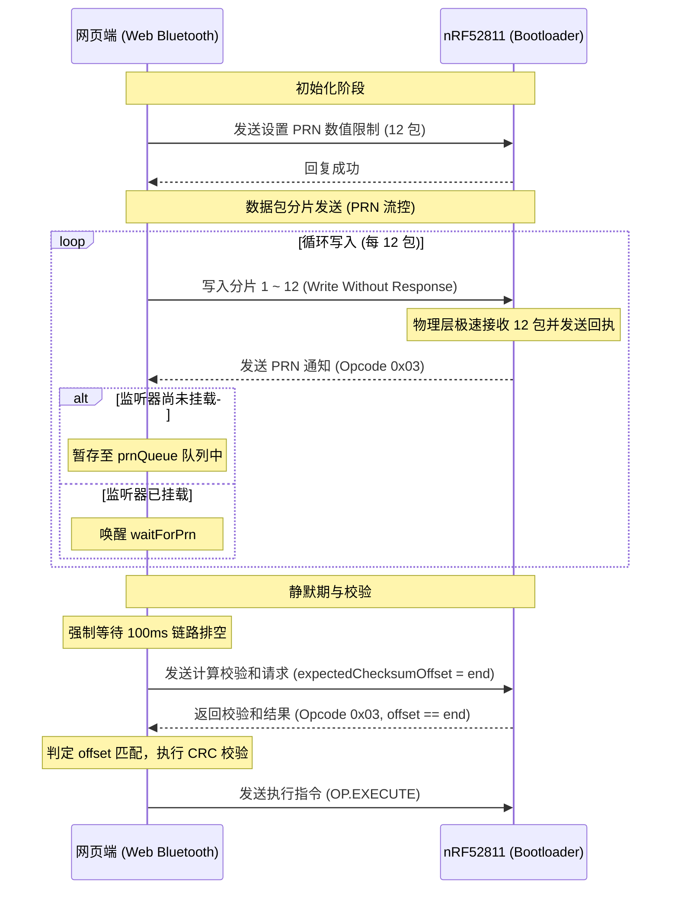

# nRF52811 Web Bluetooth DFU 升级优化技术文档

本文件记录了针对 nRF52811 硬件平台进行的 Web Bluetooth DFU (Device Firmware Update) 升级可靠性优化的前因后果、核心机制与设计方案。

---

## 一、 背景与上下文

### 1. 硬件限制与协议裁剪
本项目底层硬件基于 **nRF52811** 芯片。该芯片的硬件资源非常有限（**192KB Flash / 24KB RAM**）。
为了在有限的 Flash 空间中完整塞入 DFU Bootloader，固件工程在 `sdk_config.h` 中启用了协议裁剪标志：
```c
#define NRF_DFU_PROTOCOL_REDUCED 1
```
在该裁剪模式下，许多可选的 DFU 命令（例如 `OP_GET_MTU` (0x07)、`OP_PING` (0x09) 等）在固件编译时被剥离，设备仅保留核心的创建、写入、流控、执行与校验功能。

### 2. 升级流程的演进
由于浏览器对 Web Bluetooth 的权限安全限制（重启进入 Bootloader 后，MAC 地址改变，网页无法自动重连），前期已将升级流程改造为**三步走的手动升级交互卡片**。
但在大文件或低吞吐量写入下，为了提升传输稳定性和整体速率，我们引入了 `PRN`（Packet Receipt Notification，分片回执）流控机制，在每发送 `12` 个包（PRN = 12）时，由硬件向网页发送一个校验和回执。

---

## 二、 遇到的核心问题与根因分析

在引入 `PRN = 12` 之后，测试中频繁出现升级中途超时退化、`GATT operation already in progress` 或最终 `DFU object CRC校验失败` 的异常，其根源主要来自以下几个方面：

### 1. PRN 通知提前到达的竞态丢失（Race Condition）
* **现象**：客户端打印 `sent 12 packets, waiting for PRN...`，接着产生 4 秒超时退化。
* **根因**：网页在发送完第 12 个分片包后，在调用 `await this.waitForPrn()` 注册 `this.prnResolver` 监听器之前，JS 线程有几毫秒的调度间隔（用于进度条绘制、UI 更新以及 `delayPromise(10)`）。在这几毫秒内，蓝牙芯片由于物理层极快，已经收完数据并向上回传了 PRN 通知。由于此时网页端 `prnResolver` 尚未注册，该通知在 `handleNotification` 中被**直接静默丢弃**。随后网页端进入 `waitForPrn` 超时等待，直接卡死 4 秒后被迫退化。

### 2. 操作码碰撞与校验和错乱（Opcode Collision）
* **现象**：升级流程在中途报错 `DFU object CRC校验失败`。
* **根因**：根据 Nordic DFU 规范，**PRN 通知** 与 网页端主动发送的 **获取校验和响应**（`OP.CALCULATE_CHECKSUM`）使用的是**完全相同的操作码 `0x03`**，且返回的数据格式完全一致。
  如果在重试或数据积压期间，一个之前延迟到达的 PRN 通知恰好在网页请求 Checksum 时到达，网页端注册的 Checksum 监听器会误将这包 PRN 通知误认为是最新的 Checksum 响应，读取了错误的累计偏移量（Offset），从而导致 Slice 切片偏移与 CRC 校验失败。

### 3. GATT 链路写入拥堵
* **现象**：大量写入分片后，紧接着的 Control Point 写入动作直接抛出 `NetworkError: GATT operation already in progress.`。
* **根因**：即使网页端通过 `writeValueWithoutResponse` 写入完成，系统蓝牙协议栈的底层硬件发包队列尚未完全排空。此时立即发送 `OP.CALCULATE_CHECKSUM` 控制指令，会与队列中的残留包冲突，引发底层拥塞。

### 4. 冗余的 MTU 查询开销
* **现象**：日志提示 `Bootloader 未实现 MTU 查询，准备回退到 20 字节兼容分片`。
* **根因**：由于前述 `NRF_DFU_PROTOCOL_REDUCED = 1` 限制，固件不支持 `OP_GET_MTU`。因此每次升级开始时，网页端尝试发送该指令都会遭到芯片的拒绝（返回不支持错误），这增加了一次多余的蓝牙通信往返（RTT）与超时等待。

---

## 三、 解决方案与设计实现

我们对 `html/js/dfu.js` 与 `html/dfu.html` 进行了针对性的重构优化，设计了**带缓冲机制的 DFU 流控防错体系**：

### 1. 引入 PRN 通知排队缓冲区 (`prnQueue`)
* **逻辑**：在 DFU 实例中增加 `this.prnQueue = []`。
* **实现**：在 `handleNotification` 中，如果操作码为 `0x03` 且属于 PRN 消息，若发现监听器 `this.prnResolver` 尚未挂载，则**不丢弃该通知**，而是将其压入 `prnQueue`。
* **消耗**：在 `waitForPrn()` 启动时，优先从 `prnQueue` 中移出（`shift`）并直接 Resolve。这样无论通知是提早还是延迟到达，都能被完美捕获，彻底避免了 4 秒超时的挂死现象。

### 2. 精准的偏移量校验与隔离 (`expectedChecksumOffset`)
* **逻辑**：在请求最终 Checksum 校验前设定 `this.expectedChecksumOffset = end`。
* **实现**：在 `handleNotification` 接收到 `0x03` 操作码时，计算消息体中的累计偏移量 `offset`。
  * 若 `offset !== this.expectedChecksumOffset`，则归类为 **PRN 通知**，安全存入队列或由 `prnResolver` 消耗。
  * 若 `offset === this.expectedChecksumOffset`，则判定为**真正的 Checksum 校验响应**，放行至 `notifyFns[0x03]` 进行最终 CRC 校验。
  这在协议层完全做到了 PRN 与 Checksum 响应的绝对隔离，消除了 CRC 校验失败。

### 3. 加入静默排空延迟（GATT Settle Delay）
* 在 `transferData` 数据完全传输完毕后，强制引入 `await this.delayPromise(100)` 的 100ms 物理延迟。
* 该延迟保证了硬件和蓝牙适配器的发包队列充分清空，在此之后再发送控制指令，彻底根治了 `GATT operation already in progress` 的偶发性报错。

### 4. 彻底剥离 MTU 查询
* **操作**：鉴于 nRF52811 的 Bootloader 固件永远开启 `NRF_DFU_PROTOCOL_REDUCED`，我们直接从 HTML 中移成了“启用 MTU 查询”的 Checkbox 选项。
* **优化**：在 JS 中移成了 `OP.GET_MTU` 相关的所有收发和回退逻辑。流程启动后，升级链路默认且直接采用 `20` 字节（`DEFAULT_PACKET_SIZE`）的超级兼容分片进行数据传输，大幅加快了启动初始化速度并降低了故障率。

---

## 四、 升级流程逻辑结构图


