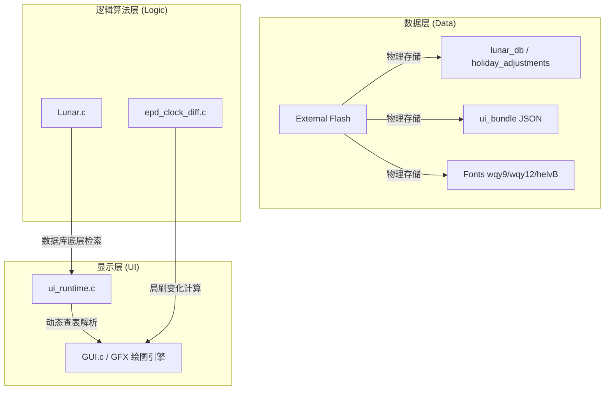
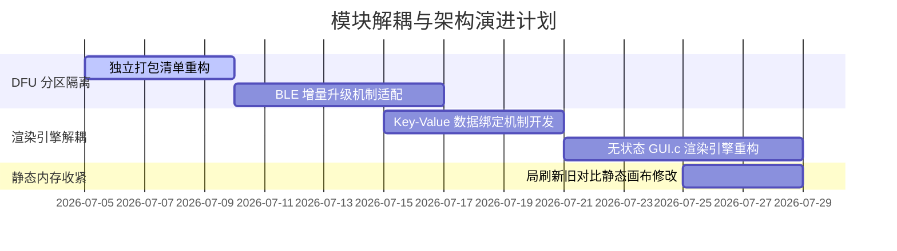

# 模块解耦与架构优化分析报告 (Module Decoupling & Architecture Optimization Analysis Report)

> [!NOTE]
> 本文档作为 [lunar_calendar_database_design_and_migration.md](file:///home/tal/Test/project/he-ma_n-rf_-epd/AiCoding/lunar_calendar_database_design_and_migration.md) 的架构设计补充文档，聚焦于当前系统中数据层、显示层（UI）和逻辑算法层的深度解耦评估与优化空间。

---

## 1. 核心解耦现状梳理 (Current Decoupling Status)

目前项目已通过多轮重构，基本确立了以数据驱动为核心的轻量化架构，极大减少了 MCU 代码体积（Flash 占用降至 57,060 字节，低于限制阈值 57,344 字节）。

### 1.1 模块职责边界明细


| 维度 | 解耦策略与现状 | 达成收益 |
| :--- | :--- | :--- |
| **数据与代码解耦** | 将字形点阵、日历调休数据库（LCDB）、页面排版布局（UI Layout JSON）打包为外部资源文件，固件内仅保留指针标记与检索引擎。 | 节省约 15KB 固件空间，更新布局无需修改 C 代码。 |
| **UI 与物理坐标解耦** | 时钟局部刷新、数字坐标计算等均通过 `ui_runtime_load_render_cache` 动态从 JSON 中载入其参考坐标，移除了历史硬编码。 | 避免了更换尺寸/排版时，底层局刷算法失效。 |
| **算法与底层显示解耦** | 移除了 `Adafruit_GFX` 内部冗余的 4色（4c）与多余的单色位图转换逻辑，使绘图层专注于 BWR 3色和基础局刷路径。 | 净化了基础绘图 API，消除了大量无用分支。 |

---

## 2. 优化改进空间与潜在问题分析 (Potential Optimizations & Issues)

结合当前的系统现状，我们在架构解耦和性能设计上依然存在以下四个方向的优化空间。

### 2.1 外部资源更新的单体化升级开销 (Monolithic Resource DFU Overhead)
* **问题描述**：
  目前外部资源包（字体、日历库、UI JSON 结构）是作为一个单体二进制包（`epd_resources.bin`，约 26KB）进行打包与打包期校验的。当开发者仅需对轻微的 UI 间距、字体 ID 做微调时，也必须将整个 26KB 的大包通过 BLE 传输到外置 Flash。
* **重构方案**：
  在 `build_ext_resources.py` 中引入“多分区资源清单（Partitioned Manifest）”设计。将外部资源包分割为若干独立块：
  1. **字形资源块** (不变，体积大，约 18KB)
  2. **日历数据库** (每年更新一次，约 6KB)
  3. **UI 布局 JSON** (频繁修改，约 1KB)
  
  在 Bootloader 与 DFU 协议层，支持“按 ID 单独覆盖外部 Flash 指定物理偏移”的机制，显著降低轻量级 UI 修改时的蓝牙传输功耗 and 耗时。

### 2.2 UI 组件渲染与数据结构的强绑定 (Widget Rendering & Data Coupling)
* **问题描述**：
  在 `GUI.c` 中，存在温度渲染 (`ui_draw_temperature`) 和节气渲染 (`ui_draw_jieqi`) 等专属控件绘制函数。这些函数入参直接包含了底层业务数据（`gui_data_t` 结构体字段）。当未来需要增加新的控件或更改数据来源时，必须到 `GUI.c` 中添加和修改具体的业务代码，UI 渲染引擎不够通用。
* **重构方案**：
  引入 **数据绑定（Data Binding）** 的无状态渲染模式。
  1. `ui_runtime` 仅负责声明容器，且每个文本字段组件都含有一个 `binding_key`（例如 `"temp_val"`, `"jieqi_name"`）。
  2. 逻辑层算法计算完成后，向一个临时的 Key-Value 数据集（Map）写入结果：
     `Map["temp_val"] = "26℃"`, `Map["jieqi_name"] = "立春"`
  3. `GUI.c` 渲染器只负责从 Map 中以 Key 取出对应的字符串并调用 GFX 绘制，彻底与 `gui_data_t` 解耦。

```
[业务计算层] -> (写入 Key-Value Map) -> [无状态布局渲染器] -> (基于 GFX 绘制)
```

### 2.3 局刷新旧像素对比临时画布的动态内存开销 (Dynamic Memory in Partial Refresh)
* **问题描述**：
  局部时钟刷新时，在 `epd_clock_diff.c` 中为每一个比对位动态调用 `GFX_begin`，该函数会在 Heap 堆区或 Stack 栈区动态分配一个临时的二进制像素缓存（画布）。在内存极为受限的 nRF52811（仅 24KB RAM）上，频繁的动态分配极易导致内存碎片化或局部溢出。
* **重构方案**：
  * 在静态内存区（BSS 段）声明一块全局复用的 `static uint8_t g_scratch_canvas[128]` 临时比对缓冲区。
  * `epd_clock_diff` 比对时统一绑定到该静态画布进行绘制比对，彻底消除堆分配，将 RAM 开销锁定在编译期。

### 2.4 国家与时区限制解耦（海外销售配置扩展）
* **问题描述**：
  虽然目前只考虑国内销售（硬编码东八区），但底层时区偏移和调休开关等逻辑在代码里是写死的。若未来产品有海外扩展需求，这些硬编码会使国际化支持非常繁琐。
* **重构方案**：
  * 将 `timezone_offset` 作为一个全局配置字段从 `ui_bundle` 的 Header 或设备配置区读入。
  * 将不同国家的本地历法判断（如公历与国内独有的农历/调休）作为动态可拔插的模块：
    ```c
    #if EPD_SUPPORT_LUNAR
        LUNAR_SolarToLunar(...);
    #endif
    ```
    使得海外版固件可以通过宏编译完全剥离农历库，进一步缩减固件体积至 45KB 以下。

---

## 3. 架构演进路线建议 (Evolution Roadmap)


