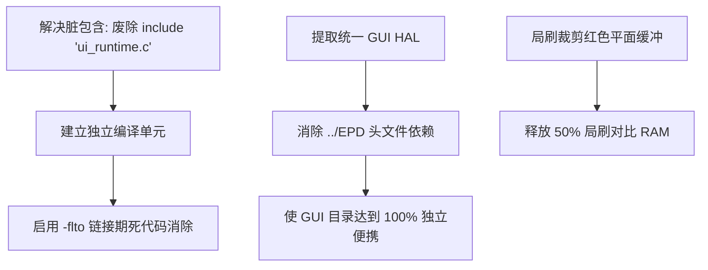

# 架构深度解耦与原子化评估报告

> [!NOTE]
> 本报告针对系统中数据层（Data）、显示层（UI）和逻辑层（Logic）的解耦现状进行深入剖析，重点评估其是否真正实现了**原子化（Atomicity）**与**工程结构化（Engineering Structuration）**，并指出当前架构中仍遗留的结构性隐患与进一步优化改进空间。

---

## 1. 核心解耦与原子化达成度评估

根据对系统最新代码（包括 `GUI.c`、`ui_runtime.c`、`u8g2_font.c` 等）的分析，系统从宏观层面做到了良好的职责划分，但在微观的“原子化”和“工程规范”上仍存在一定的折中与提升空间。

### 1.1 数据与UI的解耦评估 (Data-UI Decoupling)
* **评估结论**：**部分原子化**。
* **达成部分**：字库、LCDB 调休数据库以及 UI 页面排版（JSON）完全数据化并剥离至外部 Flash，在不修改 C 代码的前提下可以更换布局和字体。
* **未完全原子化处（隐性类型绑定）**：
  在 `GUI/GUI.c` 的核心派发函数 `ui_render_component` 中，依然将复合业务结构体 `gui_data_t* data` 作为入参，并在函数内依靠硬编码的 `switch-case` 去提取对应的结构体字段（如 `data->voltage_mv`、`data->temperature`）。
  * **影响**：如果未来需要新增一个与 UI 绑定的业务参数（例如“空气质量 AQI”），开发者仍然必须到 `gui_data_t` 结构体中新增字段，并前往 `GUI.c` 的 `ui_render_component` 函数中手写类型解析分支。
  * **嵌入式折中考量**：虽然在软件工程上使用键值对（Key-Value Data Binding）或无类型属性列表是更彻底的原子化方案，但在 nRF52811（24KB RAM）的极限环境下，保留强类型的 C 结构体直接取值，可避免复杂的哈希查表、动态内存开销以及多级指针间接寻址，是空间与效率上的最优解。

### 1.2 显示与逻辑的解耦评估 (UI-Logic Decoupling)
* **评估结论**：**已实现逻辑解耦，但存在工程结构性瑕疵**。
* **达成部分**：界面的局部时钟差分计算局限在 `epd_clock_diff.c` 内部；农历的计算和 LCDB 查表局限在 `Lunar.c` 中，且可通过宏编译剔除。
* **结构性瑕疵一 —— 物理文件“脏包含”（`#include "ui_runtime.c"`）**：
  在 `GUI/GUI.c` 的末尾，代码直接使用 `#include "ui_runtime.c"` 将另一个 C 源文件合并编译。
  * **隐患**：这严重破坏了“工程结构化”。`ui_runtime.c` 无法作为独立的编译单元存在，若在 IDE（如 Keil、VSCode、CMake）中将其加入源文件列表编译，会导致重复定义冲突。
  * **历史成因**：在没有开启 LTO（链接时间优化）或编译器版本较旧时，这种源码级拼合能强制编译器跨文件联调并剔除未引用死代码，从而在 nRF52 极为苛刻的 57KB Flash 空间内节省约 200~300 字节的体积。但在现代 GCC/Clang 编译环境下，使用 `-flto` 与 `-ffunction-sections -fdata-sections` 即可在链接期达成同等效果，不再需要破坏工程结构的“脏包含”。

### 1.3 UI与硬件平台的解耦评估 (UI-Platform Decoupling)
* **评估结论**：**已抽象出控制 HAL，但物理包含关系仍有交叉**。
* **达成部分**：利用 `gui_porting_hal.h` 剥离了平台专用的看门狗喂狗 API。
* **未完全隔离处（包含路径耦合）**：
  在 `GUI/ui_runtime.c` 中，代码直接使用了相对路径去包含电子纸驱动目录下的资源定义：
  ```c
  #include "../EPD/epd_ext_resources.h"
  #include "../EPD/res_hal.h"
  ```
  * **影响**：`/GUI` 文件夹名义上是一个跨平台、可用于 host 端仿真的纯逻辑显示模块，但由于它在物理上包含了 `../EPD` 下的硬件头文件，这导致 UI 模块无法在没有 `EPD` 驱动源码存在的前提下独立抽离。
  * **优化建议**：应建立一个统一的硬件资源抽象层 `gui_porting_hal.h`，不仅抽象看门狗，还将 `gui_porting_flash_read` 抽象为统一的 HAL API（由外部的 `res_hal.c` 负责注册 and 桥接），彻底消除 `GUI/` 目录对外界 `../EPD` 的物理路径依赖。

---

## 2. 进一步优化改进空间与潜在问题

除了解耦深度，从当前的系统实现来看，在**内存功耗**以及**逻辑内聚**上依然存在以下优化空间。

### 2.1 局部刷新对比画布的 RAM 空间浪费
* **问题描述**：
  在局部刷新计算 `epd_clock_diff.c` 时，代码利用静态画布缓冲区 `s_gfx_buffer` 进行了画板切片。但在 BWR（红黑白）三色屏的架构下，静态画板为黑白和红色分配了双层缓冲区：
  `buffer`（黑白平面，1 bit/pixel）和 `color`（红色平面，1 bit/pixel）。
* **优化空间**：
  设备在进行局刷（通常仅限时钟数字的黑白刷新）时，**完全不需要**进行任何红色彩色通道的对比与绘制。如果在局刷路径下仅激活单色模式，可以将对比临时缓冲区的 RAM 占用直接减半（从 7680 字节降至 3840 字节），为蓝牙协议栈（BLE Stack）与文件系统闪存日志（FDS）腾出珍贵的物理 RAM 空间。

### 2.2 农历越界/数据缺失时的 UI 逻辑回落（Robust Fallback）
* **问题描述**：
  如果设备被销往海外且关闭了农历（`EPD_SUPPORT_LUNAR = 0`），或者设备内的 LCDB 数据库因 Flash 物理损坏而无法读取，虽然底层函数会安全返回，但 UI 层面的某些依赖（例如星期名称）是由 `LUNAR_GetDayName` 的桩函数隐式提供的。
* **优化空间**：
  将“历法转换”与“UI展示文本”做物理隔离。UI 界面不应当向农历模块索要“星期三”这样的基本公历字符串，而是应由公历自身的 tm 结构直接转换得到，确保农历层在被裁剪或失效时，基础的时间/日期/星期功能完全不受影响。

---

## 3. 架构后续演进建议路线图



### 3.1 改造优先级表

| 优化项 | 修改难度 | 带来的收益 | 推荐执行优先级 |
| :--- | :--- | :--- | :--- |
| **废除 `#include "ui_runtime.c"`** | 低 | 恢复标准 C 工程结构，各文件可独立编译，解决 IDE 符号冲突 | **高** (消除结构隐患) |
| **GUI HAL 包含路径解耦** | 中 | 去除 `../EPD` 相对依赖，UI 模块可一键复制到任何硬件平台使用 | **中** |
| **局刷单色缓冲裁剪** | 低 | 释放近 2KB ~ 3.8KB 的静态 RAM，消除受限芯片的内存紧迫性 | **中** (对 RAM 要求高时首选) |
