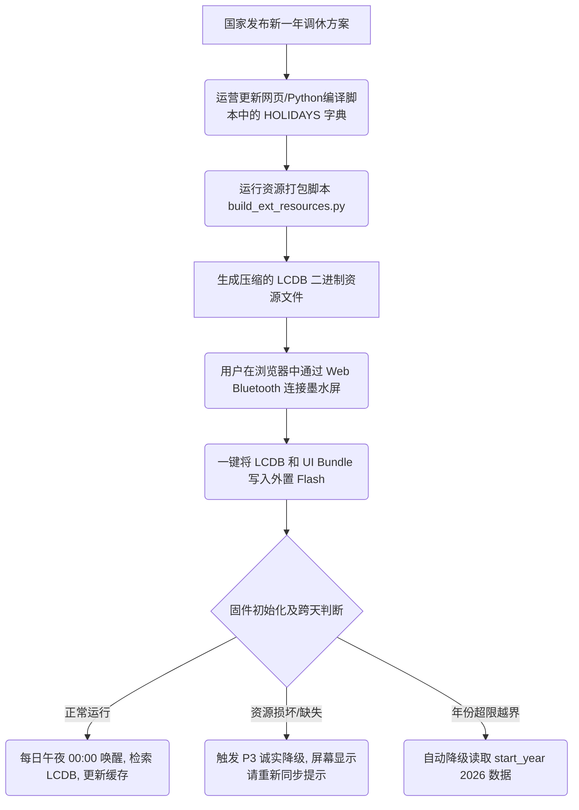

# 电子墨水屏日历农历与调休数据库 (LCDB) 迁移需求文档与多角色评估报告

> **项目背景**：在基于 nRF52811 + UC8179 + 800x480 三色墨水屏的超低功耗日历/时钟标签项目中，为将内置 Flash (ROM) 占用控制在 56KB 安全水位内，系统实施了“数据与逻辑算法解耦，下放网页/脚本编译端”的重大重构。本报告对农历与调休数据化迁移设计方案（LCDB）进行拆解，并提供多角色的深度评估与优化建议。

---

## 第一部分：产品需求文档 (PRD)

### 1. 文档元信息
* **产品名称**：nRF_EPD 低功耗蓝牙墨水屏日历系统
* **文档版本**：V1.0
* **编写人**：Antigravity (高级产品经理 / 架构师)
* **发布时间**：2026-07-04
* **开发模式**：敏捷开发 (Agile/Scrum)

---

### 2. 用户故事与 Epic 拆解 (User Stories & Epics)

#### Epic 1: 极致轻量化的固件查询引擎 (Firmware Engine)
* **User Story 1.1 (内存与空间释放)**：作为一名**固件开发人员**，我希望把复杂的阴阳历算法、24节气高精度角度计算、以及调休硬编码数组从固件中剥离，以便腾出至少 12KB 的应用 Flash 空间，为 SoftDevice 协议栈 and OTA 安全双备份升级（DFU）预留足够的容量。
* **User Story 1.2 (低功耗安全查询)**：作为一名**固件开发人员**，我希望系统实现“一日仅读取一次 Flash”的日历数据缓存机制，以防止每分钟刷新时钟时间时频繁读取 SPI 外置 Flash，从而降低功耗并消除局刷画面时的 I/O 延迟。
* **User Story 1.3 (越界降级兜底)**：作为一名**测试人员**，我希望查询超出数据库年份范围（如查询 2025 年或 2028 年）时，系统能够平稳降级至 2026 年并正常显示，而不是发生 HardFault 导致死机。

#### Epic 2: 数据驱动的资源编译器 (Resource Compiler)
* **User Story 2.1 (自动化打包编译)**：作为一名**系统集成人员**，我希望编写一个自动化 Python 脚本，将农历换算表、每年法定的调休班/休状态、固定和动态规则节日（如母亲节/父亲节）合并打包成单个 `LCDB` 二进制资源文件，以便通过 BLE 下发至外置 Flash。
* **User Story 2.2 (字符串去重压缩)**：作为一名**系统集成人员**，我希望资源打包脚本对所有年份的节日中文字符串进行全局去重和池化，以最大限度减少外置 Flash 的存储占用。

#### Epic 3: 像素级 UI 兼容与零代码更新 (UI Adaptation & OTA)
* **User Story 3.1 (所见即所得的网页设计)**：作为一名**UI 设计师**，我希望在网页端的 UI 布局编辑器中拖拽组件、微调坐标并一键导出 UI Bundle 模板下发到设备，而无需联系固件工程师重新编译代码。
* **User Story 3.2 (调休快速下发)**：作为一名**运营人员**，我希望在每年 11 月国务院发布次年调休方案后，无需更新固件，只需通过网页蓝牙下发几十字节的更新包，即可更新设备的班休状态。

---

### 3. 功能需求与业务逻辑闭环 (Functional Requirements)



#### 3.1 数据库结构规范
数据库作为一个统一的资源块（Resource Type 6, ID 1）存储于外置 Flash。整体结构包含：
1. **主头部 (Master Header, 16B)**：指明魔数（`LCDB`）、版本号、包含年份数、起始年份、每日记录的步长。
2. **年份偏移表 (Year Offset Table)**：每个年份的起始偏移地址。
3. **年份数据块 (Year Block)**：
   * 年份头部 (8B)；
   * 每日记录表 (Daily Records Table)：365 或 366 天，单条记录大小对齐；
   * 局部字符串池 (String Pool)：存放节日、自定义文本，以 `\0` 结尾。

#### 3.2 每日记录格式定义 (`daily_record_t`)
每条记录应包含以下核心字段，以满足界面渲染的全部数据需求：
* 农历月份（带闰月标志位）、农历日期。
* 干支年索引（天干、地支、生肖均由此衍生）。
* 24节气索引（0:无节气，1-24:对应节气）。
* 调休类型（0:普通日，1:法定休，2:调休上班）。
* 节日名称偏移量、特殊自定义文本偏移量。

#### 3.3 固件运行时状态机与缓存机制
1. **上电初始化**：读取 Flash 中 `LCDB` 头信息和年份偏移表，缓存在 RAM 中。
2. **单日记录缓存 (RAM Cache)**：在每天首次启动、或跨天（`current_day != s_last_rendered_day`）时，**仅读取一次**当日的 12 字节记录并存在 RAM 中。白天所有的刷新或局刷直接访问此 RAM 缓存，零 I/O 延迟。
3. **跨天刷新链**：通过 RTC 定时器判断日期翻转。午夜 00:00 自动触发 Flash 查询、更新缓存并唤醒屏幕物理全刷，清除残影。

---

### 4. 非功能性需求 (Non-Functional Requirements)

| 分类 | 需求项 | 详细指标 |
| --- | --- | --- |
| **性能** | 查询延迟 | 从外置 Flash 中读取单日记录耗时必须低于 5ms。 |
| **空间** | 内置 Flash (ROM) 预算 | 移除算法和数组后，`Lunar.c` 对 ROM 的净占用必须降至 **3KB** 以下。 |
| **低功耗** | 物理刷新时的 CPU 睡眠 | EPD 刷新期间（约 4 秒），CPU 必须进入 `System ON` 深度睡眠模式，利用 GPIOTE 边沿触发唤醒。 |
| **可靠性** | 升级中断保护 (Ping-Pong) | 蓝牙传输资源过程中如意外断电或断链，系统必须回退并继续使用先前完好的分区数据，防止设备变砖。 |
| **兼容性** | 诚实降级 (Fallback) | 外置 Flash 未烧录或损坏时，MCU 严禁进入死循环，必须正常显示 ROM 内置的应急提示界面并开启蓝牙。 |

---

## 第二部分：多角色联合评估与优化意见

### 1. 🔍 产品经理 (PM) 评估：版本控制与向后兼容性
* **评估结论**：方案在“轻量化”和“数据逻辑解耦”上完全合格。它成功消除了每年维护繁琐 C 数组的痛点。
* **优化意见**：
  * **Schema 语义握手 (Schema Versioning)**：网页端布局编辑器会不断加入新组件，必须设计语义化版本校验。当 `schema_major` 超过固件版本时触发降级页面，避免强行渲染未知组件导致界面崩溃；`schema_minor` 超过时则跳过未知组件。
  * **特性协商 (Feature Flag)**：在蓝牙广播中暴露出固件特性的掩码，让网页端自适应调整输出，形成自闭环。

---

### 2. 🎨 视觉与交互设计 (UI/UX) 评估：局刷性能与脏矩形
* **评估结论**：UI 模板化打包极大解放了设计自由度。但电子墨水屏物理属性限制了高频局刷。
* **优化意见**：
  * **刷新频率物理门限**：防止用户在模板中绑定秒级更新（如时钟秒字），这会造成屏幕快速极化损坏（烧屏）并耗尽电量。固件引擎必须强制将局部刷新频次截断为最低 60 秒。
  * **脏矩形动态合成 (Dynamic Bounding Box)**：
    > [!IMPORTANT]
    > 原始方案在 `ui_mode_record_t` 中硬编码了局刷矩形。这导致在网页上移动时钟或摆放两个局刷组件时极其繁琐。
    >
    > **建议重构为**：固件渲染时自动比对各组件绑定的数据源新旧值，将发生变化的组件标脏，并在运行时自动融合成最小包围盒（Bounding Box），下发给墨水屏执行局刷，实现 UI 排版与局刷区域的彻底解耦。

---

### 3. 💾 技术与固件开发 (Tech/Firmware) 评估：Flash 与 I/O 极致优化
* **评估结论**：12 字节的 `daily_record_t` 虽小，但在 56KB App 空间的 nRF52811 以及 I/O 敏感的外置 Flash 场景下，依然有很大的压榨空间。

#### 优化 1：基于位域 (Bitfields) 与稀疏表 (Sparse Table) 的 Daily Record 深度压缩 (Flash 优化大招)
* **原方案痛点**：每个 `daily_record_t` 结构体中包含 2 字节的 `festival_offset` 和 2 字节 of `special_label`。而在 365 天中，超过 **90%** 的日期是没有节日和自定义文本的（全为 `0xFFFF`），白白浪费了大量存储。此外，`jiazi_month` 和 `jiazi_day` 作为预留字段在实际日历展示中极少用到。
* **改进方案**：
  1. 彻底删除 `jiazi_month` 和 `jiazi_day` 字段。天干地支日与月完全可以基于当前公历日期的 Julian Day 偏移量通过极简算法在 MCU 动态算出来，无需存储。
  2. 引入 `has_festival` 和 `has_special` 标志位（各占 1 bit）。将 `festival_offset` 和 `special_label` 从每日记录中剔除，移入年份 Block 尾部的 **稀疏标签表 (Sparse Label Table)** 中。
  3. 每日记录 `daily_record_t` 压缩为 **4 字节**。

**压缩后的结构体设计 (C 语言位域)**：
```c
// 压缩为恰好 32-bit (4 字节)
typedef struct {
    uint32_t lunar_month      : 5;  // 1-12，第 5 位表示是否闰月
    uint32_t lunar_day        : 5;  // 1-30
    uint32_t jiazi_year       : 6;  // 0-59 (甲子年索引)
    uint32_t solar_term       : 5;  // 0-24 (24节气)
    uint32_t holiday_type     : 2;  // 0:工作日/周末, 1:法定休, 2:调休上班
    uint32_t has_festival     : 1;  // 1:当天有节日，需查稀疏表
    uint32_t has_special      : 1;  // 1:当天有特殊标签，需查稀疏表
    uint32_t reserved         : 7;  // 填充对齐
} packed_daily_record_t;
```

**对应的稀疏标签表条目**：
```c
typedef struct {
    uint16_t doy;              // 一年中的第几天 (0-365)
    uint16_t festival_offset;  // 节日偏移，若无则为 0xFFFF
    uint16_t special_offset;   // 自定义标签偏移，若无则为 0xFFFF
} sparse_label_t; // 每个条目仅占 6 字节
```
* **效益分析**：
  * **Flash 空间暴省**：一年仅有约 40 天有节日或特殊标签。
    * *原方案*：$365 \text{天} \times 12 \text{字节} = 4380 \text{字节}$。
    * *优化后*：$365 \text{天} \times 4 \text{字节} + 40 \text{条目} \times 6 \text{字节} = 1460 + 240 = 1700 \text{字节}$。
    * **单年份数据体积骤降 61.2%**！
  * **I/O 速度翻倍**：每次每日查询仅需从 SPI Flash 读取 4 字节，大幅降低 SPI 传输功耗。

#### 优化 2：常数字典整合与单 ID 寻址
* **原方案痛点**：农历月（"正月".."腊月"）、农历日（"初一".."三十"）、天干地支及节气等 100% 恒定不变的静态字串，原方案设计为 8 个独立的 Type 2 资源存放在 Flash 中，产生多次 I/O 寻址和 entry 描述符浪费。
* **改进方案**：将这些静态字典合并打包，紧跟在 `LCDB` 主头部之后作为**静态常量名字典区**。整个日历的 Resource ID 缩减为 1 个，固件只需对单资源执行一次偏移寻址，即可按索引流式读出，彻底精简了 C 端读取代码。

#### 优化 3：流式渲染免内存缓冲 (Zero-Copy Streaming)
* **改进方案**：针对节日等不定长中文字符串渲染，放弃“读出完整字串 -> 存入 RAM 缓冲 -> 调用绘图”的方式，改为在 GFX 字符渲染循环中**流式读取绘制（Stream-Rendering）**：每次仅通过 SPI 读取 1 个 UTF-8 字符（最大 3 字节）并即时输入绘图引擎。无论文本多长，固件 RAM 开销恒定为 `O(1)` (3 字节)，物理上杜绝了溢出和栈破坏风险。

---

### 4. 🔒 安全与容灾性 (Security) 评估：防砖与越界拦截
* **评估结论**：外部下发资源存在空中截获、不完整传输、恶意注入的物理安全隐患。
* **优化意见**：
  * **双区备份与原子切换 (Ping-Pong Buffer)**：在 Flash 中开辟 Area A 和 Area B 双槽。升级资源时永远只擦写非活动槽，计算全包 CRC32 校验成功后，通过单字节修改 Meta-Pointer 切换活跃区。若写入中途断电，重启时自动切换回旧完好分区，实现工业级防砖.
  * ** rigid 越界拦截器**：固件解析 UI Bundle 时，强制对各组件的 `x, y, w, h` 进行合法性校验。一旦发现 `x + w > 800` 或 `y + h > 480`，拒绝执行像素写操作，防止恶意模板或乱码导致内存踩踏崩溃（HardFault）。

---

### 5. ⚙️ 运营维护 (Ops) 评估：调休数据的生命周期管理
* **评估结论**：国务院每年 11 月下旬发布下一年度法定节假日安排。这决定了 LCDB 必须是易于局部升级且生命周期受控的。
* **优化意见**：
  * **增量下发机制**：由于仅调休发生变化，网页端在更新调休时，可选择不重新下发整个大字库，而是仅重构并下发 1.7KB 大小的 `LCDB` 资源包。
  * **时区与夏令时解耦**：夏令时（DST）规则极其繁琐。遵循“MCU 只渲染，计算靠客户端”原则，时区偏移直接由手机/网页在同步时间时换算为 Local Time 并写入 RTC。固件无需内置庞大的时区规则数据库，免受政治性夏令时调整的影响。

---

### 6. ⚖️ 法务与合规 (Legal) 评估：历法标准与国家规范
* **评估结论**：在中国境内发布、生产的日历和时间类设备，必须遵循国家法律法规和行业规范。
* **优化意见**：
  * **农历计算标准合规性**：中国农历（阴阳历）的编制和发布必须符合国家标准 **`GB/T 33661-2017 《农历的编算和颁发》`**。在网页/Python 端进行算法编译时，必须以此国家规范为准（例如以紫金山天文台的历年天文测算数据为唯一真理源，确保二十四节气的交节时刻、朔日时刻精确到分钟，防止因算法误差导致大小月推算错误或中秋/重阳等传统节日错位）。
  * **调休发布源合规性**：调休和休假状态必须以**国务院办公厅发布的通知**为唯一法定参考源。在 Web 客户端打包时，应对调休源数据加注数字签名或版本溯源信息，规避网络虚假谣言引起的设备误显示法律风险。

---

## 第三部分：敏捷开发落地路线图

```
========================================================================
[Sprint 1: 基础建设] ──> [Sprint 2: 极致压缩] ──> [Sprint 3: 安全与防砖]
- 实现 res_hal 抽象    - 落地 4B packed struct  - 落地 Ping-Pong 备份
- 实现 PC 黄金图回归     - 剔除 jiazi_month/day   - 落地 越界坐标 rigid 截断
- 整合常量名字典         - 实现 稀疏标签表查找    - 落地 默认 Fallback 提示屏
========================================================================
```

1. **Sprint 1 (已基本落地)**：完成 `res_hal` 资源抽象层，引入 `test_gui_golden.c` 黄金图 CRC 校验机制锁定像素。完成 `GUI.c` 拆分为 `ui_runtime` 和 `ui_render`，将常量字典进行基础整合。
2. **Sprint 2 (当前建议演进)**：实现本报告中提出的 **位域打包 (4B) + 稀疏标签表 (6B)** 数据库方案，从 Python 打包脚本到 MCU 查询端进行同步重构。同时移除 `jiazi_month` 与 `jiazi_day`。
3. **Sprint 3 (后续安全加固)**：实现外置 Flash 双槽 (Ping-Pong) 校验升级机制，补全 EPD 刷新时的 Sense Pin 深度睡眠唤醒（WaitBusy 省电优化），添加 rigid 越界坐标安全裁剪逻辑。
