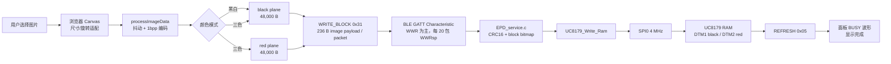
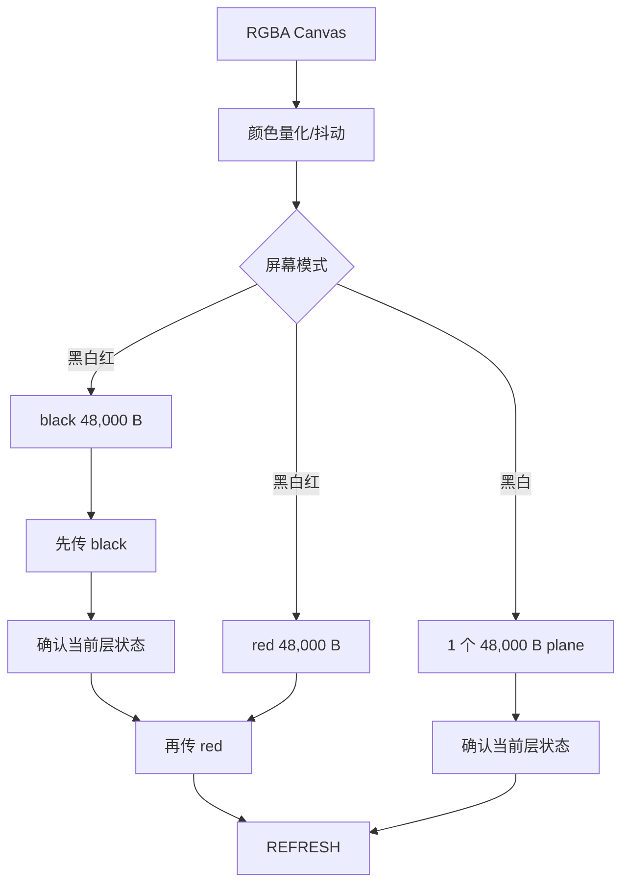
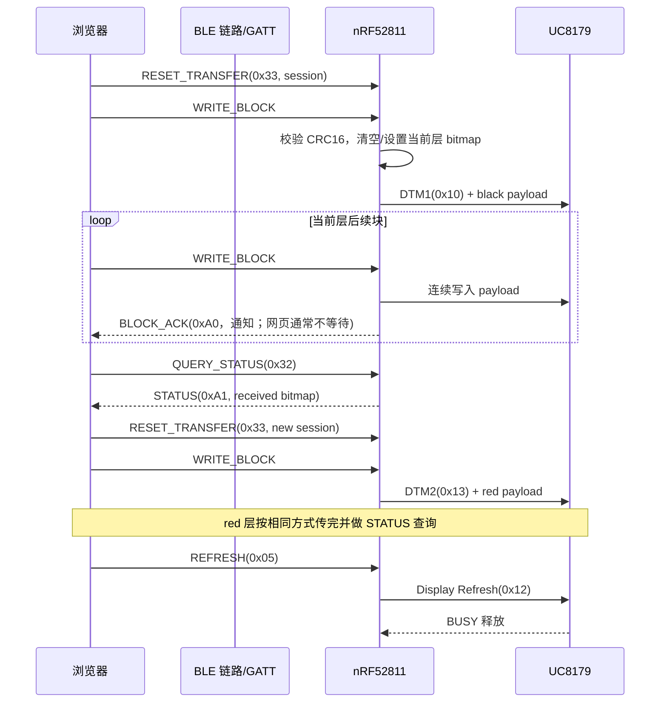
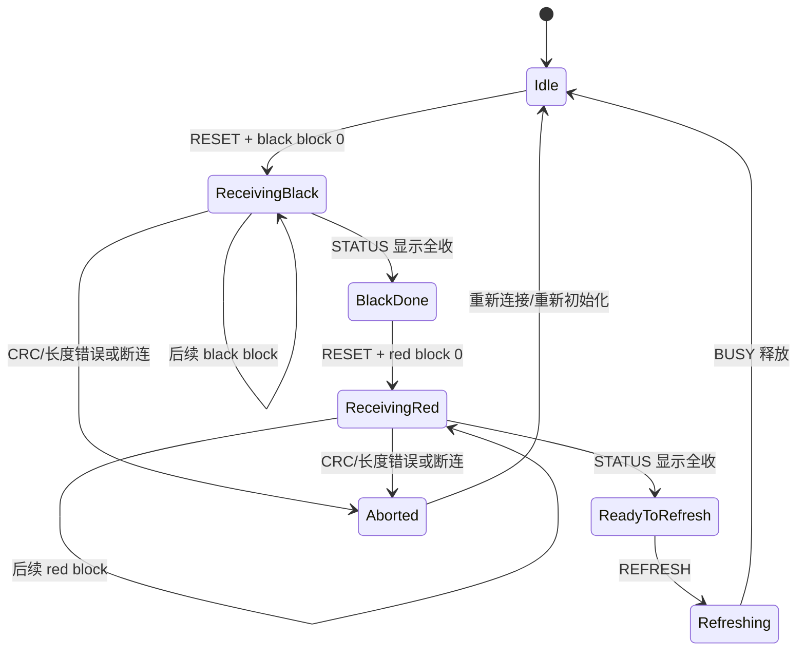
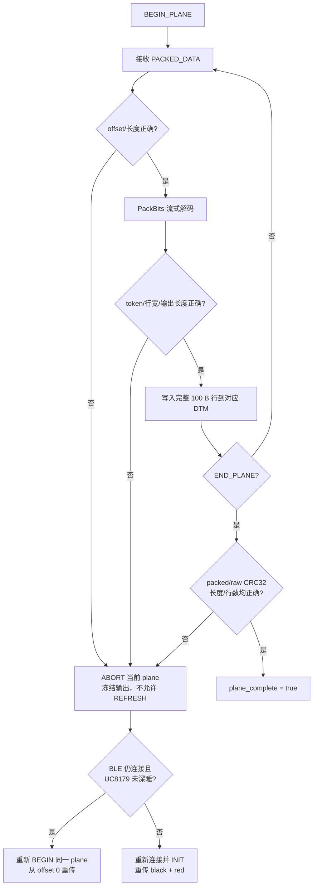

# EPD 传图压缩与传输优化方案

> 日期：2026-07-30
> 结论：**建议以「逐行自适应 PackBits（RLE）+ MCU 流式解码直写 EPD」作为第一期方案。**采用“100 B 行校验缓冲 + 200 B SPI 聚合缓冲”时，额外 RAM 约 0.4 KB、解码代码约 0.5～1.5 KB Flash；压缩收益全部作用于 BLE 传输，不能缩短 UC8179 的固定原始像素写入量和墨水刷新波形时间。若图片以照片/重度抖动为主，应整张图片回退为原始协议，而不是强行压缩。

> **范围边界**：本方案只讨论 800×480 **完整图片**上传和完整显示。三色屏上传 black/red 两个完整 plane 后执行一次全屏 `REFRESH`；不设计局部窗口、图片差分、dirty rectangle、基图版本同步或局刷传输。

## 0. 当前数据传输方案详解（Raw `WRITE_BLOCK`）

本节描述仓库中已经运行的原始传图链路，而不是后文建议的 EPT1/RLE 新协议。当前主机为 `html/js/main.js` 与 `html/js/ble_transfer.js`，MCU 入口为 `EPD/EPD_service.c`，面板驱动为 `EPD/UC8179.c`。

### 0.1 总体数据流图



说明：`WWR` 是 Write Without Response，`WWRsp` 是 Write With Response。前者追求吞吐，后者在当前网页中作为每 20 包一次的节流点。图中两层都到达同一 BLE/MCU 流，但在 UC8179 内分别写入两块 RAM。

### 0.2 浏览器端：图像变成两个连续的 1bpp plane

1. 网页将图片绘制到与驱动一致的 Canvas；如果宽高是旋转匹配，会先旋转回屏幕方向。
2. `processImageData()` 根据选择的抖动/颜色模式生成按行排列的 1bpp 位图。
3. UC8179 三色模式下，结果被拆为 black plane 与 red plane，各为 `800 / 8 × 480 = 48,000 B`；网页依次调用 `sendImageWithResume(data, 'bw')` 和 `sendImageWithResume(data, 'red')`。
4. 每一层开始前，网页发送 `RESET_TRANSFER (0x33)`，故 MCU 的位图统计仅对应当前 plane，而不代表整张双层图片。



### 0.3 BLE 协商与单包格式

固件将 GATT MTU 上限配置为 247，GAP Data Length 配置为 251；实际可用值由手机协商，网页从设备通知取得当前 MTU。因此发包器不能固定假设 247，但在最大 MTU 下，特征值可装 244 B。

当前 `WRITE_BLOCK (0x31)` 的特征值布局如下。CRC16 只覆盖 `payload`，不覆盖命令头：

```text
ATT characteristic value（最大 244 B；小端序）
┌──────┬──────────┬───────────┬─────┬─────────────────────────┬──────────┐
│ CMD  │ block_id │ total_blk │ cfg │ payload                 │ CRC16    │
│ 1 B  │ 2 B      │ 2 B       │ 1 B │ MTU - 11 B（最大 236 B）│ 2 B      │
├──────┼──────────┼───────────┼─────┼─────────────────────────┼──────────┤
│ 0x31 │ 递增编号 │ 当前层总块│图层/首块│ 连续的 1bpp 原始字节  │ payload  │
└──────┴──────────┴───────────┴─────┴─────────────────────────┴──────────┘
```

`cfg` 的低 4 bit 为 plane：`0x0F` 是 black，`0x00` 是 red；高 4 bit 表示是否为该层首块：首块为 `0x0`，续块为 `0xF`。

| plane | 首块 `cfg` | 续块 `cfg` | UC8179 目标 RAM |
| --- | ---: | ---: | --- |
| black | `0x0F` | `0xFF` | DTM1 (`0x10`) |
| red | `0x00` | `0xF0` | DTM2 (`0x13`) |

在 MTU 247 的情况下，一层需要 `ceil(48,000 / 236) = 204` 包，三色屏双层共 408 包。若手机仅协商到 MTU 23，图像载荷将降到 12 B，每层约 4,000 包；这也是确保 MTU 协商成功比微调 MCU 算法更重要的原因。

### 0.4 正常传输时序图



数据进入 MCU 后没有落到内部 Flash、外部 Flash 或完整 framebuffer。`cmd_write_block()` 校验成功便调用 `write_ram()`；`UC8179_Write_Ram()` 在首块发送 DTM1/DTM2 命令，随后每一包直接走 `EPD_WriteData()` 和 SPI。这使 RAM 占用很小，也意味着数据顺序不可逆。

### 0.5 当前协议的状态、ACK 与“重试”边界



- `BLOCK_ACK` 是 MCU 通知，不是网页逐包等待的可靠提交点；网页主要在一轮发送后查询 `STATUS`。
- bitmap 只能说明 MCU 曾处理哪些 `block_id`，**不能**让 EPD RAM 回退到某个 block 的写入位置。
- 因此“缺第 10 包、已写第 11 包，再补第 10 包”会把第 10 包追加在末尾，破坏图像顺序；不能作为有效重试策略。
- 当前网页断开时会中止发送；MCU 的 `on_disconnect()` 在非刷新期间让 UC8179 深睡并释放 SPI。重连后应重新 `INIT` 并从头发送 black/red 两层。

### 0.6 当前方案的时间组成

```text
用户感知总时间
 = 浏览器预处理/抖动
 + BLE 上传（最受 MTU、连接间隔、手机 WWR 队列影响）
 + MCU→EPD SPI 原始数据写入（两层固定 96,000 B）
 + UC8179 BUSY 刷新波形（通常占全刷绝大部分时间）
```

RLE 只能减少“BLE 上传”中的字节和包数；解压后的 black/red 数据仍须完整写给 UC8179。因此新方案应同时记录 `raw_bytes`、`packed_bytes`、BLE 用时、SPI 用时和 BUSY 用时，避免将面板刷新物理时延误认为压缩未生效。

## 1. 本项目现状与量化

### 1.1 硬件、帧数据和现有链路

当前固件目标为 `NRF52811_XXAA`（`Makefile.nRF52:143`、`Keil/EPD-nRF52.uvprojx`），屏幕为 UC8179 800×480 黑白红三色屏（`EPD/UC8179.c:1014-1045`）。一层为 1 bit/pixel：

| 项目 | 计算 | 大小 |
| --- | --- | ---: |
| 每行 | 800 / 8 | 100 B |
| 单层（黑白或红色） | 100 × 480 | 48,000 B |
| 三色全屏两层 | 48,000 × 2 | 96,000 B |
| 现有最大 ATT value | MTU 247 − ATT 3 | 244 B |
| `WRITE_BLOCK` 图像载荷 | 244 − 命令头 6 − CRC16 2 | 236 B |
| 每层 / 两层分包数 | ceil(48,000 / 236) | 204 / 408 包 |

现有数据通路为：

```text
浏览器 canvas → 1bpp 两层位图 → Web Bluetooth WRITE_BLOCK(0x31)
→ MCU CRC16/块位图 → UC8179_Write_Ram() → SPI0 → UC8179 RAM → REFRESH → 墨水波形
```

证据：MCU 的 `cmd_write_block()` 在 CRC 成功后直接调用 `write_ram()`，没有整帧缓存（`EPD/EPD_service.c:1425-1490`）；`UC8179_Write_Ram()` 直接调用 `EPD_WriteData()`（`EPD/UC8179.c:876-889`）。网页端以 20 包为一批、每批再等待 150 ms（`html/js/ble_transfer.js:15-17`），并使用 Write Without Response 传多数包、With Response 作批次边界（同文件 `:381-382`）。

### 1.2 哪一段可被压缩加速

| 阶段 | 当前关键参数 | 压缩是否有用 | 说明 |
| --- | --- | --- | --- |
| 浏览器→MCU BLE | MTU 247、Data Length 251；连接间隔请求 7.5–30 ms | **有用** | 少发字节/ATT 包，通常是传图等待的主要可优化项。 |
| MCU→UC8179 SPI | 默认 `NRF_DRV_SPI_DEFAULT_CONFIG`，即 4 MHz | **无效** | UC8179 最终必须收到解压后的 96 KB 原始位图。理论线上时间约 0.192 s；实际还有函数调用和 GPIO 开销。 |
| UC8179 刷新 | 全刷由 BUSY 等待，最长 30 s | **无效** | 这是面板波形物理时间，和图像压缩无关。 |

因此，压缩后的“传图完成”应拆成两项统计：`BLE upload time` 与 `EPD refresh busy time`；不能把后者误判为压缩无收益。

## 2. 现有实现中应先处理的边界与风险

1. **真正的任意块断点续传目前不成立。**块位图能记录收到的 `block_id`，但 EPD RAM 写入是无地址的顺序流。若中间一包没有写入、后续包已进入控制器 RAM，稍后重传该包只会追加到当前写指针，不能回填原位置。故发生缺块时必须“重新发送当前层”，而不是依位图补洞；否则可产生花屏。压缩协议也必须按顺序消费。
2. **每包 CRC16 不是 BLE 可靠传输的替代品。**BLE 链路层/ATT 已重传，CRC16 仍可保留以发现宿主或协议拼包错误，但不应由每包 ACK 驱动慢路径。建议以“整层 CRC32 + 失败整层重发”做最终一致性校验。
3. **当前分批策略仍有可测的吞吐损失。**网页每 20 包将最后一包改为 Write With Response，因此会周期性串行等待；`150 ms` 是每轮完整发送后的固定等待，不是每批等待。两层至少会引入约 300 ms 的该固定等待，另有约 20 次响应往返。应按实测队列水位/丢包率调整批大小和轮末等待，而不是固化常数。
4. **MTU 247 是配置上限，不等于所有手机实际协商值。**网页已从设备回报中更新 MTU；EPT1 不能假定 247，但要求 ATT MTU 至少 113 以容纳完整 raw 行记录。低于该阈值时整张图片回退 legacy，不能让记录跨 ATT 包。

## 3. 算法候选与取舍

这里的输入不是 JPEG/PNG，而是已经抖动、按行排列的 1bpp EPD plane；算法目标是低成本解码并立即吐出原始字节。

| 算法 | 对白底/文字 UI | 对照片+抖动 | MCU 解码 RAM/Flash | 流式直写 EPD | 结论 |
| --- | --- | --- | --- | --- | --- |
| 原始 1bpp | 1.00× | 1.00× | 近乎 0 | 是 | 必须保留为回退路径。 |
| **逐行 PackBits / RLE** | 常见 2–20× | 约 0.9–1.1× | <0.5 KB / 0.5–1.5 KB | **是** | **首选**；行内 raw、整图 legacy fallback 后不会变大。 |
| heatshrink | 通常优于 RLE | 常有收益 | 约 0.5–4 KB / 2–5 KB（窗口取决于配置） | 是 | 第二期可测；收益与 RAM/代码复杂度交换。 |
| LZ4 block/frame | 通常不错 | 较好 | 常需 64 KB 历史窗口或复杂受限实现 | 不理想 | 不符合 nRF52811 RAM 约束，拒绝。 |
| DEFLATE/zlib | 较高 | 较高 | 数 KB 以上 RAM/Flash，CPU 也更重 | 勉强 | 不推荐。 |
| CCITT Group 4 | 文档图可能很高 | 抖动图不稳定 | 位级状态机/编码兼容性成本高 | 可 | 不值得作为首期方案。 |

**推荐理由**：PackBits 是“重复字节游程 + 原始字节段”的极小状态机。对于白底、大色块、文字/日历图非常合适；对抖动照片没有明显冗余时，发送端把该行标成 raw 即可，单行最坏只多 1 B 记录头。它不需要字典、回看窗口或整帧缓存。

## 4. 推荐协议：EPT1（EPD Packed Transfer v1）

### 4.1 设计原则

- 每个 plane 独立会话，严格顺序；不允许乱序/补洞写 EPD RAM。
- 每行解出并验证恰好 100 B 后，顺序聚合为 200 B 再写 SPI；不分配 48 KB/96 KB framebuffer。
- 发送端可逐行选择 raw 或 PackBits；以“压缩后严格更小”为选择条件。
- 传输头携带解压长度、压缩长度、整层 CRC32；MCU 解码时递增计算 CRC32。
- 协议引入新命令，不改变旧 `0x30/0x31`，便于按应用版本灰度兼容。

### 4.2 会话头（新命令 `EPD_CMD_BEGIN_PACKED_PLANE = 0x34`）

小端序，建议在一次 Write With Response 中发送：

```text
byte  0      cmd = 0x34
byte  1      protocol_version = 1
byte  2      plane: 0x0F=black, 0x00=red
byte  3      flags: v1 必须为 0（非 0 拒绝，留给后续版本）
byte  4..7   transaction_id
byte  8..9   width_bytes = 100
byte 10..11  height = 480
byte 12..15  raw_len = 48000
byte 16..19  packed_len
byte 20..23  raw_crc32
byte 24..27  packed_crc32
```

MCU 只接受 `width_bytes == (epd->width + 7) / 8`、`height == epd->height`、`raw_len == width_bytes * height`，并拒绝超过协议上限的 `packed_len`。收到头后记录活动 plane 和事务 ID；在第一批完整解码数据写入时选择 DTM1/DTM2，后续连续写入不再需要“首块标志”。

### 4.3 数据记录（新命令 `EPD_CMD_PACKED_DATA = 0x35`）

每个 `0x35` 特征值的布局为 `cmd(1 B) + transaction_id(4 B) + packed_offset(4 B) + packed bytes`。所有片段以 `transaction_id` 绑定到当前会话、再以 `packed_offset` 拼为一条连续压缩流。**为限制 BLE 事件中的解码/SPI 工作量，EPT1 要求每个 `0x35` 必须在行记录边界结束，且最多携带能力协商返回的 8 个完整行记录；记录不得跨 ATT 包。**一个 plane 有 480 个记录，每行一个：

```text
row_record = row_mode(1 B) + row_encoded_bytes
row_mode bit7=0：RAW，低 7 位必须为 100；随后恰好 100 B 原始行
row_mode bit7=1：PACKBITS，低 7 位为该行 PackBits 字节数 L（1..127）；随后 L B

PackBits token：
  0x00..0x7F  => literal，复制 token + 1 个后续字节
  0x81..0xFF  => run，复制后续一个字节 (257 - token) 次
  0x80        => 保留并拒绝（避免不同实现歧义）
```

接收端必须将每个 `0x35` 的 `packed bytes` 恰好解析为 1～16 个完整 `row_record`；残留字节、零行、第十七行或记录跨包均为 `BAD_LENGTH`。这使单次 BLE 写事件的最大解压输出固定为 1600 B。

由于一行原始数据固定为 100 B，`L` 最大 127 足够。每个包最多十六行，故一次命令最多解压 1600 B；解压器仍逐行在 100 B 行缓冲中完成验证，再追加到 200 B SPI 聚合缓冲，每两行调用一次 `write_ram()`。RAM 占用不随行上限增加。当前 EPD SPI 约 4 MHz，1600 B 原始输出的线上时间约 3.2 ms，仍低于 7.5 ms 最小 BLE 连接间隔，同时高度可压缩图片的每 plane 数据包下限可由 240 个降至 30 个。

一条 raw 行记录最坏为 `1 + 100 = 101 B`，加上 `0x35` 的 9 B 头后需要至少 110 B characteristic value（ATT MTU 至少 113）。低于该值时不启用 EPT1，整张图片回退 legacy raw 协议；不能为了兼容小 MTU 而允许 RLE 行记录跨包，因为那会重新引入一次命令的大输出量和复杂状态机。

### 4.4 完成（新命令 `EPD_CMD_END_PACKED_PLANE = 0x36`）

MCU 必须检查：`packed_received == packed_len`、`rows == height`、`raw_emitted == raw_len`、原始与压缩 CRC32 全匹配。成功通知 `EPD_RSP_PACKED_PLANE_DONE = 0xA5`；任一失败通知错误码，并要求 APP **从该 plane 的 BEGIN 重新发送**。三色屏只有 black/red 两个 plane 都成功后才允许 `REFRESH`。

### 4.5 发送端策略

对每一行先做 PackBits 编码：

```text
if encoded_length < 100:
    emit 0x80 | encoded_length, encoded_row
else:
    emit 100, raw_row
```

这保证单行不会因压缩变大超过 1 B，整体最坏为 `48,480 B/plane`（+1%）；对于与 raw 同长的行，必须选 raw。网页端可先在 `html/js` 压缩完整 plane 后获知 `packed_len`，只增加浏览器内存，不增加 MCU RAM。

### 4.6 某个 plane 数据异常时的处理（必须实现）

**原则：异常 plane 不允许 `REFRESH`；同一 BLE 连接内仅从头重传该 plane；一旦断连、MCU 复位或 UC8179 已睡眠，则重新初始化并重传完整两层。**

为及早发现 WWR 发送队列丢弃、重复提交、旧数据晚到或主机协议错位，`PACKED_DATA (0x35)` 的命令参数为：

```text
byte 0..3   transaction_id：必须匹配当前活动事务
byte 4..7   packed_offset：该数据片在当前 plane 压缩流中的起始偏移
byte 8..N   packed bytes
```

MCU 维护 `expected_offset`，只接受 `transaction_id` 与当前事务完全一致且 `packed_offset == expected_offset` 的数据；每成功消费一片后递增。**ID 不匹配的数据仅丢弃并报告 `BAD_ID`，不能中止当前有效事务**，因为它可能是上一个 WWR 会话的迟到数据。对活动 ID 的偏移不连续、重复或越过 `packed_len` 才停止解析并将当前 plane 标记为失败。不要尝试跳过、补插或从中间继续压缩流。

异常通知建议定义为 `EPD_RSP_PACKED_ERROR = 0xA6`：`[0xA6, transaction_id_u32, plane, reason, expected_offset_u32]`。`reason` 至少区分 `BAD_HEADER`、`BAD_ID`、`BAD_OFFSET`、`BAD_RLE`、`BAD_LENGTH`、`BAD_CRC` 与 `TIMEOUT`；网页据此仅在可恢复错误时重发，不把错误误报成传输完成。



| 异常类别 | MCU 动作 | APP 动作 | 重传范围 |
| --- | --- | --- | --- |
| `BEGIN_PLANE` 参数非法（尺寸、层号、长度上限） | 拒绝，尚未写 EPD | 修正协议/降级旧协议 | 不自动重传 |
| 非活动 `transaction_id` 的迟到/重复数据 | 丢弃并报告 `BAD_ID`，活动事务保持不变 | 忽略该数据；必要时查询状态 | 不重传 |
| 活动 ID 的偏移不连续、重复、超长 | `plane_failed`，停止消费后续 `0x35` | 从 `BEGIN_PLANE` 重新发送 | 当前 plane |
| PackBits 非法 token、run 超过 100 B、行未完整 | `plane_failed`，不写未满的一行 | 从头重传 | 当前 plane |
| `END_PLANE` 时长度、行数、压缩/原始 CRC32 不匹配 | `plane_failed` | 从头重传 | 当前 plane |
| 当前 plane 传输超时 | `plane_failed`，丢弃 decoder 状态 | 从头重传；建议空闲超时先取 5 s、实测再调 | 当前 plane |
| BLE 断连、MCU 复位、UC8179 深睡 | 放弃 transaction | 重连、`INIT` 后重新开始 | **black + red 全图** |

实现中需要维护事务状态，例如 `black_complete`、`red_complete`、`active_plane`、`plane_failed`。`EPD_CMD_REFRESH` 必须先检查：三色屏要求 black/red 均 `complete` 且均未 `failed`；黑白屏要求 black `complete`。否则返回 `EPD_RSP_PACKED_ERROR`，绝不能将部分写入的控制器 RAM 刷到面板。

同一连接内重传 red plane 时，重新发送 red 的 `BEGIN_PLANE` 会重新选择 DTM2 并从其起点覆盖；已通过 CRC 的 black plane 可保留。黑 plane 异常则只从头覆盖 DTM1。这项“按 plane 重传”只适用于连接未断开、UC8179 未进入深睡的窗口，不能被表述为断连续传。

## 5. MCU 实现范围和资源预算

建议新增独立文件 `EPD/epd_packed_transfer.[ch]`，并由 `EPD_service.c` 调用，避免把解码状态耦合到 UC8179 驱动。

```text
BLE WRITE 0x34/0x35/0x36
  → epd_packed_begin/feed/end
  → PackBits 状态机 + CRC32
  → 100 B row_buf + 200 B SPI 聚合缓冲
  → epd->drv->write_ram(epd, cfg, row_buf, row_len)
  → SPI0 → UC8179
```

| 项目 | 预算 | 备注 |
| --- | ---: | --- |
| 解码状态 | < 64 B | 长度、行号、token 状态、CRC。 |
| 输出缓冲 | 100 B 行缓冲 + 200 B SPI 聚合缓冲 | 每次仅把完整行加入聚合缓冲；两行一次写 SPI。 |
| BLE 命令队列 | 保持现状 | 不把整包压缩数据复制进新的大队列。 |
| Flash 代码 | 目标 < 2 KB | 手写 PackBits + 固定 CRC32；以 map 文件实测为准。 |
| 解码 CPU | O(输出字节数) | 48 KB/plane，远小于面板刷新时间；每行喂狗即可。 |

`EPD_SPI_Write()` 现有 EasyDMA 分支对 Flash 源会创建 128 B 栈缓冲（`EPD/EPD_driver.c:236-267`）。本方案的 `row_buf` 位于 RAM，因此不会触发该复制路径。不要将完整解压帧放在 MCU Flash/RAM。

## 6. 可并行/优先于压缩的吞吐优化

1. **先实测并展示指标。**网页已有速度统计；新增 `原始字节、压缩字节、压缩率、BLE 上传秒数、SPI 写入秒数、BUSY 刷新秒数`。按图片类型至少测试：纯白、日历、黑白 logo、普通照片抖动、三色照片抖动。
2. **将分批响应与轮末等待改为自适应流控。**正常情况下连续 WWR，收到 MCU `RX_WINDOW`/队列水位或每 32～64 包一次状态再短暂让出；从“每 20 包一次 With Response、每轮后固定 150 ms”开始，按真实手机的接收稳定性逐步提高批大小、将轮末等待降至 0～20 ms。必须以丢包率和花屏率验证。
3. **不要在目标未验证前直接把 EPD SPI 由 4 MHz 改到 8 MHz。**驱动默认是 4 MHz（SDK 默认宏），理论上 96 KB 写入也仅约 0.192 s；即便硬件/线长允许 8 MHz，收益最多约 0.096 s，远小于 BLE 和全刷波形。作为示波器验证后的独立优化项。
4. **不纳入局部图片差分。**本方案的传输单位固定为完整 black/red plane，成功后才做一次全屏刷新；现有局刷/差分代码仅服务于设备内部时钟等 UI 更新，不复用于 APP 图片上传。

## 7. 外部 Flash 暂存：何时需要、何时不需要

本项目 FM25Q04B 为 512 KB（`EPD/fm25q04b.h`），资源区地址 `0x01000-0x7CFFF`，其中 `0x7D000-0x7DFFF` 当前标注为空洞/保护区。**首期不要借用它做传图暂存**：压缩数据可以直接解压到 EPD，最快且无擦写寿命问题。

只有在需要以下能力时，才建立专用、明确保留的 staging 区（不得与资源包/manifest 混用）：

- 断连后真正续传，不想整层重发；
- 用户要先完整上传、校验后再显示；
- 允许乱序包重传；
- 图片留存为离线资源。

此时流程应是 `BLE → 外部 Flash（可乱序并有地址）→ 完整 CRC32 → 从 Flash 顺序 PackBits 解码 → EPD`。代价是擦除/页编程时间、额外 Flash 寿命和资源布局协调；它提升可靠性，不一定缩短“点击到显示”的端到端时延。

## 8. 实施顺序、验收与回退

### P0：基线与修正（低风险）

- 记录 5 类图片的 BLE/SPI/BUSY 时间和实际协商 MTU、连接间隔。
- 将现有 `WRITE_BLOCK` 的缺块处理改为“本层失败后整体重传”；文档和 UI 不再宣传任意块可回填。
- 调整 Web 端批间固定等待，并保留可配置的保守模式。

### P1：PackBits 协议（推荐落地项）

- 新增 `0x34/0x35/0x36`，旧固件/网页继续走 `0x31`；通过 `APP_VERSION` 或能力查询协商。
- 实现严格有界的流式 decoder：拒绝超长行、未完成 token、`0x80`、输出超过 100 B、长度/CRC 不符。
- 网页端逐行自适应编码并在整图级比较链路字节数与写包数；字节收益不足 5%，或包数未下降且字节收益不足 30% 时，自动采用原始协议。
- 三色屏两个 plane 分别提交，任一失败仅重发该 plane；成功后才 Refresh。

### P2：可选增强

- 若 P1 对真实照片收益不足且 Flash/RAM map 有余量，再以相同样本对 heatshrink（小窗口配置）做 A/B；只有在平均端到端收益明显且峰值栈安全时才引入。
- 需要真恢复再做外部 Flash staging；不要用 EPD RAM 假装支持乱序恢复。

### 验收门槛

| 维度 | 要求 |
| --- | --- |
| 正确性 | 1,000 次混合样本上传，解压长度/CRC32 全通过；面板图与浏览器 1bpp 输入逐字节一致。 |
| 边界 | 断在任意 ATT 包、恶意 `packed_len`、截断 token、RLE 溢出均被拒绝且不刷新。 |
| RAM/Flash | 以 nRF52811 release map 为准；新增静态 RAM ≤ 256 B、代码 ≤ 2 KB、无 >256 B 额外栈对象。 |
| 性能 | 日历/文字类两层 BLE 上传时间至少下降 40%；照片类不比 raw 慢超过 5%。 |
| 兼容性 | 未支持 `EPT1` 的网页/固件自动回退 `WRITE_BLOCK` 原始协议。 |

## 9. 断连/重传功能复评（2026-07-30）

### 9.1 结论

**不建议在当前“BLE 直写 UC8179 RAM”的架构下继续投入“任意块断连续传/缺块补传”功能；建议保留整图校验，断连后重新初始化并重传完整两层。**

这不是放弃可靠性，而是把可靠性机制改成与 EPD RAM 的顺序写入模型相容的形式：

| 能力 | 是否保留 | 原因与处理 |
| --- | --- | --- |
| BLE 链路层可靠传输 | 已具备 | BLE 链路层负责空口 CRC、确认与重传；业务层无需重复实现逐包可靠传输。 |
| 单包格式检查 | 保留但轻量化 | `WRITE_BLOCK` CRC16 可保留到旧协议；EPT1 以整个压缩流/解压结果 CRC32 为主。 |
| 同一连接内缺包后“补该块” | **取消** | EPD RAM 没有随机写地址，补包会追加到写指针，不能回填原位置。 |
| 断连后从中间继续同一 plane | **取消** | 压缩流和原始流同为严格顺序；当前网页也没有真正自动恢复流程。 |
| 断连后重连并重传未完成 plane | 当前不保留 | 当前 `on_disconnect()` 会使 UC8179 深睡并释放 SPI；重连后必须重新初始化，不能依赖已写的另一层仍在控制器 RAM。 |
| 断连后重传完整两层 | **保留** | 这是当前固件唯一正确、低复杂度的恢复方式；RLE 可降低其代价。 |
| 断连后真续传 | 仅按需实现 | 必须先把压缩数据存入外部 Flash 等可寻址介质，再顺序解码至 EPD。 |

### 9.2 对当前代码的证据

- `cmd_write_block()` 一接收 CRC 正确的数据就调用 `write_ram()`；`UC8179_Write_Ram()` 只选择 DTM1/DTM2 后连续写 SPI，不带 EPD RAM 地址。块位图只是 MCU RAM 中的接收记录，不能定位写指针。
- `on_disconnect()` 除了使 `conn_handle` 无效，还会调用 UC8179 `sleep()` 和 `EPD_GPIO_Uninit()`（非刷新期间）。因此即便 `transfer_ctx` 仍在 RAM，也不能假定控制器内已写的 black/red plane 可在重连后继续使用；该状态同样未持久化到 Flash，MCU 复位即丢失。
- 网页 `sendImageWithResume()` 名称虽含 resume，但每次发一层都会先调用 `resetTransfer()`；遇到断连则直接抛出异常，重新连接后没有“查询状态→续发”的自动控制流。因此现状实际是“同连接内尝试缺块重发”，不是端到端可用的断连恢复。
- 当前两层完整 raw 图仅 96 KB；采用逐行自适应 RLE 后，日历/文字类图片会更小。相对于维护 staging、擦除和 Flash 寿命的成本，断连时重传一个未完成 plane 通常是更好的用户体验/复杂度折中。

### 9.3 建议的简化状态机

```text
BEGIN_IMAGE → 顺序接收/解压/直写两个 plane → END_IMAGE(CRC32 OK) → REFRESH
                       │
             CRC、长度、断连或超时失败
                       ↓
                ABORT 当前 image
                       ↓
      重连后：重新 INIT，并从 BEGIN_IMAGE 重传两个 plane（不补中间块）
```

当前固件一旦在非刷新期间断连就让面板进入深睡，故即使黑白层已经完成、红色层上传时断连，重连后仍应重传全部两层。若未来要优化为“仅重传未完成 plane”，必须在传图期间禁止断连睡眠、验证 UC8179 RAM 在该电源状态下保持，并引入有版本号的已完成 plane 状态；这会增加功耗和状态复杂度，不建议作为首期目标。

### 9.4 对 P0/P1 的调整

- P0 不再扩展 `QUERY_STATUS + bitmap` 的续传语义；改为报告 `idle / receiving / plane-complete / failed` 和失败原因。
- P1 每个 `END_PACKED_PLANE` 成功通知都是该层提交点；两个 plane 均提交后才允许整图刷新。APP 绝不把失败的压缩流从中间接上；断连后重新 `INIT` 并重传两个 plane。
- 可保留旧 `0x31/0x32/0x33` 以兼容已发布网页/固件，但新 EPT1 不需要块位图和逐包 ACK；这也会减少通知与状态查询对吞吐的影响。
- 若后续产品数据证明断连频繁、且“避免重传 24–48 KB”具有明确价值，再立项外部 Flash staging；该项目应单独评审 Flash 分区、擦写寿命、掉电一致性和端到端延迟。

## 10. 最终建议

1. 优先落实 **P0 + P1 的逐行自适应 PackBits**，而不是 LZ4/zlib。
2. 解码必须是 **BLE 输入 → 小行缓冲 → SPI 输出** 的单向流，不能在 MCU 保存整图。
3. 将“压缩提升 BLE 传图”和“UC8179 刷新波形耗时”分开衡量与展示。
4. 不实现不可靠的块级断点续传；按当前深睡策略，断连后重新初始化并重传完整两层。只有产品确实要求断线后继续同一张图片时，才使用外部 Flash 暂存；它是可靠性方案，不是首选的速度方案。

## 11. 方案复审：尚未覆盖的场景与补充要求（2026-07-30）

本轮复审结论：PackBits 的算法选择和“异常 plane 从头重传”方向正确，但在编码前还必须补齐**事务隔离、状态失效、流控和产品边界**。否则即使 RLE 解码正确，也可能出现混帧、非预期刷新或低电压中断。

### 11.1 必须在 P1 设计中解决（阻断项）

| 缺口场景 | 风险 | 必须补充的规则 |
| --- | --- | --- |
| 同一连接内重开当前 plane 后，旧 WWR 数据晚到 | 旧数据的 `offset=0` 可能被新会话误接收，造成混帧 | `BEGIN_PACKED_PLANE` 分配 32-bit `transaction_id`；每个 `PACKED_DATA`、`END_PACKED_PLANE` 和响应均带该 ID。仅接受与活动 ID 完全一致的数据。 |
| EPT1 与旧 `0x30/0x31` 混用 | black 用新协议、red 用旧协议时，完成状态和 `REFRESH` 门禁会失去原子性 | 传输格式必须以**整张图片**为单位选择：要么两层都 legacy，要么两层都 EPT1；禁止同一图片混用。 |
| EPT1 进行时收到 `REFRESH`、`INIT`、`CLEAR`、设置型号/引脚/模式、legacy 写图 | 可能在半帧刷新、改变写指针或使 decoder 状态与硬件状态不一致 | 增加 `packed_transaction_active` 排他锁。除 `PACKED_*`、取消/状态命令外拒绝上述命令；`EPD_CMD_REFRESH` 仅在事务已完整提交时放行。 |
| 定时 GUI 刷新、资源更新与 EPT1 同时发生 | 当前代码仅为资源会话暂停周期刷新，未认识 EPT1；显示内容或 SPI/供电状态可能互相干扰 | 将 packed transaction 视为与 `res_session_active` 同级的独占会话：暂停 `ble_epd_on_timer()` 自动刷新，资源写/提交与传图互斥。 |
| MCU 复位、`SLEEP`、断连深睡、低电量、驱动重新初始化后仍保留 `complete` 标记 | 软件认为 plane 已完成，硬件 RAM 实际已丢失 | 所有这些事件都清除 `black_complete/red_complete/active_plane` 和 transaction ID；下次必须完整上传。 |
| 三色输入的 black/red 同一像素同时为 0 | 面板颜色结果不确定；MCU 无完整 framebuffer，无法低成本比对两个 plane | 浏览器编码阶段先判红，红色像素强制 black plane 为白；EPT1 入口再以“红色优先”归一化并统计修正像素，保证 `black_byte | red_byte == 0xFF`。该优先级与旧协议一致。 |
| `REFRESH` 发出但 BUSY 超时/掉电 | APP 误以为新图已展示，实际面板状态未知 | 只有 BUSY 正常释放后发送 `DISPLAY_DONE`；超时进入 `display_unknown`，下次连接/刷新前强制完整两层上传和全刷。 |

### 11.2 对 EPT1 线格式的修订

为落实上述事务隔离，4.2/4.3 的字段应按以下方式实现（这是对原草案的补充）：

```text
BEGIN_PACKED_PLANE (0x34)
  cmd(1) | version(1) | plane(1) | flags(1) | transaction_id(4)
  | width_bytes(2) | height(2) | raw_len(4) | packed_len(4)
  | raw_crc32(4) | packed_crc32(4)

PACKED_DATA (0x35)
  cmd(1) | transaction_id(4) | packed_offset(4) | packed bytes(...)

END_PACKED_PLANE (0x36)
  cmd(1) | transaction_id(4)

所有成功/错误通知
  response_type(1) | transaction_id(4) | plane(1) | ...
```

`transaction_id` 由 APP 为**每次 `BEGIN_PACKED_PLANE`**生成，black 与 red 必须使用不同的值，不得只用时间低 8 bit；MCU 在 `BEGIN` 成功后回显该 ID。三色屏只允许 `BEGIN black → END black 成功 → BEGIN red → END red 成功`：开始新的 black plane 时 MCU 必须使旧的 `black_complete/red_complete` 失效；没有已提交 black 时拒绝 red，从而防止新 black 与旧 red 混合。`PACKED_DATA` 净载荷按“协商 MTU − ATT 开销 − 9 B”计算，网页不能再沿用 legacy 的 `mtu - 8`。

CRC32 还必须规定为固定的线格式：CRC-32/ISO-HDLC（反射多项式 `0xEDB88320`、初值/异或输出均为 `0xFFFFFFFF`），在协议中以小端序传输。发送端与 MCU 必须共享同一组测试向量；不能只写“CRC32”而不定义变体。

### 11.3 流控、资源和功耗场景

| 场景 | 当前/草案不足 | 建议 |
| --- | --- | --- |
| 手机对 WWR 的排队能力不同 | 只靠每 20 包一次 With Response 是经验常数；可能丢包，也可能不必要地降速 | 在 `BEGIN` 响应中给出 `rx_window`，APP 最多连续发送该数量片段，再等待 `RX_CREDIT` 或状态通知；从 16/32 片开始实测。 |
| 每块都发 ACK | 通知会占用 BLE 上行缓冲并干扰流控 | EPT1 仅发 `BEGIN_ACK`、周期性 credit、`PLANE_DONE` 或 `PACKED_ERROR`，不逐片 ACK。 |
| MTU 协商失败到 23 | 9 B 新头无法容纳一条 101 B raw 行记录 | UI 明确提示 MTU；ATT MTU 小于 113（建议以 120 为启用阈值）时改用 legacy 保守模式，而非静默进行 EPT1。 |
| 低电量或电压在上传中跌落 | 可能在写 RAM/刷新期间掉电；恢复后显示与软件状态不一致 | 在 `BEGIN` 前做电压门禁；上传期间检测到低电量则 abort，不刷新，清除状态。全刷前再次检测。 |
| 恶意/损坏的长度、频繁 BEGIN、无限传输 | 占用 BLE/CPU，或引起整数溢出、长期保持面板上电 | 所有长度计算使用 `uint32_t` 并先做上限/乘法溢出检查；设置单 plane 的单调时钟超时、总事务超时和失败次数上限。 |
| 压缩对照片无收益 | PackBits 记录头、事务头或更多 Web Bluetooth 写调用可能比 legacy raw 更慢 | 由 host 针对**整张图片**预编码并比较协议总字节数与数据包数；无收益时整张回退 legacy，不能逐 plane 混用。 |

### 11.4 产品与兼容性场景

- **能力协商而不是 APP_VERSION 推断。**增加 `GET_CAPS`，返回协议版本、支持的颜色 plane、最大尺寸、最大 MTU/推荐窗口、是否允许 EPT1；未知能力一律 legacy。这样可处理网页缓存、固件回滚和多个硬件型号。
- **访问控制。**当前 EPD 命令路径未见图片写入的应用层授权。若设备在公共或半公共环境使用，应评估 BLE bonding/白名单或应用层挑战签名；否则附近客户端可覆盖屏幕或持续发起传输造成耗电。
- **日志不应输出整包图像。**生产构建关闭 `NRF_LOG_HEXDUMP_DEBUG(p_data, length)` 对 `PACKED_DATA` 的调用，避免 RTT/UART 成为吞吐瓶颈，也避免暴露图片内容。
- **协议取消与页面关闭。**定义 `CANCEL_PACKED (0x37)`；浏览器刷新、用户取消或切图时发送它，MCU 清状态但不刷新。若没有收到取消，由单调计时器超时回收事务。
- **旧屏幕可见性。**任何新图 transaction 未最终刷新前，面板物理显示仍是旧图；UI 应显示“上传中/未应用”，而不是“已经更换”。

### 11.5 补充验收矩阵

P1 不应只做正常图片测试，至少覆盖以下自动化/真机组合：

| 类别 | 最小测试 |
| --- | --- |
| 协议 Fuzz | 随机截断、错 ID、错 offset、重复包、超长长度、所有非法 PackBits token；必须无崩溃、无刷新。 |
| 会话竞争 | 传图中注入 `REFRESH/INIT/CLEAR/SET_MODE/RES_WRITE` 与定时 tick；必须被拒绝或延后，不能改变目标图。 |
| 三色一致性 | 纯黑、纯红、纯白、相邻红黑、故意 plane 冲突；host 必须按红色优先归一化，归一化后两个 plane 必须互斥。 |
| 链路 | MTU 23/100 的 legacy fallback、MTU 120/247 的 EPT1；不同 Android/iOS 浏览器、WWR 连续窗口 8/16/32/64、主动断连和重连。 |
| 电源/面板 | 上传中降压、`REFRESH` 中断连、BUSY 超时、MCU reset；下次必须进入可预测的全量重传路径。 |
| 性能回归 | 白底 UI、日历、黑白照片、三色照片的 raw/EPT1 字节数、BLE 时间、CPU、峰值栈、Flash/RAM map。 |

**复审后的优先级**：先完成 11.1 的阻断项与 11.2 的线格式，再实现 PackBits decoder；流控和完整测试矩阵随后进入同一 P1。外部 Flash 真续传、heatshrink 属于 P2；局部图片差分不在本方案范围内。

## 12. 全链路二次 Review 结论（2026-07-30）

### 12.1 结论

整图 RLE 方案在以下前提下可以进入实现：**EPT1 只在 ATT MTU ≥ 113 时启用；每个数据包最多十六条完整行记录；当前事务必须排他；错误或断连绝不刷新半成品。**

本轮修订前，草案允许 RLE 记录跨 ATT 包。高度可压缩的输入会使一个约 235 B 的 BLE 包解压成数 KB 甚至十余 KB，然而当前 `WRITE_BLOCK` 路径是紧急命令、在 BLE 写处理链中直接写 SPI。这样的输出放大可能延长一次 BLE 事件处理并影响连接稳定性。最终采用最多十六行/1600 B 输出的包边界规则：仍为严格有界，同时减少高度可压缩图片的 Web Bluetooth 写调用。

### 12.2 仍需新增的两个小协议能力

| 能力 | 建议命令/行为 | 必要性 |
| --- | --- | --- |
| 丢失完成通知后的确认 | `QUERY_PACKED_STATUS (0x38)`：请求可带 `transaction_id`；响应返回活动 ID、`expected_offset`、活动/失败状态和 black/red 完成位。对已成功的同 ID `END_PACKED_PLANE` 应幂等地再次返回 `PLANE_DONE`。 | BLE Notification 没有应用层确认；APP 不能因为没收到 `PLANE_DONE` 就盲目重传或刷新。 |
| 主动取消 | `CANCEL_PACKED (0x37, transaction_id)`：仅清 MCU 事务/解码状态，不刷新；旧 ID 的后续 WWR 数据直接丢弃。 | 支持用户换图、浏览器页面关闭和失败后的立即资源回收。 |

这两个命令与 `BEGIN/PACKED_DATA/END` 一同必须加入 `is_urgent_command()`，且每次处理工作量保持有界；但 `REFRESH/INIT/CLEAR` 等非传输命令在 `packed_transaction_active` 时必须被拒绝，不能只是排队等待。

### 12.3 已确认的边界决策

| 主题 | 最终决策 |
| --- | --- |
| 传输范围 | 仅完整 800×480 图片；三色为完整 black + red plane，一次全屏刷新。 |
| 可靠性 | 同连接下异常重传当前完整 plane；断连/深睡/复位后重新初始化并重传整张两层图片。 |
| 解码粒度 | 100 B 行校验；每 BLE 包 1～16 行、最多 1600 B 解压输出；仍以 200 B 聚合后写 SPI。 |
| 压缩回退 | 网页在整张图片级比较协议总字节与写包数；无收益则两层一起使用 legacy raw，禁止混合。 |
| 完成条件 | 所有 plane 的长度/CRC32 成功，且 UC8179 `REFRESH` 后 BUSY 正常释放；此前物理屏幕保持旧图。 |
| 不做的能力 | 局部图片差分、乱序补块、无外部 Flash 的真断点续传。 |

### 12.4 实现前的最终检查清单

- [ ] EPT1 线格式、CRC32 变体、`transaction_id`、错误码和 `GET_CAPS` 已冻结，并有浏览器/MCU 共用测试向量。
- [x] `PACKED_DATA` 强制一至八条完整行记录；MTU 不足 113 时不进入 EPT1。
- [ ] transaction lock 同时拦截 legacy 图片写入、刷新、自动 GUI 刷新、资源写入、配置/型号变更。
- [ ] `INIT`、`SLEEP`、断连、低电量、BUSY 超时、系统复位均清空完整状态；刷新只接受完整 transaction。
- [ ] `QUERY_PACKED_STATUS`、幂等 `END` 和 `CANCEL` 已实现，通知丢失不改变最终状态判断。
- [ ] 以真实 nRF52811 release map 验证新增 RAM < 0.5 KB、Flash < 2 KB，并在 Android/iOS、MTU 120/247 下完成 Fuzz、断连、低电压和 BUSY 超时测试。

完成以上清单后，这个方案的复杂度与收益匹配；在此之前不建议引入 heatshrink、外部 Flash staging 或其他更复杂的压缩/恢复机制。

## 13. EPT1 实施记录（2026-07-30）

本方案已按“完整 800×480 图片、整图两 plane、无局部差分”的边界落地。旧 `WRITE_BLOCK (0x31)` 路径保留为兼容和压缩无收益时的整图回退路径；它的旧块位图不再被 EPT1 用作断点续传。

| 位置 | 已实现内容 |
| --- | --- |
| `EPD/EPD_service.h` | 协议版本升级至 `0x23`；新增 `0x34`～`0x39` 命令、`0xA5`～`0xA9` 响应、EPT1 常量和约 0.4 KB 的固定传输上下文。 |
| `EPD/EPD_service.c` | 实现 CRC-32/ISO-HDLC、逐行 PackBits 解码、长度/偏移/事务 ID/双 CRC32 校验、100 B 行缓冲与 200 B SPI 聚合直写；支持幂等 `END`、状态查询和取消。 |
| `EPD/EPD_service.c` | 传输会话排他：拒绝 legacy 写图、配置、资源写和自动 GUI 刷新；在断连、`INIT`、`CLEAR`、`SLEEP`、复位/配置擦除和刷新完成后使状态失效。已在执行器再次检查排队旧命令，避免它们在 EPT1 开始后改变 RAM 写指针。 |
| `html/js/ept_transfer.js` | 浏览器端逐行自适应 PackBits、black/red 红色优先归一化、事务 ID、CRC32、能力协商、完成状态补查、失败取消、字节/包数传输统计，以及整张图片无真实链路收益时回退旧协议。 |
| `html/js/main.js`、`html/index.html` | 接入能力查询和通知路由；只在三色 UC8179 整图上传时尝试 EPT1，失败、旧固件、低 MTU 或压缩无收益时，两 plane 一起回退 legacy，最后仍由既有 `REFRESH` 全屏显示。 |

### 13.1 已冻结的实际流控与 MTU 规则

- `GET_CAPS` 的 `min_value_len=110` 表示一条最坏 raw 行的最小 characteristic value；小于该值时网页不进入 EPT1。
- `rows_per_packet=16` 是**上限**，不是强制值。网页按固件能力值及当前 `mtusize` 逐包计算可容纳的完整记录数；raw 行通常仍只能一包两行，高压缩行最多一包十六行，任何记录均不跨 ATT 包。因此 ATT value=110 时仍可一包一条 raw 行工作。
- `rx_window` 当前实现为 16：网页连续使用 WWR 发送最多 16 个完整记录包，再以一次 Write With Response 作为队列边界。v1 不发送逐片 ACK 或周期 `RX_CREDIT`，避免通知反向占满链路；`QUERY_PACKED_STATUS` 只用于 `PLANE_DONE` 通知丢失后的确认。

### 13.2 异常与功耗处理的实际行为

- 当前事务 ID 错误的迟到 WWR 包仅报告 `BAD_ID`，不会破坏新事务；活动 ID 的 offset、长度、PackBits、CRC 或空闲超时错误会停止该 plane。网页会以新的事务 ID 自动从 `BEGIN` 重传**当前完整 plane 一次**；再次失败才取消 EPT1 并让整张图片回退旧协议。低电量、MTU、Busy 等不可恢复错误不盲目重试。
- MCU 在 `BEGIN` 和 `END` 各执行一次低电压门禁；低电压时不提交/刷新该 plane。刷新前清 Busy-timeout 标志，若全刷 Busy 超时则上报错误并清空 EPT1 状态，后续必须完整重传。
- 断连路径仍会让 UC8179 深睡，因此恢复策略保持为“重新连接、`INIT`、重传 black + red 完整图片”，不实现不可靠的中间断点续传。

### 13.3 尚需真机验收的项目

代码静态检查和协议边界已完成，固件已通过仓库 `build.sh` 及 RTT 调试布局编译。浏览器端已使用本机 headless Chrome 执行协议自测，但 Web Bluetooth 的实际排队、连接间隔和手机平台差异仍需真机验证。合入前应按 11.5 的矩阵至少完成：MTU 110/120/244、白底日历/照片、主动断连、低电压和 Busy 超时，并用页面新增统计对比 raw bytes、EPT1 wire bytes、包数与“上传+解压写屏”耗时。

### 13.4 首次真机验证后的修正

首次日志显示 EPT1 因 `black/red plane contains overlapping pixels` 在发送前回退，13～14 s 实际全部来自 legacy CRC 协议，不能用于评价压缩收益。根因是旧三色量化分别计算灰度黑色和红色，暗红像素会同时写入两个 active-low plane；旧渲染路径采用红色优先，因而此前没有暴露。

已做两层修正：`processImageData()` 在分类源头先判红并强制 black 位为白；`EptTransfer.normalizePlanes()` 在协议入口再次按红色优先消除冲突并统计修正数量。与此同时，将协商的每包行上限由 2 提高为 8。原上限虽然限制了 MCU 工作量，但对 800×480 双 plane 至少需要 480 个数据包，而 legacy 在 ATT value=244 时约为 408 个数据包，压缩字节减少却无法转化为明显的包数/时延收益。八行上限不增加 MCU RAM，并使纯色/大面积白底图片最低约 120 个数据包。发送端还会同时比较 EPT1 与 legacy 的估算链路字节和包数：字节收益不足 5%，或包数未下降且字节收益不足 30% 时，主动使用 legacy，避免照片类输入出现“压缩了但更慢”。

### 13.5 第二次真机验证：BEGIN 高度字段修正

纯红和纯白图片均收到 `EPT1 error 1 (BAD_HEADER)`，且在发送数据前立即回退。定位到网页会话头将高度错误地构造成 `[480, 0]`；JavaScript 转为 `Uint8Array` 时，数值 480 被截断为 `0xE0`，MCU 因而解析出 `height=224`。现改为统一使用 `u16le()` 序列化，正确结果为 `[0xE0, 0x01]`，并增加 BEGIN payload 必须为 27 B 的发送端断言及可读错误码名称。该问题与图片内容、PackBits 数据或 CRC 无关，因此两种纯色图片表现完全相同。

### 13.6 第三次真机验证：刷新 BUSY 与自动校时

修正 BEGIN 后，真机返回 `EPT1 BUSY (8), plane=0x0f, offset=0`。时间线显示连接阶段在 17:01:59 通过 `SET_TIME` 自动触发三色屏全刷，17:02:23 用户开始传图时 MCU 的 `is_refreshing` 仍为 true。EPT1 正确拒绝在面板刷新期间改写控制器 RAM；随后 legacy 协议却继续写入，说明旧路径缺少同等门禁，不能作为 BUSY 时的安全回退。

处理策略调整为：

- 固件 `0x21` 及以上连接时使用 `SYNC_TIME_SILENT`，只校准 RTC，不再无条件先触发一次耗时全刷；用户显式选择日历/时钟模式时仍使用 `SET_TIME` 正常刷新。
- EPT1 BEGIN 收到 BUSY 时每秒使用新 transaction ID 重试，最多等待 45 s；等待时间与实际上传时间分别统计。
- BUSY 或低电量错误等待/处理失败后取消本次传图，禁止回退到缺少刷新门禁的 legacy 写图路径，避免刷新期间改写 EPD RAM。

### 13.7 第四次真机验证：压缩率不等于传输时延

同一轮真机日志已经证明，旧的“字节收益 + 包数收益”选择条件仍不充分：

| 输入/协议 | 链路估算 | 实测上传时间 | 有效链路吞吐 |
| --- | ---: | ---: | ---: |
| 纯红/纯白，EPT1 | 4026 B / 120 包 | 4.069～4.542 s | 约 0.9～1.0 KB/s |
| 照片变体，legacy | 99264 B / 408 包 | 13.976 s | 约 7.1 KB/s |
| 同图无抖动，EPT1 | 59708 B / 299 包 | 47.537 s | 约 1.26 KB/s |

慢传的 RTT 中没有 `BAD_*`、CRC 失败、重试、BUSY 或断连。black plane 约 23 s，red plane 约 25 s，二者相加与网页的 47.537 s 一致。因此它不是某个 plane 异常后的隐式重传；根因是当前设备/浏览器组合下，EPT1 每次 Web Bluetooth 写入的实际成本明显高于 legacy。60.2% 的压缩结果虽然少发约 40% 字节和 109 个包，仍不足以抵消该路径的低有效吞吐。

本轮加入三项防回归与诊断优化：

1. `PACKED_DATA` 使用预分配 `Uint8Array` 直接调用 characteristic 的 write-without-response/with-response，绕过通用命令串行队列和数组二次转换；最后一个数据包也强制作为窗口屏障。BEGIN、END 和状态命令仍保留可靠写。
2. 传输选择改为耗时模型。首次使用保守基线 `EPT1=1.2 KB/s`、`legacy=6.5 KB/s`，分别估算 `wire_bytes / measured_bps`；EPT1 只有预计比 legacy 至少快 20% 才启用。成功传输后按指数移动平均将两条路径的真机吞吐保存到浏览器 `localStorage`，后续自动适应当前手机、浏览器和设备。按该冷启动基线，4026 B 纯色图仍选 EPT1（预计 3.4 s 对 15.3 s），59708 B 图片会直接选 legacy（预计 49.8 s 对 15.3 s）。
3. 网页只输出聚合快写指标：无响应/有响应包数、所有 write Promise 等待总和、平均值和最大值。RTT 调试固件对每个 plane 只输出两行：`link_total`、数据包数、解码+CRC CPU 时间、SPI 时间和最慢包处理时间；同时记录连接间隔与 PHY。`PACKED_DATA` 原有的逐包 INFO 日志已关闭，避免 RTT 干扰性能测量。

自动验证结果：

- headless Chrome 通过 8 项测试：480 高度小端序列化、纯色 PackBits 测试向量、红色优先冲突归一化、60.2% 输入选择 legacy、纯色整图选择 EPT1、4026 B/120 包统计、16 包窗口的 8 次可靠写屏障，以及数据包确实走 direct characteristic 快路径。
- release `CCACHE_DISABLE=1 ./build.sh build` 通过：text 49912 B、data 280 B、bss 9292 B，与优化前相同；诊断字段和计时在 release 中完全裁剪。
- RTT debug 布局通过：text 71224 B、data 284 B、bss 10932 B；本次诊断相对上一版仅增加约 704 B Flash 和 20 B RAM，仍在 84 KB 调试布局内。

下一次真机复测应重点记录以下三类行：

```text
EPT1 快写统计：无响应 ...，有响应 ...，浏览器写等待累计 ...，平均 ...ms/包，最大 ...ms
[EPT1] plane=0x0f packed=... packets=... link_total=...ms
[EPT1] cpu decode_crc=...us spi=...us max_packet=...us
```

判定方式：

- 如果浏览器累计写等待接近 `link_total`，而 MCU `decode_crc + spi` 仅占很小比例，瓶颈仍在 Web Bluetooth/连接调度；保持动态 fallback，不应增加 MCU 端复杂压缩算法。
- 如果 `decode_crc` 明显达到秒级，再考虑 CRC32 查表或按 raw 行合并计算；如果 `spi` 达到秒级，则检查 UC8179 SPI 时钟和 `write_ram` 调用边界。
- 同一张 59708 B 图片在未形成新性能样本时应显示“预计 EPT1 49.8 s、旧协议 15.3 s”并走 legacy，不能再次出现 47 s 的已知性能倒退；纯红/纯白仍应走 EPT1。

### 13.8 第五次真机验证：写调用数成为纯色图主要成本

复测顺序为纯红、纯红、纯白、抖动图片、无抖动图片，结果如下：

| 输入 | 选择 | 网页结果 |
| --- | --- | --- |
| 纯红（设备原本 Busy） | EPT1 | 等待屏幕空闲 16.2 s；实际上传部分 6.922 s；4026 B/120 包；写等待 4.310 s。 |
| 纯红 | EPT1 | 上传 5.181 s；写等待 4.793 s；平均 39.9 ms/包。 |
| 纯白 | EPT1 | 上传 4.406 s；写等待 4.138 s；平均 34.5 ms/包。 |
| 抖动图 | legacy | 预计 EPT1 121.0 s，主动回退；实测 13.735 s、7.2 KB/s。 |
| 无抖动图 | legacy | 预计 EPT1 80.4 s，主动回退；实测 13.550 s、7.3 KB/s。 |

这轮首先确认了防回归条件有效：两张复杂图没有再次进入 47 s 的 EPT1 慢路径。首次纯红的 23.168 s 总时间由 16.2 s Busy 等待和 6.922 s 传输组成；连接采用静默校时，因此这次 Busy 不是该次校时新触发的刷新。设备配置当时处于模式 `0x02`，可能是启动或此前周期刷新尚未结束，但所附 RTT 从最后一次 legacy 的 block 35 才开始，缺少连接/首次 Busy 前后的时间线，不能进一步确认刷新发起者。

更重要的是，纯白的浏览器写等待 4.138 s，占 EPT1 总上传 4.406 s 的 94%；三次纯色平均约 35～40 ms/包。说明直接 characteristic 快写已经消除了代码路径差异，但通用 Promise 队列并不是原先 4 s 下限的根因。对高压缩图片而言，链路字节只有约 4 KB，时间主要由 120 次 Web Bluetooth 写调用决定。因此旧的 `wire_bytes / Bps` 模型会把“每包固定成本”错误归因于字节吞吐，并给出 80～121 s 这种过度保守的估算。

所附 RTT 共 6487 行，但全部来自最后一次 legacy 后半段及全刷：每个 `WRITE_BLOCK` 都包含 urgent、执行、244 B hexdump、CRC、ACK 等几十行日志，未包含任何 `[EPT1] plane=` 或 `[EPT1] cpu` 行。最后一次 legacy 的 red plane 在 epoch 1785435062～1785435068 完成，随后全刷在 1785435068～1785435087 完成；没有 CRC 错误或缺块。

基于实测完成以下调整：

1. `rows_per_packet` 从 8 提高到 16。解码仍使用原有 100 B 行缓冲和 200 B SPI 缓冲，不增加 release RAM；单 BLE 事件最大输出从 800 B 提高到有界的 1600 B，4 MHz SPI 线上时间约 3.2 ms。纯色双 plane 从 4026 B/120 包降为约 3486 B/60 包，窗口可靠写从 8 次降为 4 次。
2. 性能模型升级为 `packet_count × measured_ms_per_packet + 300 ms`。冷启动采用 EPT1 40 ms/包、legacy 35 ms/包；成功后分别以 EPT1 实际 characteristic 写等待和 legacy 整体传输时间做 EMA。使用新 `localStorage` key，旧的按字节模型数据不会污染新模型。
3. 加入慢路径看门狗。只有性能样本预计 EPT1 至少快 20% 时才允许尝试边界图片；发送至少 32 包并遇到可靠写屏障后，根据当前实测包耗时推算整图。如果推算结果已经慢于 legacy，立即 `CANCEL_PACKED`，随后从 black plane 开始用 legacy 完整覆盖，不刷新半成品。即使某个平台仍复现约 159 ms/包，也只损失一个短探测窗口，不会完整等待 47 s。
4. 网页分别统计 write-without-response 和 write-with-response 的平均等待，便于判断约 0.9～1.1 s 的最大抖动是否集中在可靠写屏障。
5. RTT 对 `WRITE_BLOCK`、`PACKED_DATA` 和资源数据包不再逐包输出命令、hexdump 和完成日志。legacy 只保留每个 plane 的首尾块、异常、状态查询和刷新日志，使下一份 RTT 能保留真正需要的 EPT1 聚合指标。

自动验证：

- headless Chrome 通过 10 项测试，包括 16 行纯色向量 3486 B/60 包、4/56 次有响应/无响应写、冷启动保守选择、35 ms/包校准后允许受控试跑，以及 32 包慢路径提前中止。
- release：text 49912 B、data 280 B、bss 9292 B，仍与优化前完全相同。
- RTT debug：text 71240 B、data 284 B、bss 10932 B，仍满足 84 KB 调试布局。

下一轮应看到能力日志变为“单包最多=16行”。纯红/纯白预计约 3486 B/60 包，若单包等待保持不变，上传时间应接近原来的二分之一。复杂无抖动图可能因校准后的包模型进入一次受控 EPT1 探测：链路正常时有机会低于 legacy 的 13.5 s；链路仍慢时应出现“EPT1 实测速度不足……提前中止并回退旧协议”，不得再次单独占用 47 s。RTT 必须从连接前开始保存，至少包含完整的两组 `[EPT1]` plane/cpu 行。

### 13.9 第六次真机验证：30 ms 连接间隔成为链路上限

16 行固件复测成功：

- 纯红无抖动使用 EPT1：3486 B/60 包，3.178 s；其中 characteristic 数据写等待 2.758 s。
- 56 个 write-without-response 平均仅 1.2 ms；4 个 write-with-response 平均 672.4 ms、最大 674.9 ms。可靠写等待包含它之前排队数据真正通过链路并在 MCU 处理完成的时间，不能把 672 ms 简单视为一次 ATT 请求自身的固定开销。
- 有抖动输入压缩收益不足 5%，正确选择 legacy；408 包传输 17.143 s，没有缺块、CRC 错误或重传。

本次 RTT 从复位开始完整记录。链路参数为 ATT MTU 247、2M PHY，但初始连接间隔为 30 ms、slave latency 6。EPT1 两个 plane 的 MCU 指标为：

| plane | packed/packets | link_total | decode+CRC | SPI | max packet |
| --- | ---: | ---: | ---: | ---: | ---: |
| black `0x0f` | 1440 B / 30 | 1523 ms | 119140 us | 97229 us | 8178 us |
| red `0x00` | 1440 B / 30 | 1434 ms | 119079 us | 97839 us | 8361 us |

每 plane 主动 CPU+SPI 约 216～217 ms，只占 link total 的约 14%～15%。SPI 写 48 KB 约 97 ms，与 4 MHz 的理论 96 ms 基本一致；提高 SPI 或 CRC 查表即使完全消除该部分，双 plane 也最多节省约 0.43 s，并非当前首要矛盾。相反，30 个包和 30 ms 连接间隔本身已经构成约 0.9 s/plane 的调度尺度，与实测一致。

legacy 的 black plane 从 epoch 1785436470 到 1785436477，red plane 从 1785436478 到 1785436486，约 7 s 和 8 s。每 plane 204 包，在 30 ms 连接间隔下仅理论连接事件就需要约 6.12 s；因此此次 17.1 s 波动同样来自连接调度，而非日志、CRC 或 SPI 异常。

启动时间线还显示：静默校时本身没有直接刷新，但校时后周期 GUI timer 在模式 `0x02` 下进入了一次完整刷新，epoch 1785436378～1785436403 共约 25.9 s。用户在刷新结束约 34 s 后才开始纯红传输，因此本次 EPT1 没有 BUSY 等待。此前首次传图遇到 BUSY，应继续由现有 BEGIN 等待机制处理。

本轮将 GAP 首选最大连接间隔从 30 ms 收紧为 15 ms，最小值仍为 7.5 ms，slave latency 仍保留 6：

- 当前手机接受后，RTT 应显示初始或更新后的 `interval=15.00ms`，理论上 EPT1 可进一步接近约 2 s，legacy 有机会下降至约 8～11 s。
- 手机拒绝连接参数时，`ble_conn_params` 已配置为只记录失败并保留连接，不会为了性能主动断连，兼容性回退仍安全。
- 该调整不增加 Flash/RAM；release 仍为 text 49912 B、data 280 B、bss 9292 B，RTT debug 仍为 71240/284/10932 B。
- 更短连接间隔会增加连接期间的射频唤醒机会，但 slave latency 6、断连休眠和屏幕刷新策略均未改变。当前优化针对用户主动连接传图阶段，后续若长期保持连接的功耗实测不理想，再引入“传输时 15 ms、空闲时 30 ms”的动态参数，而不是现在扩展协议。

另外使用 headless Chrome 对完全均匀的 `RGB(255,0,0)` 800×480 输入进行了独立测试：无抖动、Floyd-Steinberg、Atkinson、Bayer、Stucki、Jarvis 六种算法均生成 `black=0xff`、`red=0x00` 的纯色 plane。因此，如果网页第二次确实使用完全相同的纯红画布，仅切换抖动算法，它仍应得到约 3486 B/60 包；此次“链路字节收益不足 5%”说明第二次发送时的实际画布并非完全均匀的调色板红色，或发送的是另一张内容。网页 fallback 日志已补充候选 `wireBytes/packets/ratio`，下次无需 RTT 即可确认量化后的真实复杂度。

### 13.10 第七次真机验证：15 ms 连接参数收益确认

手机先以 30 ms 间隔建立连接，约 5 s 后接受固件的参数更新：`[BLE] conn interval=15.00ms latency=6 timeout=4000ms`。之后的结果与第 13.9 节预测一致：

| 路径 | 30 ms 间隔实测 | 15 ms 间隔实测 | 改善 |
| --- | ---: | ---: | ---: |
| 纯红 EPT1（3486 B / 60 包） | 3.178 s | 1.919 s | 39.6% |
| 有抖动 legacy（99264 B / 408 包） | 17.143 s | 6.988 s | 59.2% |

EPT1 black/red plane 的 `link_total` 分别为 1043 ms 和 729 ms，MCU 解码+CRC 与 SPI 仍分别约 119 ms、97 ms；无错误、BUSY、重复块或 CRC 失败。legacy 的两个 204-block plane 分别约 3 s，完整网页计时 6.988 s。由此确认 15 ms 连接事件调度是决定性优化，且保留 16 行上限、窗口 16、slave latency 6 的组合在当前 Android/Chrome 和 2M PHY 上稳定。

当前方案达到阶段性收敛：不提高到 32 行（按实测会使单包 MCU 处理约从 8.4 ms 增至约 16.8 ms，超过 15 ms 连接间隔），不扩大窗口（只能合并等待，不能减少空口连接事件），也不引入 CRC 查表或更高 SPI 时钟（收益小于约 0.4 s 且增加 Flash 或硬件风险）。后续只需在不同手机、MTU 110/120/244 与真实图片上按已有矩阵做回归；若某手机未接受 15 ms，保持安全回退到其协商间隔即可。

### 13.11 单包常量 plane 填充（0x3A）

针对纯红、纯白、纯黑等整图，逐行 PackBits 虽然已把每行压缩为 2 B 左右，但仍必须携带 480 行记录和双 plane 的 60 个数据包。新增 EPT1 可选能力 `solid_fill`（`GET_CAPS` 第 10 字节 bit0）与命令 `FILL_SOLID_IMAGE (0x3A)`：浏览器在红色优先归一化之后确认 **两个完整 48,000 B plane 各自都是同一个字节** 时，直接使用它。

```text
Browser → MCU, one ATT write, 9 B total

+------+---------+-------+-------------------+------------+----------+
| 0x3A | version | flags | transaction_id LE | black_fill | red_fill |
+------+---------+-------+-------------------+------------+----------+
   1 B     1 B      1 B           4 B              1 B          1 B

MCU (not in the BLE callback):
  black_fill × 48,000 B ──┐
                           ├─ 200 B SPI chunks × 480 → EPD RAM
  red_fill   × 48,000 B ──┘
                           ↓
                  `PACKED_DONE(id, plane=0xFF)` → Browser → REFRESH
```

- 这不是“两包（一包 black、一包 red）”，一条命令已经同时表达两层；链路负载为 **9 B / 1 个 ATT 写**，而旧 CRC 路径在 ATT value=244 时约为 `99,264 B / 408 包`，16 行 PackBits 约为 `3,486 B / 60 包`。
- `fill` 值允许任意 `0x00`～`0xFF` 常量，因此除了纯色也能正确表达任意字节重复的规律图案；纯红通常为 `black=0xFF, red=0x00`，纯白为 `0xFF/0xFF`。它仍是完整整图写入，不依赖面板当前内容，也不是局部差分。
- MCU 复用已有 200 B `spi_buf`，不分配 96 KB 帧缓存。每次 scheduler 回调只写一个 200 B SPI 块，避免约 0.2 s 的完整 RAM 写入阻塞 BLE 回调；会话、低电压、Busy、取消、10 s 空闲超时和刷新前双 plane 完成检查均与 EPT1 一致。调试 RTT 会输出 `[EPT1] solid ... ble=1 spi_chunks=480`。
- `DONE` 通知丢失时网页仍以 `QUERY_PACKED_STATUS` 检查 black/red complete bit；旧固件没有 capability 位时网页不发送 `0x3A`，自动保持现有 PackBits 或 legacy 回退。

#### 与逐行 PackBits 的关系及下一步边界

基础 PackBits 只识别**一行内部**的重复字节；现已补充最安全的跨行 `row-fill`，但仍不会识别“相同的非恒定整行图案”或“背景之外的稀疏行”。后续优化仍须保持完整整图覆盖，而不是把 `0x3A` 套在每行上：

| 图像规律 | 当前路径 | 可选下一步完整整图编码 |
| --- | --- | --- |
| 两个 plane 都为单一字节 | `0x3A`，9 B/1 包 | 已落地，无需行记录。 |
| 连续多行均为同一个字节（典型为连续白底行） | 每行各编码一次 | `row-fill`：发送填充值 + 重复行数；已落地。 |
| 每行都是相同的 100 B 非常量图案 | 每行各编码一次 | 后续可选 `row-pattern-repeat`：发送一条行记录 + 重复行数。 |
| 大部分行是白底，仅少数行有文字/图形 | 所有行都发送 | `plane-fill + row-overrides`：先填充完整 plane，再只发送偏离背景的行，偏离行仍可用 PackBits。 |
| 每行/每字节均无重复 | raw 行记录，必要时 legacy | 不强制压缩；自动选择现有 PackBits/legacy，避免变大或变慢。 |

`plane-fill + row-overrides` 虽然写入时仍完整覆盖两层，不属于“依赖上一帧”的局部差分，但需要新增 begin/override/end 状态、行位图/顺序校验和失败时重新填充。本次已先落地风险最低、收益确定的常量整图单包和顺序 `row-fill` 两层优化；下一阶段应先采样真实日历/照片的“重复行数、背景行比例”，只有当大量图片明显满足该规律时再增加该模式。不能仅因每行 PackBits 很短就断言可单包：若 480 行的填充值不同，至少仍须传达这些不同值。

本次自动验证：headless Chrome 模拟 characteristic 已验证 `0x3A` 只发送 9 B/1 写、black/red 值和 `DONE` 事务匹配；关闭 capability 后同一输入仍完整走 `BEGIN → PACKED_DATA → END` PackBits 流程。`CCACHE_DISABLE=1 ./build.sh build` 通过，release 为 `text=50552 B, data=276 B, bss=9300 B`；RTT debug 布局同样通过，为 `72264/284/10932 B`。尚未烧录真机，下一次真机验证应上传纯红、纯白、纯黑并观察网页的“EPT1 单包常量填充”和 RTT 的 `[EPT1] solid ... ble=1 spi_chunks=480`，随后再发送非均匀图确认自动返回 PackBits/legacy。

### 13.12 首次真机验证：单包路径生效与 ADC 去抖

真机固件 `0x24` 已确认单包特性正确工作：纯红 `black=0xFF/red=0x00` 的网页端“上传+写屏”为 `0.868 s`，纯黑 `0x00/0xFF` 为 `0.745 s`，均为 `9 B/1 包`；非均匀图候选为 `99,332 B/472 包`，因压缩无收益正确回退 legacy，实测 `6.779 s`。这是完整写屏开始前的传输时间，不包含随后 UC8179 约 19 s 的物理刷新。

RTT 对应 solid 两次分别为 `link_total=736/633 ms`、SPI 累计 `192,993/193,664 us`、最大 200 B SPI 分块 `427 us`，与 4 MHz SPI 的理论值一致，功能无 CRC、Busy 或数据错误。日志同时暴露每个 200 B 分块都调用 `EPD_ReadVoltageAndCache()`，导致一次填充出现约 480 次 ADC 转换和大量 `ADC value` RTT 输出；这解释了 SPI 约 193 ms 之外的主要软件开销。

已修正为：命令开始前保留一次低电压门禁，写满两层、发出 `DONE` 前再检查一次；中间不重复采样。填充实际不足一秒，电压不会在该窗口内发生有意义的阈值跨越，而提交前检查仍保证低电量时不允许 `REFRESH`。release 和 RTT debug 布局重新编译均通过，二进制尺寸不变。复测预期 RTT 只保留两次 ADC 采样，`link_total` 应明显下降；若仍高于约 300 ms，再从 scheduler 调度空档而非 SPI 或 BLE 字节数继续分析。

复测结果符合预期：纯红网页端从 `0.868 s` 降至 `0.388 s`（减少 55.3%），RTT `link_total` 从 `736 ms` 降至 `317 ms`（减少 56.9%）；填充期间仅出现开始和提交前两次 ADC 值。SPI 仍为 `193,725 us`、最大分块 `488 us`，即 MCU 非 SPI 的剩余开销约 `123 ms`，浏览器端相对 MCU 还包含约 `71 ms` 的可靠写/通知调度。这已经是当前 4 MHz SPI 与整图写 RAM 模式下的合理下限；再合并多个 200 B 分块虽可能节省部分 scheduler 开销，但收益小于约 0.1 s，且会增大单次 BLE 让出延迟，因此不在当前 15 ms 连接间隔方案中引入风险。非均匀图仍正确以 `99,332 B/472 包` 回退 legacy，实测 `6.685 s`。

### 13.13 PackBits 跨行常量填充（row-fill）

在 `0x3A` 解决两个 plane 都完全恒定的极端情形后，EPT1 继续优化逐行 PackBits：新增 capability `GET_CAPS` 第 10 字节 bit1（`row_fill`）并保留协议版本 `1`。只有浏览器确认该 capability 后，才会在既有 `PACKED_DATA (0x35)` 流中使用此前保留的无效模式 `0x00`：

```text
普通逐行记录： [ 0x80 | packed_len, PackBits row ... ]   → 1 行
raw 行记录：    [ 100, raw row[100] ]                      → 1 行
跨行填充记录：  [ 0x00, repeat_rows(1..16), fill_byte ]    → N 行
```

浏览器依次扫描完整 plane；如果当前行的 100 B 都等于同一个值，并且后续相邻行也完全相同，则合并至最多 16 行的一条 row-fill 记录。MCU 在原有 100 B 行缓冲中 `memset` 后顺序写入 RAM、逐行更新 raw CRC32，并把 3 B 控制记录纳入 packed CRC32。因此不增加 RAM、不产生随机 RAM 写入、不依赖上一次屏幕内容，也不改变最后的整图全刷。

| 数据特征 | row-fill 效果 |
| --- | --- |
| 480 行白底/红层为空 | 每 16 行仅 3 B；但若两个 plane 都恒定，优先使用 9 B 的 `0x3A`。 |
| 日历、文字、留白图片 | 长连续白底行从每行 3 B 降为每段 3 B，减少 ATT 包数。 |
| 每行都是恒定字节但行值不同 | 仍可正确编码；相邻值不同无法合并，收益接近原逐行 PackBits。 |
| 抖动/照片，行内和跨行均无规律 | 不产生 row-fill，维持原 PackBits 统计；耗时模型无收益时仍回退 legacy。 |

浏览器 headless 自测已以“320 行连续白底 + 160 行非恒定图案 + 全白红层”验证：row-fill 比旧逐行编码更短；模拟 MCU 解码后的完整 96 KB 与原图逐字节一致，raw/packed CRC32 均匹配；关闭 capability 后不发送 `0x00` 记录。release 编译通过 `text=50776 B, data=276 B, bss=9300 B`，RTT debug 布局通过 `72536/284/10940 B`（额外 8 B 仅用于 row-fill RTT 统计）；尚需真机用白底日历图对比 row-fill 行数、链路字节/包数和总上传时间。

首次真机验证（固件 `0x25`）已完成。具有大面积连续背景行的整图最终选择 EPT1：原 legacy 约 `99,264 B / 408 包`，EPT1 为 `2,176 B / 62 包`（2.2%），传输、解压和写屏合计 `1.409 s`，相较同批 legacy 的约 `6.5–7.2 s` 减少约 `78–80%`。网页统计合计跨行填充 `849 行 / 56 条记录`；剩余图形行仍使用原 PackBits，因此这是完整整图上传，不是局部差分。

RTT 证明两层均正常完成：black 和 red 各为 `776 B / 31 包`，每层链路总时间约 `624 ms`；解码及 CRC 时间约 `103/105 ms`，SPI 写入约 `98/97 ms`，单个 BLE 数据包 MCU 处理最长约 `8.5 ms`，低于 15 ms 连接间隔。网页端的 `1.196 s` 写等待主要来自 BLE 调度：58 个无响应写平均仅 `1.5 ms`，4 个可靠写/排空点平均约 `277 ms`，这属于浏览器和连接事件的正常等待，而非 PackBits 解码或 SPI 瓶颈。

真机日志还发现 row-fill 的 RTT 计数在 red plane 开始时未清零，因而 red 行显示为双 plane 的累计 `56/849`。这只影响调试显示，不影响编码、CRC 或屏幕内容；固件已修正为每个 plane 单独统计。重新烧录 debug 镜像后预期显示为 black `28 条 / 425 行`、red `28 条 / 424 行`，网页合计仍为 `56 条 / 849 行`。

后续复测确认该统计修正：另一个背景图的 RTT 分别为 black `27 条 / 426 行`、red `27 条 / 425 行`，正好等于网页的 `54 条 / 851 行`；该图为 `2,133 B / 62 包`（2.1%），EPT1 耗时 `1.415 s`。同批另一张图在前 48 包的实测为 `66.2 ms/包`，EPT1 预测总计 `9.0 s`，旧协议实际仅 `6.528 s`；取消后回退总耗时 `9.841 s`，说明完整性保护正确，但探测代价约 `3.3 s` 仍可优化。

为避免“很短的 row-fill 包”的历史速度误用于接近 ATT 满载的逐行原始/字面量包，网页端新增保守预判：逐个 plane 判断，任一 plane 的平均压缩 payload 至少 `160 B/包`、且该 plane 的链路仍不少于 legacy 同层的 `25%`，直接使用 legacy，不再启动 EPT1 探测。逐 plane 判断很重要：red plane 即使很短，也不能掩盖总是先发送、且可能很慢的 black plane。该规则只拦截低收益、MCU 解码和 SPI 工作接近原图的候选；`0x3A`、row-fill 与小 PackBits 记录不受影响。其余候选仍保留已有的性能模型和运行时提前中止兜底。

最终回归覆盖了三类代表输入：`1,995 B / 62 包 (2.0%)` 的背景图走 row-fill，耗时 `1.540 s`；`99,293 B / 472 包 (100.0%)` 的无规律图因字节无收益直接走 legacy，耗时 `6.757 s`；纯色图走 `0x3A` 的 `9 B / 1 包`，MCU 写满双 plane 为 `0.308 s`、端到端传输为 `0.346 s`。中等压缩候选 `38,931 B / 215 包 (39.2%)` 也已在发送前回退，legacy 为 `7.019 s`，没有发生运行时探测开销。其 payload 平均为约 `172 B/包`，因此上述 `160 B/包` 阈值可保证在浏览器没有历史性能缓存时同样直接回退。

另一例慢路径进一步证明必须按 plane 判断：RTT 中 black plane 的 `BEGIN` 声明压缩长度为 `15,464 B`，约为单层原始数据的 32%；该层以近满 ATT 包发送，48 包后实测 `57.1 ms/包`，预测 `7.3 s`，最终回退 legacy 后总耗时 `9.95 s`。即使另一层很短使整图压缩率降低，black plane 的低收益和首发阻塞仍然存在；新规则将该类型在 `BEGIN` 前直接回退。

### 13.14 刷新空闲栅栏（firmware `0x26`）

最终真机日志发现，尽管网页提示“刷新完成前请不要操作”，用户在上一张图发出 `REFRESH` 约 18 s 后即开始下一张 legacy 图，而 UC8179 的实际全刷约在第 19 s 才结束。刷新期间到达的 legacy 块会在 MCU 恢复处理后积压；RTT 出现 `duplicate block=91..203`。这些重复块会被位图安全忽略，状态仍可显示 `received=204`，但会浪费 BLE 队列、使发送时延不可预测，不能依赖这种行为。

新命令 `0x3B WAIT_FOR_IDLE` 和响应 `0xAA DISPLAY_IDLE` 作为**普通排队命令**而非 urgent 命令：如果全刷正在执行，它不会在全刷回调返回前执行，因此 `0xAA` 通知天然表示此前的刷新和命令已经完成。`GET_CAPS` 的 byte 9 bit2 宣告该能力；网页仅在该 bit 存在时，在每次图像上传、选择 EPT1/legacy 之前等待栅栏。等待超过 200 ms 会显示“设备正在刷新，已等待屏幕空闲”；45 s 内未收到通知则为了避免积压取消本次上传。旧固件没有 bit2，网页不发送该命令，保持兼容。

该项使应用版本升级为 `0x26`。编译验证：release `text=50792 B, data=276 B, bss=9300 B`；RTT debug `72552/284/10940 B`。headless Chrome 已验证 capability `0x07`（solid fill、row-fill、idle fence）能正确解析，并且网页只在收到模拟 `0xAA,0x00` 通知后继续执行传输。

首次真机使用发现网页主通知分发原先只将 `0xA5–0xA9` 转交 EPT1，遗漏了新的 `0xAA`；因此 MCU 已执行 `0x3B`、且网页显示 `⇓�`（二进制 `0xAA` 被错误当文本），但等待器超时。已扩展为 `0xA5–0xAA`，此修正仅需刷新网页，已烧录的 `0x26` 固件不需要重刷。
