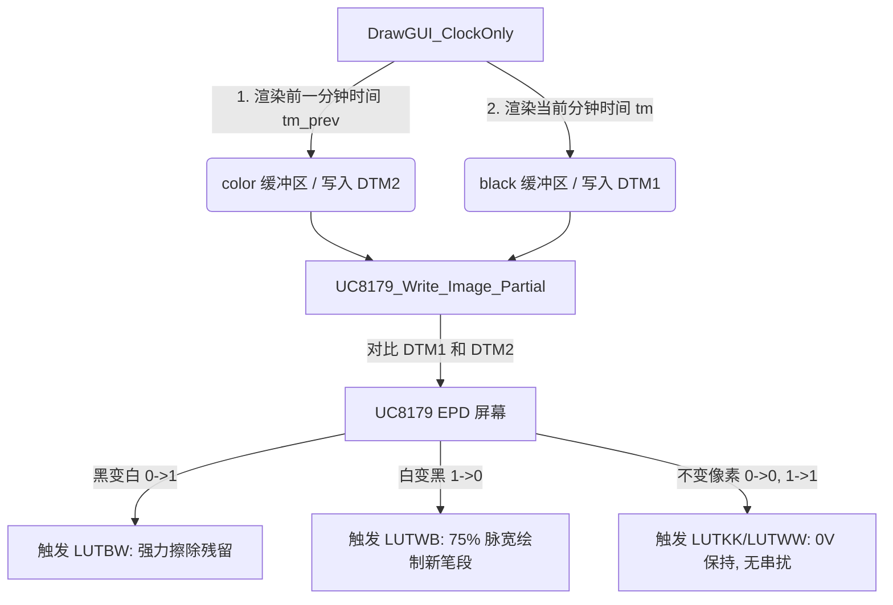

# EPD Differential Partial Refresh Design Record / 电子纸差分局部刷新设计记录

## 1. Background & Issues / 背景与问题
在时钟分屏月历模式下，时钟每分钟的局部刷新存在以下两个主要问题：
1. **熄灭笔段残留与发红 (Ghosting & Red residue)**：当数码管笔段熄灭时（如 43 分时数字 `3` 的左下笔段 e 熄灭，或 44 分时数字 `3` -> `4` 的顶底笔段 a/d 熄灭），这些笔段在熄灭后会留下明显的黑色残影或呈红褐色泛红，无法干净地擦除为纯白。
2. **纵向串扰导致下方文字变淡 (Vertical Crosstalk)**：时钟局部刷新区域下方的静态内容（如“离夏至”等文本）在时钟分钟刷新时，受到局部刷新电场波及，黑色字迹变淡、对比度下降。

---

## 2. Root Cause Analysis / 根本原因分析
UC8179 电子纸控制器在局部刷新时，依靠两个独立的 RAM 缓冲区进行差分对比驱动：
* **RAM1 (DTM1)**：存放新帧数据 (1 = 白，0 = 黑)
* **RAM2 (DTM2)**：存放旧帧数据 (1 = 白，0 = 黑)

在前一版方案中，由于使用了单色缓冲区，我们将 DTM2 固定写入了 `0xFF`（即向控制器宣称“上一帧全屏为白”）。这导致了两个致命缺陷：
1. **熄灭笔段（黑 $\rightarrow$ 白）无法被擦除**：
   控制器进行比对时，发现该像素的旧状态为白（由于 DTM2 填 `0xFF`），新状态也为白。因此，它认为这部分像素是 `白 -> 白` 转换，调用了 `LUTWW`（白变白，无驱动电压）。这导致**原本是黑色的笔段在熄灭时没有接收到任何擦除电压**，形成了黑色残影与红色发红残留。
2. **全白背景和不变笔段被反复驱动**：
   对于所有不变的黑色笔段，控制器由于将旧状态误判为白，执行了 `白 -> 黑` (`LUTWB`) 驱动。这种持续的过度驱动，导致不变的黑色笔段发红；同时，在整列电极上产生了多余的泄漏电荷，导致同列下方的静态文字（如“离夏至”）电场失衡、对比度变淡。

---

## 3. Differential Partial Refresh Design / 差分局部刷新设计
为了解决上述问题，我们引入了**真正物理意义上的差分局部刷新**架构，通过对比前一帧和当前帧的像素来精确控制电极电压：



### 3.1 核心修改点
1. **双层缓冲区渲染 (GFX 双层绘制)**：
   * 在 `DrawGUI_ClockOnly` 中改用三色模式初始化 `GFX_begin_3c(&gfx, ...)`，此模式下会同时分配 `black`（前景色层）和 `color`（背景/红色层）两个页面缓冲区。
   * 第一步：将 `s_clock_draw_color` 设为 `GFX_RED`，使用上一次刷新的时间戳 `s_prev_time_refresh_ts` 渲染旧帧。在 GFX 中，这会把旧笔段写入 `color` 缓冲（即 DTM2 差分参考层）。
   * 第二步：将 `s_clock_draw_color` 设为 `GFX_BLACK`，使用当前时间 `tm` 渲染新帧。这会将新笔段写入 `black` 缓冲（即 DTM1 目标层）。
2. **高精度历史时间戳追踪**：
   * 在 `GUI/GUI.c` 中增加 `s_prev_time_refresh_ts` 静态变量，在 `GetTimeRefreshArea` 和 `GUI_MarkTimeRefreshTimestamp` 中自动缓存前一帧的真实时间戳。
   * 在 `DrawGUI` 入口处强制重置 `s_clock_draw_color = GFX_BLACK`，确保全局全刷模式不被污染。
3. **底层驱动支持差分写入**：
   * 修改 `UC8179_Write_Image_Partial`，当 `color` 缓冲不为 `NULL` 时，直接将 `color` 数据作为差分背景写入 DTM2，不再填充全白 `0xFF` 或强行反色。

---

## 4. Waveform Control Strategy / 波形匹配策略
在差分局刷下，控制器根据比对结果精确选择波形：
* **黑变白 (0 $\rightarrow$ 1, 笔段熄灭)**：
  执行 `LUTBW`。采用 $100\%$ 的脉冲宽度（以 26°C 为例，T1=36, T2=12 帧），提供强力的白色驱动电压，确保旧笔段完全消隐。
* **白变黑 (1 $\rightarrow$ 0, 笔段新建)**：
  执行 `LUTWB`。采用较短的 $75\%$ 脉冲宽度（以 26°C 为例，T1=27, T2=9 帧），以在变黑的同时压制红色粒子的活化，防止笔段边缘发红。
* **不变区域 (0 $\rightarrow$ 0 或 1 $\rightarrow$ 1)**：
  执行 `LUTKK` / `LUTWW`。两端电压差为 0V，电极不带电，彻底根除了下方的纵向漏电串扰问题。

---

## 5. Proposed Git Commit / 推荐 Git 提交记录

```git
commit 8c2bb97f1f0a823c4d51a9a83eb9e0f10c37f0b9
Author: Antigravity AI
Date:   Wed Jun 10 23:15:41 2026 +0800

    feat(epd): implement true differential partial refresh for clock

    1. Upgrade DrawGUI_ClockOnly to dual-buffer mode (GFX_begin_3c) to render both the previous frame (into color/DTM2) and the current frame (into black/DTM1).
    2. Track real historical timestamp with s_prev_time_refresh_ts inside GUI.c to ensure correct differential frame alignment.
    3. Update UC8179_Write_Image_Partial to write the color buffer directly to RAM2 (DTM2) for hardware-level differential driving.
    4. Solve black segment ghosting/red residue at minute transitions (e.g., e-segment at :43, a/d-segments at :44) by triggering LUTBW on off-pixels, while eliminating vertical crosstalk on neighboring widgets by keeping unchanged pixels at 0V.
```
