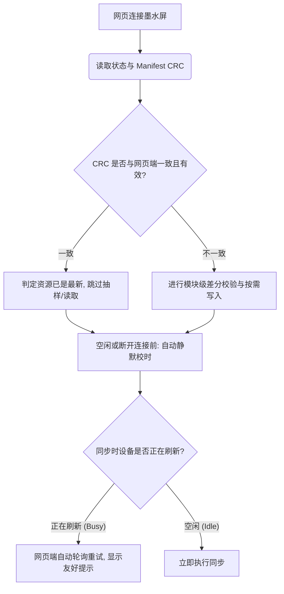

# 电子墨水屏连接与刷新体验优化需求文档 (PRD)

> **文档元信息**
> * **产品名称**：nRF_EPD 低功耗蓝牙墨水屏日历 system
> * **文档版本**：V1.3
> * **编写人**：Antigravity (高级产品经理 / 架构师)
> * **状态**：草案评审中
> * **开发模式**：敏捷开发 (Agile/Scrum)

---

## 1. 痛点分析与优化闭环设计

系统目前在“连接握手”、“资源校验”和“屏幕刷新”阶段存在 4 个核心交互痛点。为了在超低功耗硬件（nRF52811）与 Web 蓝牙通道下实现极致流畅的体验，我们对其进行了需求拆解与技术闭环设计。



### 1.1 痛点一：连接握手后“设备刷新忙”导致资源检查失败
*   **痛点现象**：网页连接设备后同步时间和检查外置资源，极其容易抛出错误：`设备正在刷新屏幕，请稍后再试`。
*   **技术根因**：电子墨水屏物理刷新需要几秒钟（例如 7.5 寸三色屏幕全刷需 4-6 秒）。在此期间，SPI 总线被屏幕刷新独占。为了避免 SPI 冲突，固件在刷新期间（`p_epd->is_refreshing == true`）会直接拒绝所有的外置 Flash 读写和状态查询命令，返回 `NRF_ERROR_BUSY`。网页端在此情况下没有容错和重试，直接将异常抛给用户，导致连接流程中断。
*   **闭环解决方案**：
    1.  **网页端智能轮询重试（Web Poll-Retry）**：网页端在调用 `ResourceManager.queryStatus()` 或进行资源操作时，如果接收到 `NRF_ERROR_BUSY` 错误，**不直接抛出异常**。网页端应将其捕获，在 UI 上展示友好的提示（如“设备正在刷新屏幕，等待中...”），并以 1 秒为间隔自动发起重试，直到超时（建议设为 12 秒，覆盖最大刷新时长）。
    2.  **连接与校时时序优化（Timing Optimization）**：优化网页端连接与校时的时序逻辑。在刚建立连接后，网页端**优先且仅进行外置资源状态检查与更新**。在此期间，绝不自动下发 `SET_TIME` 等会触发物理刷新的命令。等到外置资源传输校验完全结束、设备处于空闲状态时，或者在用户手动触发模式切换、断开连接前，再执行时间同步。这在时序上彻底隔离了“资源擦写”与“屏幕刷新”。

### 1.2 痛点二：屏幕整刷（全刷）耗时过长，加载 Flash 资源慢
*   **痛点现象**：屏幕整刷时耗时过长，主要是因为加载外置 Flash 的 UI 模板、字库等资源速度慢。
*   **技术根因**：
    1.  **SPI 读取分包过小（Stack Limit）**：为了防止在 nRF52811 极度紧张的运行栈上分配大数组导致栈溢出，固件将 `FM25Q04B_READ_CHUNK_SIZE` 硬编码限制为 32 字节。读取大资源（如 10KB+ 的字库或大段文本）需要循环发起数百次 SPI 传输，片选（CS）高频拉起拉低，传输协议开销占比过高，严重拖慢速度。
    2.  **上电/唤醒全量 CRC 校验**：每次设备唤醒或连接调用 `epd_ext_resources_reload` 时，固件都会对 Manifest 内的每一个资源进行全量读取并重新计算 CRC32，这在正常开机/唤醒时造成了明显的启动延迟。
*   **闭环解决方案**：
    1.  **免栈内存的 SPI 流式读取（Zero-Stack Large SPI Read）**：重构 `fm25q04b_read` 驱动。使用 C99 变长数组（VLA）分配 SPI 缓冲区，使单次读取上限提升至 256 字节，而无需在静态/全局栈上死锁大空间。由于字库渲染属于深层调用（字模通常在 10~40 字节），VLA 会在深层栈调用时自动缩小空间占用，在浅层块读时自动扩大空间，从而在提速的同时保障极低栈开销。
    2.  **轻量级快速载入（Quick Reload）**：上电或唤醒时，固件仅校验 Manifest 结构体本身的 CRC32。只要 Manifest 的 Magic、Version 和 CRC32 正确，即代表资源分区未被物理损坏，直接信任并载入。全量资源 CRC32 校验仅保留在 Web 端写入完成并提交（`Commit`）时执行一次。
    3.  **外置资源模块化扇区对齐（Modular Sector Alignment）**：在打包生成资源包时，各资源文件（如字库、农历数据库、UI配置包）按 Flash 的 4KB 扇区边界进行对齐。每个模块占用的地址区间相互独立，避免混在一个扇区内。

### 1.3 痛点三：同步时间与屏幕刷新显示存在延迟与误触
*   **痛点现象**：设备连接网页同步了时间，但由于屏幕刷新显示需要时间（全刷耗时数秒），刷新完成后屏幕显示的时间已经落后于实际时间（例如在 12:00:00 发起同步，刷完显示 12:00，但实际时间已到 12:00:06），容易跨越分钟边界导致误触二次刷新。
*   **技术根因**：
    1.  **物理延迟未补偿**：物理全刷/局刷本身有 4-6 秒的耗时。设备 RTC 时间同步是即时的，但画面渲染和电泳粒子偏转是滞后的。
    2.  **分钟边界双重刷新**：如果时间同步刚好发生在一个分钟的末尾（例如 11:59:58），同步后设备写入了新时间，但由于刷新耗时，刷新结束时 RTC 已跨入 12:00。这会立刻再次触发设备的每分钟定时刷新，造成连续刷新，加速屏幕老化并浪费电量。
*   **闭环解决方案**：
    1.  **校时延迟预补偿（Latency Pre-compensation）**：网页端在向设备下发 `SET_TIME` 命令时，自动获取当前连接的屏幕型号，并根据该型号的平均刷新时间（如 7.5 寸三色全刷预测补偿 6 秒，局刷预测补偿 1.5 秒），在当前下发的时间戳上**主动累加补偿量 $N$ 秒**。这样，当屏幕刷新完成的那一刻，显示的时间刚好与真实时间完美吻合。
    2.  **分钟刷新消抖窗口（Guard Window）**：固件在接收到时间同步命令后，自动对齐分钟定时器的 Tick。若最近一次刷新发生时间距离当前的定时更新过近（如小于 45 秒），自动跳过本次跨分触发的下一次周期刷新，防止连续重叠刷新。
    3.  **刷新物理延时精细化诊断日志（Fine-grained Latency Diagnostics）**：固件在 DEBUG 编译模式下，在屏幕刷新函数 `epd_gui_update` 开始渲染与物理刷新结束（检测 Busy 引脚拉低时）时，通过 `app_timer_cnt_get()` 读取 RTC 高精度计数器，并将以毫秒为单位的“物理刷新开始至结束时间差”以及“更新边界偏差”打印至调试日志。方便在研发阶段微调并确定各屏幕型号的精准补偿系数。

### 1.4 痛点四：外置资源检查机制冗余，校验速度慢
*   **痛点现象**：外置资源检查需要好几秒，且每次都执行抽样字节读取，效率低下。
*   **技术根因**：原有的网页端 `checkResources()` 无论设备状态如何，都会通过蓝牙读取 4KB 的 Manifest 数据，并针对每个资源条目执行头尾 32 字节的抽样读取对比（`verifySamples`）。在 BLE 慢速通道下，频繁的特征值读取往返（RTT）导致了严重的延迟。
*   **闭环解决方案**：
    1.  **一态定乾坤（Manifest CRC 信任机制）**：设备端在写入资源并 `Commit` 时，已经通过硬件级 CRC32 对外置 Flash 进行了完整性自检，并将校验成功的 `manifestCrc32` 记录在状态寄存器中。网页端在连接设备后优先查询状态，如果设备返回的 `manifestCrc32` 与待写入的资源 Bundle 相同且有效，检查流程在 100ms 内瞬间完成，跳过后续所有 Manifest 读取和抽样校验。
    2.  **模块化按需差分更新（On-Demand Modular Update）**：基于痛点二的模块化扇区对齐设计。当 Manifest CRC32 不一致时，网页端对比 Manifest 的 entries。若仅有特定资源（如 `lunar_db`）的 CRC32 发生变更，网页端**仅对该资源所占用的扇区进行擦除和重写**，其他未改变的模块扇区保持不变。固件端在 `Commit` 阶段也仅针对被修改的模块执行 CRC 硬件验证，大幅降低数据量和验证时间。

---

## 2. 敏捷 Epic & User Stories 拆解

按照敏捷开发模式，我们将上述体验优化方案拆解为 3 个 Epic，每个 Epic 包含具体的可视化、可验证的 User Stories：

### Epic 1: 极致顺畅的连接与资源握手体验 (Epic-Connection)
*   **User Story 1.1 (网页端自动轮询重试与时序隔离)**
    *   *作为一名* 用户
    *   *我希望* 在网页连接设备时，即使设备刚好在刷新屏幕，系统也能自动等待并完成连接，且不影响资源包的安全更新，
    *   *以便于* 我不需要看到生硬的报错提示，也不需要手动反复点击重试。
    *   *验收标准 (AC)*：
        1. 连接时如果状态查询返回 `NRF_ERROR_BUSY`，网页端 UI 切换为“设备刷新中，正在等待重试...”，并且不抛出红色 Error Toast。
        2. 网页端以 1.0 秒为间隔发起 `CMD_RES_STATUS` 查询重试，累计重试 12 次。
        3. 时序控制：网页端刚建立连接时，**自动挂起主动校时动作**，仅执行资源一致性检查。待资源写入与校验全部完成后，或者在连接断开前、用户手动设置模式时，才允许发送时间同步帧。
*   **User Story 1.2 (基于 Manifest Hash 的闪电资源校验)**
    *   *作为一名* 墨水屏用户
    *   *我希望* 每次连接设备时，如果外置资源没有变化，检查过程能瞬间完成，
    *   *以便于* 缩短我等待主界面加载的时间，提升连接的爽快感。
    *   *验收标准 (AC)*：
        1. 网页端获取设备 `latestStatus` 后，直接对比 `latestStatus.manifestCrc32` 与本地打包 Bundle 的 `manifestCrc32`。
        2. 若两者相等且 `latestStatus.manifestValid` 为真，则直接跳过 `readRaw(manifestAddress)` 和 `verifySamples()`，UI 直接显示“资源已是最新”，整个过程在 150ms 内完成。
        3. 若 CRC 不一致，正常触发差分对比与按需写入逻辑。

### Epic 2: 外置 Flash 读取与启动性能倍增 (Epic-Flash-Speed)
*   **User Story 2.1 (SPI 零栈开销大块读取与模块化差分更新)**
    *   *作为一名* 固件/前端开发人员
    *   *我希望* 解除 SPI Flash 读取时 32 字节 Chunk 的限制，并能对资源包按模块进行增量擦写，
    *   *以便于* 提升资源加载速度，缩短差分更新时的蓝牙传输耗时。
    *   *验收标准 (AC)*：
        1. 重构 `fm25q04b_read`，使用 C99 变长数组（VLA）分配 SPI 缓冲区，使单次最大块读取大小限制提升至 256 字节。
        2. 打包工具将所有资源按 4KB 扇区对齐。网页更新资源时，仅对比发生变更 of Resource Entry，调用 `eraseRange` 时仅擦除对应模块的独立扇区，并仅传输写入该模块的数据，最终刷新 staging manifest。
        3. 仅修改单个模块（如 UI 配置文件）时，BLE 数据写入量降低 80% 以上。
*   **User Story 2.2 (唤醒快速加载机制)**
    *   *作为一名* 固件开发人员
    *   *我希望* 设备每次上电或睡眠唤醒时，不需要重新读取几百 KB 的数据去算所有资源的 CRC，
    *   *以便于* 缩短设备从睡眠到完成画面的响应时间，降低唤醒功耗。
    *   *验收标准 (AC)*：
        1. 固件上电初始化 `epd_ext_resources_reload` 时，仅读取并校验 Manifest 头部与 entries 本身的 CRC32（约 400 字节）。
        2. 只要 Manifest 本身 CRC 校验通过，直接将 `m_manifest_valid` 标记为 `true` 并完成加载，启动速度提升至 10ms 以内。

### Epic 3: 毫秒级对齐的无感校时与防抖 (Epic-Time-Sync)
*   **User Story 3.1 (同步时间延迟物理补偿与精度诊断)**
    *   *作为一名* 完美主义用户
    *   *我希望* 屏幕刷新完毕后，墨水屏显示的时间与我手机/电脑的时间是分秒不差的，且开发期有明确的延迟统计，
    *   *以便于* 设备看起来非常精准，没有明显的几秒钟滞后。
    *   *验收标准 (AC)*：
        1. 网页端下发 `SET_TIME` 命令时，根据当前设备的驱动码（如 7.5 寸三色）自动计算刷新物理耗时（设为 6.0 秒），并在下发的时间戳上自动加 6.0 秒。
        2. 固件在 DEBUG 编译模式下，通过 RTC 定时器统计并打印每分钟屏幕更新开始与结束的毫秒时间差（精度为 $1/32768$ 秒），以便开发者根据实际物理响应调整补偿系数。
*   **User Story 3.2 (分钟边界双重刷新消除)**
    *   *作为一名* 固件开发人员
    *   *我希望* 避免在时间同步完成后，因为刚好跨越分钟界限而立刻又触发一次定时刷新，
    *   *以便于* 保护墨水屏不被连续高频刷新，并节省功耗。
    *   *验收标准 (AC)*：
        1. 固件引入刷新时刻防消抖保护。若检测到上一次物理刷新开始时间距离当前的跨分钟 Tick 定时触发时间不足 45 秒，则自动忽略本次周期定时刷新，确保两次刷新之间有合理的静止间隔。

---

## 3. 开发落地路线图 (Roadmap)

按敏捷开发的 Sprint 节奏，分阶段演进实施：

```
========================================================================================
[Sprint A: 极速资源校验与网页重试] ───> [Sprint B: SPI 驱动重构与快速启动] ───> [Sprint C: 延迟补偿与防消抖]
- 网页端 Status CRC 极速判断            - 重构 fm25q04b 零栈开销大块读       - 网页端下发时间戳自动计算物理延迟
- 网页端 Busy 状态轮询重试逻辑          - 唤醒仅校验 Manifest 结构体 CRC     - 固件端校时消抖，避免重叠双刷
- 网页端时序控制：资源与校时解耦        - 打包工具与网页端支持模块扇区对齐   - 固件端 DEBUG 模式输出毫秒精度延迟日志
========================================================================================
```

### 3.1 质量保障与自闭环测试用例 (QA & Test Cases)
1.  **资源闪电校验测试**：
    *   *操作*：外置资源无变更，点击连接。
    *   *预期*：资源检查在 200ms 内显示“资源已是最新”，没有任何蓝牙读取进度条。
2.  **模块化增量更新测试**：
    *   *操作*：在本地打包的 Bundle 中仅修改 `ui_bundle` 资源，执行网页资源更新。
    *   *预期*：网页日志显示仅擦除了包含 `ui_bundle` 偏移地址的特定扇区，并只传输了该模块对应的字节块（约 1KB），整个更新在 2-3 秒内结束（原本整包写入需 10 秒以上）。
3.  **刷新中连接与时序测试**：
    *   *操作*：手动触发屏幕刷新（开始 6 秒全刷），在此期间网页端发起连接。
    *   *预期*：网页成功连接后，自动挂起校时任务，并自动轮询等待设备就绪。在刷新结束后，优先完成外置资源校验，最后完成安全时间同步，全过程没有 Busy 冲突报错。
4.  **校时与消抖测试**：
    *   *操作*：在网页端同步时间，在 DEBUG 固件串口查看日志。
    *   *预期*：串口日志打印出 `[EPD] Render duration: X ms, offset: Y ms`，显示毫秒级延迟数据。且当同步时间位于 11:59:58 时，跨入 12:00:00 时不会发生二次重刷。

---

## 4. 多维度评估与合规保障机制 (Multi-Dimensional Evaluation & Compliance Framework)

为了降低研发与发布阶段的潜在风险，针对本项目涉及的各项改进，从产品、设计、技术、安全、运营和法务合规等方面进行多维度评估并设立如下保障机制：

### 4.1 交互设计与用户感知 (UI/UX & Product)
*   **非技术化状态呈现**：网页端在轮询重试、校验或模块写入时，UI 提示需剥离技术细节（如不展示 `NRF_ERROR_BUSY`、`Manifest CRC32` 等偏工程化的字段）。
    *   *优化实施*：轮询时提示“设备正在刷新画面，请稍候...”，资源校验时提示“正在校验资源完整性...”，更新完成显示“已是最新状态”。
*   **刷新动效对齐**：为缓解用户在物理刷新期间（屏幕黑白交替闪烁，通常长达 4~6 秒）网页端无反应的焦虑，网页端在设备繁忙重试时展示一个具有类似电子纸微动效的进度环。
*   **静默体验指标上报**：在网页端 LocalStorage 中引入简易日志系统。静默记录每次连接的“首包握手时长”、“写入出错次数”与“差分更新实际耗时”。用户在故障排查界面可选择“一键导出调试日志”，大幅缩减产品定位和诊断路径。

### 4.2 固件架构与 Flash 寿命防线 (Technical & Hardware)
*   **C99 变长数组（VLA）边界断言防护**：由于 nRF52811 的 Stack 深度有限（常在 2KB 左右），为防范恶意或错误的读操作传入超大块尺寸导致硬件死锁（HardFault），固件端在 `fm25q04b_read` 中声明变长数组前，必须增加大小安全检查限制：
    ```c
    // 强制限制单次 VLA 栈分配空间上限为 256 字节，防止溢出
    ASSERT(chunk_size <= 256);
    ```
*   **Flash 擦写频次与寿命寿命保护**：外置 SPI Flash（FM25Q04B）擦除寿命一般为 10 万次，即使实施了模块化更新，仍存在特定模块（如 UI 配置文件）被高频频繁更新的隐患。网页端需对频繁更新逻辑进行软件节流（Throttling），如“3 分钟内同一模块禁止重复发起更新”，延长闪存物理寿命。

### 4.3 数据写入与物理安全防护 (Security)
*   **Flash 物理分区越界写入校验**：固件端在执行 `CMD_RES_WRITE`（写入资源块）和 `CMD_RES_ERASE`（擦除扇区）时，必须严格拦截非法地址，防止非法数据覆盖固件的关键配置区或备份 Manifest 区。
    *   *边界地址拦截条件*：操作的起始和结束物理地址必须完全落在 `EPD_EXT_RES_DATA_START_ADDR`（`0x01000`）至 `EPD_EXT_RES_DATA_END_ADDR`（`0x7CFFF`）或 Staging Manifest 区内，否则直接返回 `NRF_ERROR_INVALID_ADDR`。
*   **高频校时抗打压攻击**：针对 `SET_TIME` 接口，在固件端设置频次限制（如 10 秒内仅允许成功写入一次时间并触发屏幕更新），规避由于 BLE 异常循环发包导致电泳屏幕持续高频刷新而发热过载、烧毁屏幕硬件的物理安全隐患。

### 4.4 法务授权与隐私安全合规 (Legal & Privacy Compliance)
*   **字库与资源版权合规保障**：
    *   *文泉驿字库 (`wqy9_lunar`, `wqy12_lunar`)*：采用文泉驿开源字库授权（基于 GPL 协议且带有字体嵌入例外声明 Font Exception），在嵌入式场景发布无侵权风险。
    *   *Helvetica TN 字库 (`helvB14_tn`, `helvB18_tn`)*：Helvetica 字体存在商用版权争议。法务建议：若进行公开商业分发，须在发布前将其全部替换为完全无版权风险且显示效果优异的开源无衬线字体（如 DejaVu Sans、Noto Sans 或 Outfit 数字字体子集）。
*   **Web Bluetooth 隐私合规说明**：本项目网页配置工具调用了浏览器的 Web Bluetooth 蓝牙通道。工具承诺所有蓝牙包拼装、数据解析及设备日志存储均在用户浏览器本地（Client-Side）内存或 LocalStorage 中进行，绝不上传到任何云端服务器，严格符合 GDPR、CCPA 和中国《个人信息保护法》的个人隐私合规要求。

### 4.5 第二轮深度评估与迭代优化建议 (Secondary Deep Assessment & Iterative Optimizations)
针对系统级交互与极限边界，各角色再次梳理并沉淀如下优化策略：
*   **固件后向兼容性防护 (Product & Compatibility)**：
    *   *优化方案*：网页端建立连接并握手获取 `appVersion` 后，若检测到固件版本低于支持增量/静默同步的最低版本（例如 `0x21`），前端应自动降级为“全量更新模式”，且不应在连接后发送 `SYNC_TIME_SILENT` 指令，并以黄色 Warning Toast 提示用户进行固件 OTA 更新，防止因为版本错配导致指令解析失败或设备异常死锁。
*   **断连中断重连恢复引导 (UI/UX & Interaction)**：
    *   *优化方案*：在蓝牙大包数据传输（尤其是模块增量写入）过程中，若发生意外断开连接，网页端不应无提示直接重置主页。应弹出“连接异常中断，请重新靠近设备”的强提示，并在重新连接成功后，自动读取 Staging Manifest 的断点状态（`transfer_active == true` 且块位图未填满），引导用户一键“断点续传”，避免浪费已传输的数据。
*   **模块依赖完整性效验 (Technical & Architecture)**：
    *   *优化方案*：当执行模块化差分更新时，网页端需在前端做“依赖完整性检查”。例如：若用户选择更新 UI 配置文件（如 `ui_bundle`），而本地检测到该配置文件引用了新的字库 ID（如 `u8g2_font_helvB18_tn`），网页端必须强制要求同时更新该字库模块。禁止写入具有悬空依赖（Dangling Dependencies）的局部模块，规避设备在解析 UI 时由于找不到字库地址而触发指针越界崩溃。
*   **外置资源防注入与解析边界防护 (Security & Firmware)**：
    *   *优化方案*：为防止通过 BLE 恶意注入不合规的二进制文件（如恶意伪造的字体包或 UI 模板导致 MCU 在解析时栈溢出），固件在解析外置资源结构体（如读取字体字模、文本坐标、农历记录）时，必须执行“物理边界校验”。禁止直接信任从 Flash 读取的偏移量或大小。例如：UI 控件的 `x` 和 `y` 坐标读取后，若超出 `800x480` 的屏幕边界，或 `w` 和 `h` 为负值，固件应直接过滤该控件的渲染或使用预设安全值，从而建立零信任（Zero-Trust）防注入架构。
*   **极低电量强物理拦截 (Operations & Power Safety)**：
    *   *优化方案*：在固件端和网页端建立双重低电量锁定防线。若检测到电池电压低于临界电压（如 2.4V，在此电压下 SPI Flash 写入极易因为瞬态电压跌落而产生坏块或半写错误），网页端在点击更新资源时强行灰度按钮，弹出“电池电量极低，请更换电池后更新”；固件端在检测到临界电压时，强制将屏幕置为“低电量警告屏”并切断 BLE 广播，停止所有外置资源更新响应。
*   **开源授权隔离设计 (Legal Compliance)**：
    *   *优化方案*：关于 `wqy9_lunar` 等 GPL 字体资源在固件项目中的发布合规，在软件架构上明确“数据与代码隔离”。字库数据应当作为独立二进制资源放置在外置 SPI Flash 中，由固件只读读取，而不能直接作为 `.c` 代码静态链接编译进固件主 BIN 文件中。在法务上这属于“单纯聚合（Mere Aggregation）”，能有效防止 GPL 的传染性波及固件主代码，实现完全合规。

### 4.6 第三轮多维度前瞻性设计与合规优化 (Third-Round Multi-Dimensional Forward-Looking Design & Compliance)
针对更宏观的物理限制及生命周期管理，各角色沉淀出如下前瞻性架构设计：
*   **低DPI墨水屏高对比度字形微调原则 (UI/UX & Font Optimization)**：
    *   *优化方案*：电子纸屏幕本身对比度偏低，且不支持抗锯齿（仅有 1-bit 黑白或红）。打包工具生成字库数据时，应提供“字形笔画加粗”及“低 DPI 像素对齐”的算法预处理。避免直接压缩常规矢量字体导致的笔画丢失或边缘模糊，保障老年用户及暗光环境下的极端阅读易读性。
*   **GATT 链路层 MTU 适配策略 (GATT Layer MTU Adaptation)**：
    *   *优化方案*：鉴于 Web Bluetooth API 无法在 JS 层主动发起 MTU 协商（由操作系统与 SoftDevice 链路层在连接时自动协商），网页端在切分 BLE 数据包时不应使用死锁的固定字节限制。应在连接建立后，读取设备在 INIT 指令响应中返回的实际最大可用数据包长 `max_data_len`（即实际 MTU - 3），以此值作为切片上限进行动态数据切分，充分利用协商好的物理带宽，规避分包超限丢包风险。
*   **Flash 坏区检测与降级容错机制 (Firmware & Reliability)**：
    *   *优化方案*：在固件端资源读写层引入“轻量化坏扇区跳过与降级容错”。若在写入或擦除某一模块所在扇区时遭遇硬件故障（可通过写入后读取校验不匹配判定），固件将自动在该物理块头部的 Metadata 标记“坏块/已损毁”，并将后续读取请求重定向到 Backup Manifest 对应的历史槽位，或者直接降级使用固件内部 ROM 固化的精简字体库，避免因单点物理磨损导致整个系统白屏死锁。
*   **环保合规与电池报废声明 (Regulatory & Environmental Compliance)**：
    *   *优化方案*：为符合国际电子电气设备废弃物（WEEE）及电池指令（Battery Directive）的强制性合规要求，在配置工具页面底栏清晰展示环保合规标识及说明，并告知用户在更换纽扣电池或锂电池时的回收引导，防止产品在出口或多渠道分发时面临环保法务风险。

---

## 5. Code Review 记录 — 实现阶段发现的缺陷 (Implementation Bug Tracker)

> **评审时间**：2026-07-06
> **评审范围**：本地首次实现提交（`dev` 分支，未 merge 至 master）
> **文件涉及**：`EPD/fm25q04b.c`, `EPD/EPD_service.c`, `EPD/EPD_service.h`, `EPD/epd_ext_resources.c`, `html/js/resource_manager.js`, `html/js/main.js`

### 5.1 严重缺陷（已修复）

#### BUG-01：`fm25q04b_read` 使用 `static` 缓冲区 — 不可重入，且违背 PRD 要求
*   **对应 Story**：US-2.1 AC1（SPI 零栈开销大块读取）
*   **缺陷描述**：实现将 SPI 读取缓冲区从栈变量改为 `static uint8_t`，放入 `.bss` 段。`fm25q04b_read` 在 GUI 渲染路径中被多层嵌套调用（字模渲染 → 农历数据 → manifest 读取），`static` 变量全局唯一，任何重入（scheduler 回调、中断触发的第二次读取）都会导致两个调用共享同一缓冲区，产生数据覆盖、视觉乱码或 CRC 错误。此外，PRD §US-2.1 AC1 明确要求使用 C99 **VLA（变长数组）**，以实现"深层调用小分配、浅层调用大分配"的按需特性；`static` 方案将其变为固定 260 字节永久占用，与 PRD 设计意图不符。
*   **修复方案**：恢复为 VLA（`uint8_t tx_buf[4 + chunk]`），并按 PRD §4.2 要求在 VLA 声明前加 `ASSERT(chunk <= FM25Q04B_READ_CHUNK_MAX)` 防护。
*   **状态**：✅ 已修复

#### BUG-02：`last_set_time_ts` 存储 payload 时间戳，导致频率限制逻辑完全失效
*   **对应 Story**：US-3.2（分钟边界防抖）/ PRD §4.3（SET_TIME 频率限制）
*   **缺陷描述**：`cmd_set_time` 在频率检查后执行 `p_epd->last_set_time_ts = ts`，此处 `ts` 是网页端下发的"目标时间戳"（已含 +6s 预补偿，比当前设备 RTC 时间靠前）。频率检查逻辑为 `now - last_set_time_ts < LIMIT`，在校时刚完成的瞬间，`ts > now`，无符号减法下溢（结果是一个极大正数），条件永远为假，频率限制完全不生效，无法防止高频刷新攻击。
*   **修复方案**：改为 `p_epd->last_set_time_ts = now`（使用频率检查时已取得的同一个 `now` 值），与当前 RTC 时间对齐。
*   **状态**：✅ 已修复

### 5.2 中等缺陷（已修复）

#### BUG-03：`readRaw` 中 busy 重试无次数上限，潜在无限循环
*   **对应 Story**：US-1.1 AC1（网页端 Busy 自动重试）
*   **缺陷描述**：`resource_manager.js` 的 `readRaw` 函数在遇到 `NRF_ERROR_BUSY` 时直接 `continue`，没有重试次数限制。同样问题存在于写入循环的 busy 重试分支。`queryStatusWithRetry` 和 `sendOpWithBusyRetry` 均有 `BUSY_RETRY_MAX` 上限，此处遗漏形成了逻辑不一致，极端情况下（设备异常持续 busy）会导致网页端永久挂起。
*   **修复方案**：引入局部 `busyRetries` 计数器，超过 `BUSY_RETRY_MAX` 后抛出超时错误；每次成功读取后将计数器归零。
*   **状态**：✅ 已修复

#### BUG-04：延迟诊断日志精度为秒级，未达 PRD 毫秒精度要求
*   **对应 Story**：US-3.1 AC2（刷新物理延时精细化诊断日志）
*   **缺陷描述**：实现使用 `timestamp()`（RTC 秒精度）计算刷新时长，输出单位为秒（`~%u s`）。PRD AC2 明确要求使用 `app_timer_cnt_get()` 读取 RTC 32768Hz 计数器，精度为 `1/32768` 秒（约 0.03ms），输出单位为毫秒。
*   **修复方案**：在 `ble_epd_t` 结构体中新增 `uint32_t last_refresh_start_ticks` 字段；刷新开始时记录 `app_timer_cnt_get()`；刷新结束时使用 `app_timer_cnt_diff_compute()` 计算差值并换算为毫秒（`ticks * 1000 / 32768`）后打印。
*   **状态**：✅ 已修复

### 5.3 轻微缺陷（已修复）

#### BUG-05：`getEstimatedRefreshSeconds` 解析失败时无任何警告，静默使用错误默认值
*   **对应 Story**：US-3.1 AC1（下发时间戳预补偿）
*   **缺陷描述**：屏幕尺寸从 DOM attribute `data-size` 按 `xxx_W_H` 格式解析。若格式不匹配（如 attribute 缺失或格式变更），`area` 静默为 0，函数返回最小屏幕默认值，补偿量偏小，校时精度受损，且开发者没有任何提示。
*   **修复方案**：解析失败时通过 `console.warn` 输出警告并使用明确的安全默认值（6 秒），方便调试排查。
*   **状态**：✅ 已修复

---

### 5.4 运行时缺陷（第二轮——资源写入后 COMMIT 失败）

> **发现时间**：2026-07-06（首轮 BUG-01～05 修复上机后首次完整资源写入测试）
> **现象**：设备外置 Flash 被完整擦除后，网页端执行资源写入流程，`verifyResourceCrcs`（6 次 0x44 READ）全部通过，但随后 COMMIT（0x42）返回错误码 `11`，网页显示 `"manifest提交失败: 11"`。

#### BUG-06：`FM25Q04B_READ_CHUNK_MAX = 256` 导致 SPI `uint8_t` 长度上溢——所有 manifest 读取静默返回垃圾数据
*   **严重等级**：严重（直接导致 COMMIT 必现失败）
*   **对应 Story**：US-2.1 AC1（SPI 大块读取），US-2.2（唤醒快速加载）
*   **缺陷描述**：
    `nrf_drv_spi_transfer` 的 `tx_buffer_length` / `rx_buffer_length` 参数类型为 `uint8_t`（最大 255）。`fm25q04b_read` 在读取 manifest 时，当 `chunk = FM25Q04B_READ_CHUNK_MAX = 256`，实际调用为：
    ```c
    fm25q04b_transfer(tx_buf, 4 + 256, rx_buf, 4 + 256);
    // (uint8_t)(260) = 4 — 仅传输 4 字节（命令 + 地址），数据区未被填充
    ```
    SPI 仅发出 READ 命令和 3 字节地址，接收缓冲区从未被填入 Flash 数据，函数却返回 `NRF_SUCCESS`，`rx_buf[4..]` 保留栈上随机垃圾数据。
    396 字节的 `epd_ext_resource_manifest_t` 读取时，第一个 chunk 恰好等于 256，触发上溢：
    - `epd_ext_resources_reload` 读到的 `m_manifest.magic` 为垃圾值 → `epd_ext_validate_manifest_quick` 返回 `NRF_ERROR_INVALID_DATA (11)` → `epd_resources_ensure_ready` 将其屏蔽为 `NRF_SUCCESS`（11 在豁免列表中），ERASE/WRITE/READ 命令可以正常执行
    - `epd_ext_resource_commit_staging` 再次读取 396 字节 manifest → 同样得到垃圾 → `epd_ext_validate_manifest_full` 返回 `NRF_ERROR_INVALID_DATA (11)` → 此处**不被豁免**，直接作为 COMMIT 响应返回网页 → `"manifest提交失败: 11"`
    
    `verifyResourceCrcs` 不受影响，因为网页端每次 READ 的请求长度受 BLE MTU 限制（约 10 字节），chunk 远小于 252，SPI 传输正常。
*   **修复方案**：
    1. 新增 `FM25Q04B_SPI_PAYLOAD_MAX = 251`（= `255 - 4`，使 `4 + chunk ≤ UINT8_MAX`）
    2. 将 `FM25Q04B_READ_CHUNK_MAX` 改为等于 `FM25Q04B_SPI_PAYLOAD_MAX`（原来硬编码 `256U`）
    3. 同时更新注释，说明这是 `nrf_drv_spi_transfer uint8_t` 参数约束，而非纯栈保护
*   **状态**：✅ 已修复

#### BUG-07：`fm25q04b_write` 页编程未限制 chunk 上限——备份 manifest 静默写入 0 字节
*   **严重等级**：中等（备份 manifest 始终无效，系统无法从备份恢复）
*   **对应 Story**：US-2.2（唤醒快速加载），隐式涉及 manifest 双副本容灾
*   **缺陷描述**：
    `epd_ext_resource_commit_staging` 在主 manifest 写入成功后，会把 `staging` 写入备份区 `0x7F000`（页对齐地址）：
    ```c
    fm25q04b_write(EPD_EXT_RES_BACKUP_MANIFEST_ADDR, &staging, sizeof(staging)); // 396 字节
    ```
    `fm25q04b_write` 中：
    ```c
    size_t page_left = FM25Q04B_PAGE_SIZE - (address % FM25Q04B_PAGE_SIZE); // = 256（页对齐）
    size_t chunk = (length < page_left) ? length : page_left;               // = 256
    fm25q04b_page_program(address, in, 256); // 4+256=260 → uint8_t 截断为 4
    ```
    `fm25q04b_page_program` 以 4 字节调用 SPI，仅发送 PAGE PROGRAM 命令和地址，无任何数据字节。Flash 执行 0 字节写入后立刻置 WIP=0，`fm25q04b_wait_ready` 立刻返回 `NRF_SUCCESS`，整个写操作静默"成功"但实际未写入任何内容。结果：备份 manifest 前 256 字节始终为全 `0xFF`（已擦除），magic 不匹配，每次上电均提示 "Backup manifest invalid or missing"，双副本容灾机制完全失效。
*   **修复方案**：
    1. `fm25q04b_page_program`：新增对 `FM25Q04B_SPI_PAYLOAD_MAX (251)` 的边界检查，超过则返回 `NRF_ERROR_INVALID_LENGTH`
    2. `fm25q04b_write`：在 chunk 计算后加一行 `if (chunk > FM25Q04B_SPI_PAYLOAD_MAX) chunk = FM25Q04B_SPI_PAYLOAD_MAX`，使 396 字节的备份写入从 2 次分片（256 + 140）正确拆分为 3 次（251 + 5 + 140），每次 SPI 传输均在 255 字节以内
*   **状态**：✅ 已修复

#### BUG-08：JS `NRF_ERROR_INVALID_DATA` / `NRF_ERROR_NOT_SUPPORTED` 常量值与 SDK 定义反转——错误语义全部错乱
*   **严重等级**：轻微（不影响逻辑分支，但导致错误描述严重误导排查）
*   **缺陷描述**：
    `resource_manager.js` 中定义：
    ```js
    NRF_ERROR_INVALID_DATA: 9,   // 错误：SDK 实际值 = 11 (0x0B)
    NRF_ERROR_NOT_SUPPORTED: 11, // 错误：SDK 实际值 = 6  (0x06)
    ```
    nRF5 SDK 17.x `nrf_error.h` 实际顺序：
    | 常量 | SDK 真实值 | JS 原值（错误） |
    |---|---|---|
    | `NRF_ERROR_INVALID_LENGTH` | 9 | JS 误标为 `INVALID_DATA` |
    | `NRF_ERROR_INVALID_DATA` | **11** | JS 误标为 `NOT_SUPPORTED` |
    | `NRF_ERROR_NOT_SUPPORTED` | **6** | 未定义 |
    | `NRF_ERROR_BUSY` | 17 | ✅ 正确 |

    影响：
    1. COMMIT 返回的真实错误 `NRF_ERROR_INVALID_DATA = 11` 被 `describeUiBundleError` 匹配为 `this.NRF_ERROR_NOT_SUPPORTED`，弹出误导性提示"UI 资源 schema 版本高于固件，请升级固件或下发兼容资源包"（实际原因是 manifest CRC 校验失败）
    2. `checkResources` 中 `status.uiBundleError` 若值为 11，描述完全错误
*   **修复方案**：
    ```js
    NRF_ERROR_BUSY: 17,          // 不变
    NRF_ERROR_INVALID_DATA: 11,  // 修正（原 9）
    NRF_ERROR_NOT_SUPPORTED: 6,  // 修正（原 11）
    ```
*   **状态**：✅ 已修复
