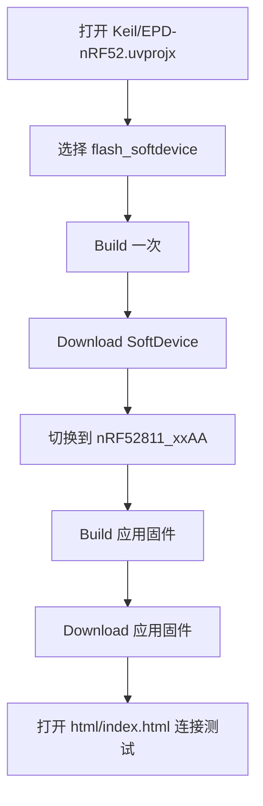
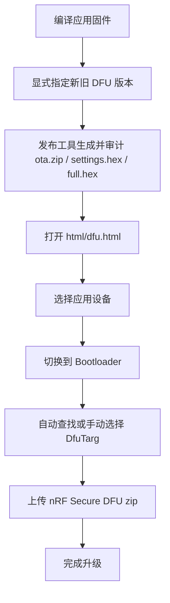

# nRF_EPD

面向 `nRF52811` 电子价签与墨水屏设备的开源项目，重点适配盒马 / 阿里系 `nRF52811` 价签，并围绕当前工程提供完整的固件、网页控制台、DFU 和调试工具链。

项目基于 [tsl0922/EPD-nRF5](https://github.com/tsl0922/EPD-nRF5) 持续扩展，当前仓库已经包含：

- MCU 固件
- Secure DFU Bootloader 工程
- Web Bluetooth 控制台
- 独立 Nordic DFU 升级页
- Windows GUI 模拟器
- Keil 编译体积分析辅助工具
- Nordic SDK 17.1.0
- 设备资料、协议说明和开发文档

## 目录

- [项目定位](#项目定位)
- [仓库结构](#仓库结构)
- [发布亮点](#发布亮点)
- [版本发布与下载](#版本发布与下载)
- [功能概览](#功能概览)
- [支持设备](#支持设备)
- [屏幕与驱动型号对照表](#屏幕与驱动型号对照表)
- [快速开始](#快速开始)
- [固件编译与刷机](#固件编译与刷机)
- [典型刷机流程图](#典型刷机流程图)
- [模拟器编译](#模拟器编译)
- [网页端使用说明](#网页端使用说明)
- [DFU 升级说明](#dfu-升级说明)
- [协议与低电量行为](#协议与低电量行为)
- [FAQ](#faq)
- [文档导航](#文档导航)

## 项目定位

这个仓库不是单一固件工程，而是一套完整的墨水屏开发工具链，覆盖了从驱动适配、界面显示、BLE 通信，到网页控制、图片传输、OTA 升级、模拟调试的整个流程。

适合以下场景：

- 盒马 / 阿里 `nRF52811` 电子价签二次开发
- 墨水屏 BLE 传图与控制
- Buttonless DFU 升级流程接入
- GUI 逻辑本地模拟与调试

## 仓库结构

```text
nRF_EPD/
├─ EPD/        墨水屏驱动、配置、BLE 服务实现
├─ GUI/        日历、时钟、字体和界面绘制逻辑
├─ html/       Web Bluetooth 控制台与独立 DFU 页面
├─ Keil/       应用固件工程、DFU Bootloader 工程、分析输出
├─ SDK/        Nordic nRF5 SDK 17.1.0
├─ tools/      OTA 打包、SoftDevice 中转、密钥与工具
├─ docs/       设备资料、开发说明、协议说明、数据手册
├─ main.c      固件入口
├─ keil5_disp_size_bar.exe  Keil 编译后显示 Flash/RAM 占用的辅助工具
├─ Makefile.nRF52
├─ Makefile.win32
└─ emulator.c  Windows 模拟器入口
```

## 发布亮点

如果你是第一次看到这个仓库，可以把它理解成一套围绕电子价签开发的“发布可用工具箱”：

- 固件侧已经集成 BLE 控制、图像传输、时钟/日历界面、低电量保护与 Buttonless DFU
- 网页侧已经提供主控台和独立 DFU 升级页，适合直接部署给测试或现场使用
- 工程侧同时保留了应用固件工程和独立 DFU Bootloader 工程，方便完整交付
- 调试侧提供 `emulator.exe`，可以在 Windows 本地快速预览 GUI 效果
- 构建侧提供 `keil5_disp_size_bar.exe`，便于在 Keil 编译后快速观察程序体积占用

## 版本发布与下载

如果你是使用者而不是开发者，建议优先从 Releases 获取现成产物：

- 发布页：https://github.com/YCD12/nRF_EPD/releases
- 源码主页：https://github.com/YCD12/nRF_EPD

发布产物建议关注这几类：

- `application.hex`
  适合已经完成 SoftDevice / Bootloader 基础环境的设备，仅更新应用固件
- `ota.zip`
  适合通过 `html/dfu.html` 或 Nordic Secure DFU 工具进行无线升级
- `full.hex`
  适合产线、首刷或全量恢复场景，通常包含 SoftDevice、Bootloader、Application、settings
- `bootloader.hex`
  用于独立烧录或替换 DFU Bootloader

如果你准备自己维护发布版本，推荐在 Release 说明里明确写清：

- 适用硬件型号
- 屏幕尺寸和驱动 IC
- 是否包含 SoftDevice
- 是否包含 Bootloader
- 推荐刷机方式：直刷 / OTA / 全量恢复

一个常见的发布包组合可以是：

- `nrf_epd_app.hex`
- `nrf_epd_ota.zip`
- `nrf_epd_full.hex`
- `release-notes.md`

## 功能概览

### 1. MCU 固件

- 基于 Nordic BLE 外设模式广播，设备名为 `NRF_EPD`
- 内置 `EPD` 自定义 BLE 服务，支持控制命令、状态通知和图像传输
- 支持图片、日历、时钟、时钟+日历、待办事项+日历及全屏待办模式
- 固件 `0x3D` 支持全屏待办和独立待办字体，字号 `9/12/16/20/24/32`，可加粗、斜体及组合：网页设置触发/截止、提前显示与过期保留时间、常驻/完成状态及显示数量，触发后红框、截止后删除线，支持排队补位、缺字生成和备份；模式 `4/5` 共用事项和调度，详见 [待办工作区说明](docs/todo-calendar.md)
- 支持运行时设置屏幕驱动和引脚映射
- 支持多种电子纸控制器与不同尺寸屏幕组合
- 支持 `Buttonless DFU`，可从应用固件无按键切入 Bootloader
- 支持看门狗、RTT 日志、BLE 参数协商
- 支持电池电压采样、低电量页和临界关机保护

### 1.1 Secure DFU Bootloader 工程

- 独立工程文件：`Keil/DFU-nRF52.uvprojx`
- 基于 Nordic Secure DFU Bootloader
- 对应源码入口位于 `Bootloader/main.c`，GCC 构建入口为 `make -f Bootloader/Makefile`
- 项目验签和布局定制集中在 `Bootloader/`，`SDK/` 保持仓库版本；应用的内部 FDS/fstorage 开关由项目编译参数提供，详见 [SDK 目录恢复说明](docs/sdk-cleanup-20261009.md)
- 用于构建可与应用固件配套使用的 BLE DFU Bootloader
- 与 `tools/bootloader/bl_nrf52811_xxaa_s112_8k.hex`、网页 DFU 页面和 OTA 打包脚本相互配合

### 2. 图片传输

- 当前网页仅连接 `0x38` 及以上固件；旧固件使用对应的旧版网页
- 支持 `WRITE_BLOCK + CRC16` 分块校验传输
- 支持断点续传、丢块补发、状态查询
- 支持黑白层和彩色层分层发送
- 适合移动端和浏览器场景下更稳定地传图

### 3. Web 控制台

主页入口：`html/index.html`

连接后在主页面直接操作设备；外置 Flash 分区资源也在主页面更新。

- 蓝牙连接、重连、设备过滤、日志查看
- 屏幕驱动选择与引脚配置下发
- 日历、时钟、待办事项+日历及全屏待办模式切换
- 连接后自动读取固件版本、时间、MTU、电池电压
- 图片上传、抖动处理、旋转、镜像、翻转、裁剪
- 图片效果保留原始底图，抖动强度与对比度可反复调整；撤销、刷新恢复参数，文字、画笔与课表保持可编辑
- 旧版缓存可能仅有处理后的点阵；若调节效果不再变化，重新导入一次原图即可
- 手绘、文字工具、课表生成；独立待办工作区提供定时清单、全屏预览和字体选择
- 图片工作台不再提供重复待办入口，旧待办草稿保留，可在待办工作区手动导入
- 支持多种画布尺寸、双色 / 三色 / 四色 / 六色模式
- 六色模式目前用于预览和数组导出，当前固件不支持六色传图

### 4. 独立 DFU 升级页

升级页入口：`html/dfu.html`

- 独立于主页连接状态，避免日常控制和升级流程互相干扰
- 按 Nordic `unbonded buttonless DFU` 流程引导升级
- 支持 Nordic `nRF Secure DFU` 的 `.zip` 固件包
- 支持自动切换到 Bootloader
- 支持自动查找或手动选择 `DfuTarg`
- 支持环境自检、升级会话恢复、手动继续和会话放弃

### 5. 本地模拟器

- 可以在 Windows 下直接运行 GUI 代码
- 修改 `GUI/` 后无需每次烧录到硬件即可查看界面效果
- 适合调试字体、布局、日历与时钟绘制逻辑

### 6. Keil 构建辅助工具

- `keil5_disp_size_bar.exe` 会在 `Keil/EPD-nRF52.uvprojx` 编译完成后自动运行
- 用于辅助查看当前固件的 Flash / RAM 占用情况
- 适合在持续迭代功能时快速观察体积变化，判断是否逼近芯片资源上限

## 支持设备

当前 README 以 `nRF52811` 工程为准，当前支持定位为：

- `nrf52811`

- 盒马 / 阿里 `nRF52811`

当前建议按以下状态理解：

- 已支持：`nRF52811`
- 主线验证中：`nRF52811 + 7.5寸 UC8179 三色屏`
- 预留适配项：网页工具里保留的其他屏幕尺寸、颜色模式和驱动选项

如果后续重新扩展到其他 MCU 或历史驱动板，建议单独在文档中拆分“历史适配”章节，避免和当前主线工程混淆。

## 屏幕与驱动型号对照表

### 已支持 / 主线验证中

根据当前固件主线代码：

- 默认配置来自 `EPD_CFG_52811`
- 默认 `model_id = 0x07`
- 当前底层驱动 IC 枚举仅包含 `UC8179`
- 当前模型表仅包含 `7.5 寸黑白红三色屏（UC8179）`

因此，当前主线工程应以这组配置为准：

| 项目 | 当前主线值 |
| --- | --- |
| MCU | `nRF52811` |
| 默认模型 ID | `0x07` |
| 默认驱动 IC | `UC8179` |
| 主线屏幕规格 | `7.5 寸` |
| 主线颜色类型 | 黑白红三色 |
| 主线分辨率 | `800x480` |
| 说明 | 当前固件主线和时钟/局刷逻辑围绕该配置维护 |

建议按状态理解：

- 已支持：`nRF52811` 平台
- 主线验证中：`UC8179 / 7.5寸 / 800x480 / 三色`
- 预留适配项：网页端下拉框中保留的其他尺寸与驱动组合

### 预留适配项（网页工具内置预置）

下面这张表按当前 `html/index.html` 里的驱动选择器整理，表示网页工具内置的屏幕/驱动预置项。

注意：

- 这些选项首先是网页端的图像处理和尺寸预置入口
- 不应直接理解为“当前 nRF52811 固件主线已经完整验证这些组合”
- 如果固件侧没有对应模型/驱动实现，仅切换网页选项并不能自动获得完整支持

| 驱动值 | 屏幕规格 | 颜色 | 驱动 IC | 画布尺寸 |
| --- | --- | --- | --- | --- |
| `01` | 4.2 寸 | 黑白 | `UC8176` | `400x300` |
| `03` | 4.2 寸 | 三色 | `UC8176` | `400x300` |
| `04` | 4.2 寸 | 黑白 | `SSD1619` | `400x300` |
| `02` | 4.2 寸 | 三色 | `SSD1619` | `400x300` |
| `05` | 4.2 寸 | 四色 | `JD79668` | `400x300` |
| `06` | 7.5 寸 | 黑白 | `UC8179` | `800x480` |
| `07` | 7.5 寸 | 三色 | `UC8179` | `800x480` |
| `0c` | 7.5 寸 | 四色 | `JD79668` | `800x480` |
| `08` | 7.5 寸低分 | 黑白 | `UC8159` | `640x384` |
| `09` | 7.5 寸低分 | 三色 | `UC8159` | `640x384` |
| `0a` | 7.5 寸 HD | 黑白 | `SSD1677` | `880x528` |
| `0b` | 7.5 寸 HD | 三色 | `SSD1677` | `880x528` |

补充说明：

- 网页端画布尺寸与驱动选择会联动，建议先选驱动，再确认传图尺寸
- 同尺寸屏幕不代表驱动 IC 一定相同，接错驱动类型会导致刷新异常或显示错乱
- 当前 `nRF52811` 主线建议优先按 `UC8179 / 7.5寸 / 800x480 / 三色` 这一组合理解和使用
- 真实硬件适配除了尺寸和驱动 IC，还需要确认引脚映射、唤醒脚和 LED 配置

## 快速开始

如果你是第一次接手这个项目，推荐按下面顺序上手：

1. 先读 [docs/develop.md](docs/develop.md) 了解整体开发方式。
2. 用 Keil 打开 `Keil/EPD-nRF52.uvprojx`，先编译应用固件。
3. 如需完整 OTA 链路，再打开 `Keil/DFU-nRF52.uvprojx` 了解 Bootloader 工程。
4. 需要看界面时，用 `Makefile.win32` 编译 `emulator.exe`。
5. 需要日常控制设备时，打开 `html/index.html` 对应网页。
6. 需要升级固件时，进入 `html/dfu.html` 使用独立 DFU 页面。
7. 需要查命令和通知格式时，查看 [docs/ble-protocol.md](docs/ble-protocol.md)。

## 固件编译与刷机

当前保留原有 8 KiB 内置应用数据区域（`0x27000–0x29000`），应用区为 56 KiB（`0x19000–0x27000`）。配置、日期标注、待办及字体继续使用外置 Flash，应用已停用内部 FDS。需要更新修复后的 Bootloader 时，通过 SWD 安装配套完整 HEX；应用 OTA 仅更新应用。具体构建与升级说明见 [8 KiB 保留区说明](docs/internal-flash-8k-20261008.md)。

当前待办日期刷新修正、验证结果及 Bootloader 源码目录缺失问题见 [2026-10-10 代码复核](docs/current-code-review-20261010.md)。

### 方式一：Keil 编译（推荐）

推荐环境：

- `Keil 5.36` 或更低版本
- J-Link 或 DAPLink

工程文件：

- `Keil/EPD-nRF52.uvprojx`：应用固件
- `Keil/DFU-nRF52.uvprojx`：Secure DFU Bootloader

当前 nRF52 工程常用 Target：

- `nRF52811_xxAA`：应用固件
- `flash_softdevice`：安全中转并烧录 SoftDevice

Keil 工程配套说明：

- `build.bat` 默认编译应用并生成完整 HEX；正式发布 OTA 前必须显式指定新旧 DFU 版本，避免开发构建重复产生同版本升级包
- 同时会自动调用 `keil5_disp_size_bar.exe`，辅助查看当前构建结果的 Flash / RAM 占用
- `Keil/DFU-nRF52.uvprojx` 用于单独编译 BLE Secure DFU Bootloader，适合需要完整升级链路的场景

推荐刷机流程：

1. 全片擦除目标板。
2. 在 Keil 中切换到 `flash_softdevice`。
3. 先执行一次 `Build`。
4. 再执行 `Download`，刷入 `s112_nrf52_7.3.0` SoftDevice。
5. 切回 `nRF52811_xxAA`，编译并下载应用固件。

注意事项：

- 当前仓库的安全流程会把 SoftDevice 中转到 `Keil/_build_softdevice_nRF52/`，避免误删 SDK 原始文件。
- 如果 `flash_softdevice` 构建时报缺少 `s112_nrf52_7.3.0_softdevice.hex`，请检查 `SDK/17.1.0_ddde560/components/softdevice/s112/hex/`。
- 这部分背景可参考 [docs/flash_softdevice_safe_refactor_summary.md](docs/flash_softdevice_safe_refactor_summary.md)。

### 方式二：命令行 GCC 编译

入口文件：`Makefile.nRF52`

适合已经具备 Nordic GCC 环境的开发者。需要准备：

- `make`
- `arm-none-eabi-gcc` 工具链
- `nrfjprog`（如需命令行刷机）

常用命令：

```bash
make -f Makefile.nRF52
make -f Makefile.nRF52 flash
make -f Makefile.nRF52 flash_softdevice
make -f Makefile.nRF52 erase
```

Windows 下 `build.bat build` 会先清理，再执行完整测试和编译；日常开发可用
`build.bat incremental` 保留已有目标文件，只重编译发生变化的文件。两者默认都按
单任务编译；如需调整并行数，请设置 `BUILD_JOBS`。批处理会在最后指定并行数，
因此命令行上的 `-jN` 不改变它（例如 `build.bat build -j8` 仍按单任务编译）。
如果清理 `_build` 失败，`build.bat` 会立即报错，避免继续运行测试后才在编译阶段失败。

说明：

- 默认编译目标是 `nrf52811_xxaa`
- `flash` 会烧录应用固件
- `flash_softdevice` 会烧录 `s112_nrf52_7.3.0` SoftDevice
- `erase` 会执行全片擦除
- 如果你主要使用 Keil，仍然建议优先走 `flash_softdevice` 的安全中转流程

### 方式三：生成 DFU/OTA 包

工具脚本：`tools/dfu_release.py`，或其封装 `tools/make-ota-nrf52.bat`

发布时必须指定单调递增的 Nordic DFU 版本。例如当前 P4 发布包从 `0x19` 升到 `0x1A`：

```bat
set DFU_APPLICATION_VERSION=0x1A
set DFU_PREVIOUS_APPLICATION_VERSION=0x19
build.bat ota
```

脚本能力：

- 生成 Nordic Secure DFU 使用的 `.zip`
- 生成 settings hex
- 合并 SoftDevice、Bootloader、Application 为完整 hex

相关资源：

- 私钥：`tools/priv.pem`
- 当前 8 KiB 保留区 Bootloader：`tools/bootloader/bl_nrf52811_xxaa_s112_8k.hex`
- `nrfutil`、`mergehex`：`tools/bin/`

`build.bat` 的默认动作会生成完整 HEX；需要 OTA 包时显式运行 `build.bat ota`。直接在 `Keil/EPD-nRF52.uvprojx` 中编译时只生成应用 HEX，需要再运行上述脚本。

Windows 下直接执行 `build.bat`（或 `build.bat build`）会在应用编译和测试通过后，生成
`_build/nrf52811_xxaa-settings.hex` 与 `_build/nrf52811_xxaa-full.hex`。完整 HEX
包含 SoftDevice、配套 8 KiB 保留区 Bootloader、Application 和两页 settings，可用于 SWD 全量烧录，
并直接支持外置 Flash 分区读取和资源更新。
该开发构建只使用 CRC 启动校验，也不生成 OTA ZIP；需要签名 OTA 时使用 `build.bat ota`。
两个构建流程均检查编译后 Bootloader 的布局描述符和 UICR 地址，拒绝缺少正确标识或布局不匹配的镜像；正式发布还核对签名公钥，开发构建不检查签名密钥。settings 的应用版本默认
为 `0x1C`，可在构建前通过 `set BUILD_APPLICATION_VERSION=0x1D` 覆盖。

### 方式四：生成全部外置 Flash 资源包

在项目根目录执行以下命令，生成分区表、日历、UI、字体、默认 EPD 配置、空用户标注及空待办包：

```bat
build-external-resources.bat
```

可指定资源 revision、输出目录和从旧设备导出的 `EPD-MIG1` 迁移备份：

```bat
build-external-resources.bat 2 output\resources-r2 epd-migration.json
```

第 4 个参数可传入年度日历 JSON，用于更新放假调休表，或同时扩展农历、春节和节气计算年份。没有迁移文件时，第 3 个参数传空字符串：

```bat
build-external-resources.bat 3 output\resources-r3 "" calendar-2027.json
```

脚本只生成并校验 `.ers` 文件，不会写入设备。上传顺序和迁移说明见 [外置资源生成说明](docs/external-resources-p4-20260916.md)。

网页主控制台的“设备资源”区域也可直接执行资源生成与发送流程，复用当前蓝牙连接。进入该功能时，JS 从默认源数据和网页内的基础字模生成并自动载入 7 个 ERS 包；生成过程无需 Python、批处理、本地后端或预生成资源工程。
可修改日历、布局或字模，导入日历 JSON、EPD-MIG1 迁移备份，点击“重新生成并载入”，然后“发送资源到设备”。发送前会自动生成尚未应用的修改并校验；校验或生成失败时停止发送，保留当前工程。“下载全部资源 ZIP”可保存全部文件及日历、布局源数据。仍支持选择批处理生成的资源目录，并兼容不含待办的旧版 6 包目录。使用说明见[浏览器生成设备资源](docs/browser-resource-generation.md)。网页会校验资源并按分区表、日历、UI、字体、配置、标注、待办的顺序连续写入；内容与版本均相同的模块可跳过。
连接设备时会先读取并校验实际分区表。仅当设备报告分区表未安装或未提交时按空白 Flash 初始化；已有有效分区表时保留现有分区表、设备配置、日期标注及待办，只更新日历、UI 和字体资源。
格式错误、CRC 错误或不兼容的分区表不会被当成空白 Flash。单包更新、完整 Flash / 单分区 BIN 备份和 ERS 校验导出收在“高级操作”中。
更新状态区与保留区禁止上传。
当前业务固件直接支持查看、导出和更新分区资源；新版分区固件停用旧版 BIN 字库入口，字体改用 `fonts.ers`。
完整工程 v2 会保留导入的 TTF/OTF、字体设置及尚未生成的源文本，无需先生成成功即可导出备份；资源 ZIP 也包含完整工程。草稿恢复失败时暂停自动保存并保留原草稿，可重试恢复或导出后清除。小字和中字可分别预览最终点阵。

“检查字体并预览点阵”会集中列出缺字及尺寸超限字符。草稿按最新保存序号恢复，并显示待保存/保存中状态。发送前保留旧资源备份，失败后可下载恢复 ZIP，或连接同一设备重试未完成的模块；备份与重试计划仅保留在当前网页，关闭前请保存到本地。
BIN 为原始备份，不能直接作为 ERS 上传；列表的包头校验不代表载荷 CRC 已校验。

“编辑并生成设备资源”支持使用默认数据或导入完整资源工程，在浏览器内修改日历、节日/休班表、文字和 19 个固定 UI 组件。“字体与补字”支持系统字体、拖入 TTF/OTF、额外文字/TXT、仅补字或重绘所选槽位，以及最终二进制字模的点阵和容量预览；高级设置支持兼容的 u8g2 `.bin`。新增文字与已有标注、待办的缺字会一起检查，生成支持进度与取消。编辑内容及导入字体自动保存草稿，刷新后恢复。也可下载单个 ERS、完整 ZIP 或 JSON 工程。JSON 仅用于网页编辑，设备只读取二进制资源。默认年份为 2025–2027；扩展年份须提供相应计算表。替代 Python 生成流程的模块位于 `html/js/ui_tools/`，基础字模位于 `html/resources/fonts/`；只需托管 `html` 目录即可使用。

保存日期标注时，网页会检查设备实际字库，为缺字生成对应字模并写入外置 Flash，字体应用成功后继续保存标注。该能力提供通用的字模生成和设备安装接口；当前支持 Unicode BMP，标注标签仍最多 9 个 UTF-8 字节。使用与接口说明见[网页按需补充外置字库](docs/web-font-generation.md)。待办的字体和事项在同一资源会话内提交，最后一次性应用，避免中途刷新。新保存统一使用 TODO v4，兼容回读 v1/v2/v3；自定义字体、更大字号、加粗和斜体使用 `FPK1` 可选第四槽，不替换日历及时钟基础字体。时间及字形格式见[待办说明](docs/todo-calendar.md)。

固件 `0x35` 起，写入完成后直接校验并应用资源，保留设备时间。网页切换日历、分屏时钟、全屏时钟后，设备保持蓝牙连接也会刷新；资源维护会话、传图及屏幕初始化期间保留显示互斥。资源更新页面可选择完成后自动断连，也可单独点击“应用并断开连接”，断连不是刷新的前提。断开后设备继续运行，蓝牙按原策略间歇广播。广播间隔、超时和唤醒配置沿用原逻辑，资源应用不关闭蓝牙广播。单张图片继续直传屏幕 RAM；这里没有加入图片轮播存储。

应用固件刷新后，日历和时钟模式会请求一次屏幕更新，即使外置资源未全部安装也不会丢弃请求。已有有效 UI 布局时尽量显示当前模式；缺少 UI 布局时屏幕显示 `NO DATA`，提示通过网页安装外置资源包。仅刷新 MCU 固件不会写入外置 Flash 中的日历、UI 和字体数据。单张图片只直传屏幕 RAM，固件重启后没有图片数据可重绘，因此图片模式保留电子纸原有画面，需重新传图才会更新。

本轮实现和实测占用见[资源生命周期与内存优化记录](docs/project-optimization-20260928.md)。

## 典型刷机流程图

### 1. 本地编译并直刷设备



### 2. 生成 OTA 包并网页升级



## 模拟器编译

模拟器入口：`emulator.c`

Windows 下可以通过 `Makefile.win32` 直接编译：

1. 安装 [MSYS2](https://www.msys2.org)
2. 打开 `MSYS2 MINGW64`
3. 安装依赖

```bash
pacman -Syu
pacman -S make mingw-w64-x86_64-gcc
```

4. 在项目目录执行

```bash
make -f Makefile.win32
```

生成产物：

- `emulator.exe`

说明：

- 修改 `GUI/` 下代码后重新执行上述命令即可
- `GUI/` 目录尽量不要直接依赖 MCU 平台 API，否则模拟器无法编译
- 模拟器当前主要用于预览 `400x300` 电子纸界面
- 默认可查看日历模式与时钟模式
- 键盘交互包括：`空格` 切换模式、`R` 切换颜色模式、`W` 切换周起始日、方向键调整日期/月视图
- 它更适合验证 GUI 逻辑与显示效果，不等价于完整 MCU/BLE 行为模拟

## 网页端使用说明

### 主页面

入口：`html/index.html`

主页负责：

- 连接设备并打开通知
- 下发驱动与引脚配置
- 执行时钟 / 日历模式控制
- 查看电池电压与低电量提示
- 图片处理后通过 BLE 发送到设备

### 运行建议

网页端使用 Web Bluetooth，建议通过安全上下文访问页面：

- `https://`
- `http://localhost`

项目已经内置环境检查与兼容提示。实际升级流程建议从主页跳转到独立 DFU 页，不再在主页内部直接做 DFU。

## DFU 升级说明

入口：`html/dfu.html`

当前流程要点：

1. 选择 `nRF Secure DFU` 固件包 `.zip`
2. 选择应用设备
3. 发送 Buttonless 命令切换到 Bootloader
4. 自动查找或手动选择 `DfuTarg`
5. 完成升级

页面还支持：

- 环境自检
- 手动选择 `DfuTarg` 时显示全部蓝牙设备，并在选择后尽量校验，正式连接时再次确认是否为 DFU Bootloader
- 多镜像升级过程中的手动继续
- 可恢复会话保护
- 放弃当前会话
- 从手动 `DfuTarg` 模式恢复到默认流程

## 协议与低电量行为

BLE 协议详情见 [docs/ble-protocol.md](docs/ble-protocol.md)。

当前值得关注的几点：

- `EPD_CMD_INIT (0x01)`：初始化驱动，并上报 `mtu`、时间、电压
- `EPD_CMD_SET_TIME (0x20)`：设置时间并立即刷新
- `EPD_CMD_SET_WEEK_START (0x21)`：设置周起始日
- `EPD_CMD_SET_MODE (0x22)`：切换图片 / 日历 / 时钟 / 时钟+日历 / 待办事项+日历 / 全屏待办模式（`0–5`）
- `EPD_CMD_SYNC_TIME_SILENT (0x23)`：静默校时，不立即刷新，仅固件 `>= 0x21` 支持
- `EPD_CMD_REFRESH (0x03)` / `EPD_CMD_SLEEP (0x04)`：刷新与休眠
- `EPD_CMD_WRITE_BLOCK (0x30)`：带 CRC16 的分块传图
- `EPD_CMD_QUERY_STATUS (0x31)` / `EPD_CMD_RESET_TRANSFER (0x32)`：断点续传相关命令
- `EPD_CMD_GET_CONFIG (0x93)`：固件 `>= 0x34` 的迁移配置确认回读

低电量行为：

- `<= 2800mV`：进入低电量页面，停止正常自动刷新
- `< 2700mV`：显示 `power off` 后进入 `SYSOFF`
- 低电量页激活后每 `10` 秒轮询一次电压

## FAQ

### 1. 我只是想刷固件，不想自己编译，需要先刷 SoftDevice 吗？

如果你使用的是已经打包好的完整发布固件，通常不需要手动单独处理 SoftDevice。  
如果你是基于当前仓库自己编译应用固件，再按本文档流程刷机，建议先刷一次 `s112_nrf52_7.3.0` SoftDevice。

### 2. `EPD-nRF52.uvprojx` 和 `DFU-nRF52.uvprojx` 分别是干什么的？

- `Keil/EPD-nRF52.uvprojx`：应用固件工程，负责屏幕驱动、BLE 服务、图片传输、界面模式等主功能
- `Keil/DFU-nRF52.uvprojx`：Secure DFU Bootloader 工程，负责 OTA 升级链路

### 2.1 当前哪些内容是“已经支持”，哪些是“后续预留”？

- 已支持：`nRF52811` 主线工程、应用固件、DFU Bootloader、网页控制台、独立 DFU 页
- 主线验证中：`UC8179 / 7.5寸 / 800x480 / 三色` 这一组当前默认配置
- 预留适配项：网页工具里仍保留的其他屏幕尺寸、驱动和颜色模式，后续可逐步接入固件主线

### 3. `keil5_disp_size_bar.exe` 是必须的吗？

不是必须。它主要用于在 Keil 编译完成后辅助查看 Flash / RAM 占用，方便你判断资源余量。  
即使不关注体积分析，也不影响固件本身功能。

### 4. `emulator.exe` 能替代真机调试吗？

不能完全替代。它更适合验证 `GUI/` 里的界面绘制逻辑、字体布局和日历/时钟显示效果。  
BLE 连接、真实墨水屏刷新、电源与低电量行为，仍然需要在真机上验证。

### 5. 网页端为什么建议分成主页和独立 DFU 页？

因为日常控制连接和升级连接属于两条不同流程。  
当前仓库把 DFU 拆到 `html/dfu.html`，可以避免主页的 BLE 连接状态影响升级稳定性。

### 6. Web 页面为什么要用 `https://` 或 `localhost` 打开？

因为 Web Bluetooth 依赖安全上下文。  
如果不是 `https://` 或 `http://localhost`，浏览器通常不会允许页面访问蓝牙设备。

### 7. 传图不稳定时先看什么？

建议先检查这几项：

- 浏览器是否支持 Web Bluetooth
- 当前访问环境是否为安全上下文
- MTU、确认间隔设置是否过激
- 设备是否低电量
- 是否已经切换到了正确的屏幕驱动和画布尺寸

## 文档导航

- 开发说明：[docs/develop.md](docs/develop.md)
- BLE 协议：[docs/ble-protocol.md](docs/ble-protocol.md)
- 网页按需补充外置字库：[docs/web-font-generation.md](docs/web-font-generation.md)
- Flash 与网页优化实现及验证：[docs/flash-web-optimization-20261001.md](docs/flash-web-optimization-20261001.md)
- 当前内置 8 KiB 保留区及配套固件：[docs/internal-flash-8k-20261008.md](docs/internal-flash-8k-20261008.md)
- 当前待办、字库和 Flash 修改复核：[docs/current-changes-review-8k-20261009.md](docs/current-changes-review-8k-20261009.md)
- SDK 目录恢复及项目定制迁移：[docs/sdk-cleanup-20261009.md](docs/sdk-cleanup-20261009.md)
- SoftDevice 安全刷写说明：[docs/flash_softdevice_safe_refactor_summary.md](docs/flash_softdevice_safe_refactor_summary.md)
- 应用工程：`Keil/EPD-nRF52.uvprojx`
- Bootloader 工程：`Keil/DFU-nRF52.uvprojx`
- 数据手册：`docs/datasheets/`
- OTP/LUT 参考：`docs/OTP/`

## 版本说明

- `V0.0.1`：同步上游 `tsl0922/EPD-nRF5`，作为当前项目演进基础
