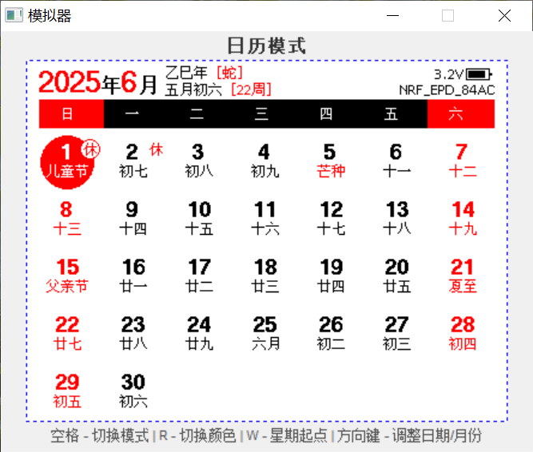

## 开发

> **当前主线范围说明:**
> - 本文档以当前 `nRF52811` 主线工程为准
> - 当前主线默认验证重点为 `UC8179 / 7.5寸 / 800x480 / 三色`
> - 其他屏幕尺寸、驱动或颜色模式可作为后续适配项保留，但不应默认理解为都已在当前主线完整验证
> - 代码分层、`EPD/` 目录职责与新增屏幕步骤见 [EPD 分层架构、模块划分与屏幕扩展指南](epd-architecture-20261104.md)

> **注意:**
> - 推荐使用 Keil 5.36 及以上，并安装 **ARM Compiler 6.11**（MDK 5.38 默认包含；
>   当前应用 Target 使用 AC6 6.11 + LTO，ARMCC5 已无法把完整功能压进 56 KiB 应用区）
> - `sdk10` 分支为旧版 SDK 代码，蓝牙协议栈占用的空间小一些，用于支持 128K Flash 芯片（不再更新）

Keil 工程拆分为两个独立的单 Target 工程（请勿再合并回同一个 `.uvprojx`）：

- `Keil/EPD-nRF52.uvprojx`：应用固件，单 Target `nRF52811_xxAA`，
  使用 **ARM Compiler 6.11 + LTO**。双击打开后直接 Build/Rebuild 即可。
- `Keil/flash_softdevice.uvprojx`（可选）：SoftDevice 中转/烧录，单 Target
  `flash_softdevice`，仍使用 ARM Compiler 5；只链接一个占位镜像，Build 后由
  After Make 脚本把官方 HEX 复制到 `Keil/_build_softdevice_nRF52/`。没有该工程时
  可用 `build.bat flash_softdevice` 刷写。

> **为什么拆开？** 两个 Target 放在同一个工程时，旧 uVision 会话保存工程会把
> 两个 Target 的文件列表合并回写；应用 Target 因此重复编译
> `nrf_sdh*/startup`（L6235E、`_1.o`）并误把 `app_error_handler_keil.c` 交给
> ARM Compiler 6。拆分后应用工程只有一个 Target，不会再发生这种合并。

应用 Target 的配套文件（请勿删除/重命名）：

- `Keil/EPD-nRF52-ac6.sct`：显式放置 BLE/SDH observer section 的 scatter 文件。
  因为 armclang 会定义 `__GNUC__`，SDK 使用 GNU section-set 迭代；该 scatter 把
  `sdh_*_observers` / `pwr_mgmt_data` 放到自动尺寸的独立区域。
- `Keil/ac6_gnu_symbols.c`：把 SDK 需要的 `__start_*`/`__stop_*`/`__isr_vector`/
  `__data_start__` 别名到链接器 `Image$$<region>$$Base/Limit`，确保迭代边界精确。
- 如果增删 `NRF_SDH_*_OBSERVER`、`NRF_PWR_MGMT_HANDLER_REGISTER` 注册，需重新构建
  并检查 `Keil/Listings/EPD-nRF52.map` 中 observer section 的起止地址是否仍匹配。

当前应用 Target 实测：Code 52,704 B、RO-data 1,400 B、RW-data 112 B（Flash 合计
54,216 B），0 errors / 0 warnings。

应用工程 Build/Rebuild 成功后会通过 After Make 自动运行
`tools/keil-postbuild.bat`，生成与 `build.bat` 相同的发布产物：

- `_build/nrf52811_xxaa-v<版本>-full.hex`（SoftDevice + Bootloader + App + Settings）
- `_build/nrf52811_xxaa-v<版本>-ota.zip`（Nordic Secure DFU 包）
- `_build/nrf52811_xxaa-v<版本>-settings.hex`、`_build/nrf52811_xxaa-v<版本>-release.json`

`<版本>` 来自固件 `APP_VERSION`（当前 `0x21`），也可用 `DFU_APPLICATION_VERSION` 覆盖。

脚本使用仓库自带的 `tools/windows_tools/nrfutil.exe`、`mergehex.exe`，并要求
系统 `PATH` 中有 Python；不需要再单独执行 `build.bat ota`。

> **常见故障：Keil 工程被旧会话合并回写。** 如果 Build 输出出现
> `object file renamed ... _1.o`，或看到 `app_error_handler_keil.c` 被
> ARM Compiler 6 编译，说明打开的是旧的两 Target 工程，或旧 uVision 会话把
> 合并结构写回了 `EPD-nRF52.uvprojx`。处理：彻底关闭 Keil（提示保存工程时选
> “否”），重新生成/恢复单 Target 工程文件后再打开。恢复后可运行
> `python tests/test_build_config_parity.py`，输出 `OK` 表示 Groups/FilePath
> 结构正常。

烧录器可以使用 J-Link 或者 DAPLink（可使用 [RTTView](https://github.com/XIVN1987/RTTView) 查看 RTT 日志）。

**刷机流程:**

> **注意:** 这是自己编译代码的刷机流程。如不改代码，强烈建议到 [Releases](https://github.com/tsl0922/EPD-nRF5/releases) 下载编译好的固件，**不需要单独下载蓝牙协议栈**，且有 [刷机教程](https://b23.tv/AaphIZp) （没有 Keil 开发经验的，请不要给自己找麻烦去编译）

1. 全部擦除（Keil 擦除后刷不了的话，使用烧录器的上位机软件擦除试试）
2. 用 Keil 打开 `Keil/flash_softdevice.uvprojx`，执行一次 `Build`
3. 该工程会把 SDK 中的官方 `s112_nrf52_7.3.0_softdevice.hex` 复制到
   `Keil/_build_softdevice_nRF52/`（不会再直接把 SDK 目录当成输出目录）
4. 对该工程执行 `Download`，刷入蓝牙协议栈（只需一次）
5. 关闭该工程，打开 `Keil/EPD-nRF52.uvprojx`，Build 并下载应用固件

> **注意:**
> - 不要再把 Keil 的输出目录指向 SDK 的 `softdevice` 目录。`Clean Target` 会删除 target 输出文件，这样会误删 SDK 原始 SoftDevice 文件。
> - 如果 SoftDevice 中转失败，请先把官方 `s112_nrf52_7.3.0_softdevice.hex` 恢复到
>   `SDK/17.1.0_ddde560/components/softdevice/s112/hex/`。

### 晶振配置

本项目默认都没有使用外部低速晶振 (频率: `32.768kHz`)，因为不是所有的板子都有这个晶振，没有低速晶振的板子刷了开启低速晶振的固件是运行不起来的。
如果你的板子有外部低速晶振，建议修改为使用外部晶振，这样时钟走时会更准确一些。以下是修改方法：

**nRF51**

修改 `main.c`:

```c
#define NRF_CLOCK_LFCLKSRC      {.source        = NRF_CLOCK_LF_SRC_XTAL,             \
                                 .rc_ctiv       = 0,                                 \
                                 .rc_temp_ctiv  = 0,                                 \
                                 .xtal_accuracy = NRF_CLOCK_LF_XTAL_ACCURACY_20_PPM}
```
**nRF52**

修改 `sdk_config.h`:

```c
#define NRF_SDH_CLOCK_LF_SRC 1
#define NRF_SDH_CLOCK_LF_RC_CTIV 0
#define NRF_SDH_CLOCK_LF_RC_TEMP_CTIV 0
#define NRF_SDH_CLOCK_LF_ACCURACY 7
```

### 模拟器

本项目提供了一个可在 Windows 下运行界面代码的模拟器，修改了界面代码后无需下载到单片机即可查看效果。

仿真效果图：




**编译方法：**

下载并安装 [MSYS2](https://www.msys2.org) 后，打开 `MSYS2 MINGW64` 命令窗口执行以下命令安装依赖：

```bash
pacman -Syu
pacman -S make mingw-w64-x86_64-gcc
```

然后 cd 到项目目录，执行 `make -f Makefile.win32` 即可编译出模拟器的可执行文件。

模拟器按 `800x480` 黑白红（BWR）面板渲染，使用内置字库，并复用
`tests/stubs/` 下的 host 资源桩来提供默认 UI 布局与日历数据，因此不需要连接
MCU 或外置 Flash；真机替换外置资源后，界面以真机显示为准。

**修改界面：**

修改 GUI 目录下的代码后，重新执行上面的 make 命令编译即可。

> **注意:** GUI 目录下的代码不可依赖平台相关的东西，比如单片机特有的 API 接口，否则在 Windows 下编译会失败。正确的做法是：在调用 `DrawGUI` 函数前就把数据算好并放到 `gui_data_t` 里，然后通过 `data` 参数传进去。
