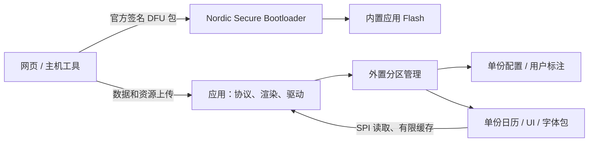

# 外置数据迁移计划：单份资源 + 官方 Secure DFU

状态：P0 规格定版、P1 存储底座已实现，进度见 [P1 实施记录](external-resources-p1-20260916.md)。按用户最新要求：**固件使用官方 Nordic Secure DFU；外置不存固件；所有外置数据采用单份存储，不设主备副本；现有 8 KiB 内部 FDS 地址范围暂不调整。**

| 阶段 | 状态 | 对应产物 |
| --- | --- | --- |
| P0 | 已完成规格定版；设备实物盘点仍待执行 | [候选数据盘点](external-data-candidates-20260916.md)、[分区布局](external-flash-layout-v1.draft.json) |
| P1 | 已实现并通过主机测试 | [P1 存储底座实施记录](external-resources-p1-20260916.md) |
| P2 | 已完成 | [P2 字体与日历](external-resources-p2-20260916.md) |
| P3 | 已完成 | [P3 UI 布局](external-resources-p3-20260916.md) |
| P4 | 已完成 | [P4 配置与标注](external-resources-p4-20260916.md) |
| P5 | 发布工具已实现；等待 Keil Bootloader 产物完成最终签名联调 | [P5 DFU 发布闸门](external-resources-p5-20260916.md) |

## 1. 总体架构

外置保存八类数据：EPD 配置、用户日历标注、节日、放假/调休、农历等文字、年份/节气计算表、各模式 UI 布局、三套字体。

内置保留协议接收与调度、校验、日期计算、布局执行、字体解码、屏幕刷新、Flash 驱动、更新状态处理、异常恢复和官方 BLE/DFU 接口。启动必要的最小默认配置、分区表定位与 BLE 修复能力也保留内置。

数据外置不等于函数外置。尤其 UI 坐标从编译期常量变为运行时参数后，解析器和通用组件可能增加代码；最终节省必须通过逐阶段 BIN 对比验证。

## 2. 外置 Flash 分区

FM25Q04B 共 512 KiB，擦除扇区 4 KiB、编程页 256 B。建议采用单份分区表，独立于用户 EPD 配置。以下地址末端不包含在区间内：

| ID | 分区 | 地址范围 | 容量 | 内容 |
| --- | --- | --- | ---: | --- |
| 1 | 分区表 | `0x00000–0x01000` | 4 KiB | 分区类型、偏移、大小、格式版本 |
| 2 | EPD 配置 | `0x01000–0x02000` | 4 KiB | 当前配置记录，载荷约 14 B |
| 3 | 用户标注 | `0x02000–0x03000` | 4 KiB | 当前标注记录，载荷最多 1,040 B |
| 4 | 资源更新状态 | `0x03000–0x04000` | 4 KiB | 当前传输目标、版本、进度、校验信息 |
| 5 | 日历资源 | `0x04000–0x08000` | 16 KiB | 节日、放假/调休、文字、农历/节气表 |
| 6 | UI 布局与图标 | `0x08000–0x18000` | 64 KiB | 模式布局、样式、图标 |
| 7 | 字体合集 | `0x18000–0x58000` | 256 KiB | 三套字体及目录 |
| 8 | 预留区 | `0x58000–0x80000` | 160 KiB | 后续新增资源/分区 |
| | **合计** | | **512 KiB** | |

机器可读文件：[external-flash-layout-v1.draft.json](external-flash-layout-v1.draft.json)。已检查总容量、连续性、4 KiB 对齐、无重叠及每类分区只有一份。

容量说明：

- 字体 256 KiB 是三套字体合集的总容量，包含目录，不是每套字体的容量。当前仓库字模共 9,534 B，设备实际安装包仍需盘点。
- 日历当前可迁常量为 1,114 B，16 KiB 用于包头、索引和后续年份扩展，最大年份范围由生成工具按真实数据检查。
- UI 64 KiB 可以容纳一定数量的小图标，或一张 48,000 B 的 800×480 单色原始图加有限布局；不能据此承诺容纳任意多图片或双色整帧。超出时使用预留区新增图片分区。
- 更新状态区只保存小型控制信息，不保存任何旧数据副本。普通配置/标注写入不需要每次都额外擦写此区。
- 新布局与现有 FST3 首末目录及字体分配范围冲突，不能直接按新表擦写旧设备。

## 3. 分区表规范

分区表位于固定 `0x00000`。表头建议包含 magic、格式版本、布局版本、generation、entry count、表长度、CRC 和最后提交标志。每项包含 ID、type、offset、size、数据格式版本和访问属性。

V1 最多 32 项，采用固定宽度、小端编码，不直接写入带编译器填充的 C 结构体。校验长度、数量、擦除对齐、重叠、越界和未知必需类型。分区表不记录每个 BLE 数据包的进度。

一份布局 JSON/YAML 生成固件头文件、Python 打包工具与网页常量；设备提供布局和容量查询，业务按 ID 查找分区。后续优先从预留区分配，移动已用区必须真实搬移数据，不能只改 offset。

分区表本身也只有一份。更新中断导致表无效时，固件进入有限恢复模式：使用内置固定定位、芯片容量和允许的恢复命令，重新写入受支持的表；不信任坏表中的地址，也不自动格式化数据区。保留这些最小恢复常量不等于在外置保存第二张表。

官方 Bootloader 不解析此表，资源故障不影响进入官方 DFU。

## 4. 单份数据的更新规则

### 正常更新

1. 按 partition/resource ID 检查目标、长度、格式和依赖，禁止任意地址写入。
2. **先使目标记录/包无效，再修改任何载荷。** 无效状态必须确认写入成功后才开始后续擦除，防止旧有效头指向半新半旧内容。
3. 分扇区擦除、分页写入；BLE 接收采用队列背压，写入在主循环进行并喂狗。
4. 回读检查包头、长度、CRC、结构及依赖；全部通过后最后写有效提交标志。
5. 重新加载该资源；若影响字体/布局，清除旧局刷状态并先全刷。

校验涵盖头字段和载荷，不能只有一个可误判的 valid 字节。擦除态、未提交状态、CRC 错误均不得参与渲染或配置加载。

### 中断后的行为

原地更新不保证旧数据保留，也不保证新数据完整。重新启动时，无效资源停用并允许重传；进度记录完整且与 Flash 内容匹配时可续传，否则从头上传。进度区本身损坏也可从头上传，不把它当作唯一恢复依据。

- 配置无效：使用内置最小默认配置并允许重新设置。
- 标注无效：按无有效标注处理，等待重新上传。
- 字体/日历/UI 无效：使用缺字占位或基本显示，保留 BLE 查询与修复入口。
- 分区表无效：进入布局修复模式，不按不可信地址读取资源。

CRC 和最后提交标志负责识别完成状态，**不提供旧数据回滚**。旧内容可能已被覆盖，这是单份方案的约定。

单份配置/标注也不保留历史日志副本。保存请求可合并，只在内容变化且明确保存时写入，避免每次 UI 操作都擦扇区；具体寿命预算依据芯片规格和实际保存频率确认。未完成持久化不能向主机声称保存成功。

多个包更新不保证原子切换。字体、UI、日历必须有资源 ABI/版本依赖，混合版本不兼容时暂停受影响页面并等待剩余资源上传，不强行继续使用。普通资源更新不改分区表。

## 5. 八类数据迁移映射

| 数据 | 外置表示 | 内置保留 |
| --- | --- | --- |
| EPD 配置 | 有 schema、序号、CRC 的单记录 | 引脚/模式校验、运行时配置、默认恢复参数 |
| 用户标注 | 保持现有标注业务格式，加存储记录头 | 分包接收、保存锁、查询、BLE 回读 |
| 节日日期与名称 | 日历包节日记录、字符串 ID | 日期匹配、特殊节日规则 |
| 放假/调休 | 带年份的日期记录 | 年份选择和工作日匹配 |
| 农历/星期/生肖/节气文字 | UTF-8 字符串表 | 文本排版、字形选择、缺字占位 |
| 农历年份/节气表 | 起止年份、记录宽度、压缩数组 | 日期转换、节气计算、越界处理 |
| 各模式 UI | 组件、样式、坐标/尺寸、资源 ID | 组件执行、分页/裁剪、月历排版、局刷策略 |
| 三套字体 | 合集目录 + 字模数据 | u8g2 解码、有限读取缓存、字体结构检查 |

第 3–6 类放同一个日历包，不给每张小表一个扇区。字体已外置，本次是迁入新的管理布局，不能重复计算字模节省。

`tools/dist` 的旧导出有 4 项与当前 ELF 不一致，其 EPDR 目录也不同于现用 FST3；应以确认的数据源重新生成包，不能沿用旧偏移直接烧写。

## 6. UI 布局数据化

V1 支持 TEXT、ICON、LINE/RECT、CLOCK、MONTH_GRID 等受限组件，字段包括 mode、component ID、data binding、x/y/w/h、锚点/对齐、font ID、前景/背景、可见条件枚举及允许的缩放参数。不引入任意脚本、函数地址或表达式虚拟机。

- 日历：标题、星期栏、网格边界、字体与标注样式。
- 时钟日历：左右区域、分隔线、数字区、日历区和底栏。
- 时钟：日期栏、数字区、设备/电压栏和底栏。
- 图片：保留上传显示，可配置图片框与必要提示。

三套位图字体字号固定，font ID 选择实际字库；任意 `size` 值不会自动生成新字号。新增字号需字模或另行实现缩放。七段数字可使用已有几何缩放，图标尺寸/编码必须符合渲染器能力。

当前 `GUI/clock_layout.h` 与 `EPD/epd_clock_refresh.c` 的 OLD/NEW 重建相互依赖。外置布局生成统一几何，全刷、窗口计算和旧/新条带共用；校验屏幕范围、x/w 字节对齐、最小窗口及 512 B OLD 条带处理能力。不符合局刷条件的合法布局走全刷。

布局或字体开始更新时停用受影响的绘制；更新完成后重新加载，旧局刷状态失效并先全刷。不能在一轮分页过程中一边擦字体、一边继续读旧地址。

先用外置默认布局生成与当前一致的图像，再共享组件以减少代码。运行时解析可能增加镜像，不能把整个 GUI/GFX/u8g2 的约 10 KiB 都计为可外迁数据。

## 7. 官方 DFU 与内置容量

### 保留官方升级流程

固件继续使用签名 DFU ZIP、现有 BLE DFU 协议及 Nordic Bootloader，只写内置 Flash。资源包使用应用态上传协议，写外置单份数据。

仓库 `NRF_DFU_SINGLE_BANK_APP_UPDATES=0`、`NRF_DFU_FORCE_DUAL_BANK_APP_UPDATES=0`，表示优先双 bank、空间不足时允许单 bank。这是官方支持的策略，不要求应用必须小于分区一半。[Nordic DFU 配置说明](https://docs.nordicsemi.com/r/bundle/nrf5_sdk_v17.1.1/page/group_nrf_dfu_validation_config.html)。

当前应用 52,412 B，在现有分区下不能同时保留两份同等大小固件，需验证单 bank 中断后再次进入 DFU 的恢复流程，不承诺自动回滚旧固件。实际预编译 BL 与源码配置仍需核对。保留现有签名、防降级、硬件版本、SoftDevice 兼容检查及官方 settings 管理。[Nordic Bootloader 说明](https://docs.nordicsemi.com/r/bundle/nrf5_sdk_v17.1.0/page/lib_bootloader.html?contentId=hvxEUZARafgBW_huWq8FqQ)。

资源与固件声明版本/ABI 兼容关系。普通兼容资源可独立更新；格式不兼容时，先通过官方 DFU 安装能够进入资源修复模式的新应用，再上传它需要的资源。单份方案不承诺整个过程中原 UI 始终可用。统一打包脚本与发布版本，避免旧固定版本号导致官方防降级拒绝。

### 本次固定保留 56 KiB 应用及 8 KiB FDS 区域

第一阶段应用仍使用 `[0x19000,0x27000)`，Bootloader 起点保持 `0x29000`。完成数据迁移并移除应用的 FDS 依赖后，先测实际 BIN/RAM，暂保留原内置 8 KiB 数据地址范围。资源外置不要求给 Bootloader 增加 SPI 或资源解析器。

按用户要求，本次不调整链接脚本、不修改 `NRF_DFU_APP_DATA_AREA_SIZE=8192`，也不扩大应用至 64 KiB。以后是否回收这段空间另行决定；当前所有阶段都必须满足 56 KiB 上限。

保留 20 KiB Bootloader、MBR 参数页和 settings 页。资源读取及维护接口会增加代码，必须使用实际构建结果核算余量。

## 8. 迁移与运行约束

先盘点实际 FST2/FST3 的记录位置、大小、CRC，以及内置配置/标注，并导出主机备份。新分区可能覆盖旧字模，尤其不能把草案中的预留区直接当空闲区。

过渡版本识别旧格式和新表，通过维护模式执行转换。单份方案允许采用“导出确认 → 重建布局 → 导入验证”的受控流程；期间断电可能需要重新导入，须先具备 BLE 修复路径。主机导出文件不占外置备份分区，也不等于设备能自行回滚。

若实际空闲位置允许，也可先搬移冲突资源再提交新表，但不把无损、全程掉电自恢复作为任意旧布局都能满足的承诺。切换后禁止运行会将整个旧 504 KiB 区域当字体分配区的旧固件。

迁移固件仍必须装进旧 56 KiB；包含旧读取与新写入的双路径，若超限应拆分过渡阶段，不能先扩大链接范围绕过旧 BL。新设备可直接写匹配的表和资源。

外置访问在主循环协调，BLE 中断不执行擦除。保留配置 RAM 副本、1,040 B 标注活动缓冲、1,536 B 绘图页缓冲和 512 B OLD 条带；缓存只加载当前模式/记录，新增 RAM 与栈峰值单独测量。

外置引脚固定 CS12/MISO13/SCK14/MOSI15，不能依赖待加载的外置配置才能访问芯片。配置/资源损坏时保留最小默认值、占位或基本显示和 BLE 修复能力。

## 9. 实施计划

| 阶段 | 交付 | 验收 |
| --- | --- | --- |
| P0 | 分区 ID/格式、资源 ABI、容量定版；盘点设备和实际 BL | 表容量正确，字体/图片需求适配，官方 DFU 参数和包版本正确 |
| P1 | 布局生成器、单表读写、包无效/有效提交、进度与修复 API | 对齐/边界/重叠拒绝；更新中断不会使用半包；坏表和坏资源可重传 |
| P2 | 字体与日历资源包、主机/网页上传 | 字模一致、日期/节气正确、无效资源可恢复，BIN/RAM 实测 |
| P3 | 默认 UI 包、受限组件、共享局刷几何 | 页面 golden 一致，布局/字体改变后的全刷与局刷正确 |
| P4 | 配置/标注单记录、保存确认、旧布局导出/导入迁移器 | 数据重导入正确、失败不报保存成功、迁移版 ≤56 KiB |
| P5 | 官方 DFU 与资源兼容流程 | 断连/断电可重新 DFU，坏签名/不兼容包拒绝，资源故障可 BLE 修复 |
| 暂缓 | 回收内置 8 KiB | 用户要求暂不调整，不属于本次实施范围 |

各阶段在新设备或隔离布局验证，旧设备统一通过迁移器切换。每阶段记录 BIN、静态 RAM 和必要实机结果，保留 4 KiB 余量预警，不预先承诺 UI 数据化能净省多少。

**P0/P1 的分区规范、生成工具、存储底座和 BLE 维护接口已实现并通过主机验证，详见 [实施记录](external-resources-p1-20260916.md)。** 设备盘点和实机验证仍待完成。接下来进入 P2 接入字体/日历，再依次迁移 UI、配置/标注；本次固定保留 8 KiB 内部 FDS 区域，固件升级保持官方 Secure DFU。
