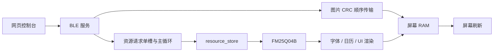

# 外置 Flash 与网页交互评审（2026-09-30）

本次分析以当前工作区为准，包含已有暂存修改；未修改固件、网页或既有测试源码。此前已经实现的通知背压处理、模式 token 确认、配置校验、资源缓存回填和 GUI 裁剪均按现状评估，不再作为待实现事项。

结论：有优化空间。资源安装首先受小包停等协议影响；Flash 写入存在大量小粒度编程和同步等待；GUI 读取主要需要减少重复查字、分页读取。网页应先补齐整项操作的互斥与完成状态，再提升吞吐量。

## 当前功能与数据路径

| 功能 | 当前实现与边界 |
| --- | --- |
| 硬件主线 | nRF52811 + UC8179，800×480 黑白红三色屏；网页仍保留其他规格选项，不代表当前固件全部支持 |
| 显示 | 图片、全屏日历、时钟与日历分屏、全屏时钟；时钟有局刷、失败回退与刷新策略 |
| 网页 | Web Bluetooth 连接、校时、配置、传图、日期标注、图片处理/手绘、资源编辑与安装 |
| 持久化 | 512 KiB FM25Q04B 存分区表、设备配置、日期标注、日历资源、UI 与字体；存在 CRC、提交标记、失败重试和缓存失效 |
| 资源生命周期 | 独占维护、安装后热重载、可选应用后断连；当前资源上传断连后重新上传 |
| 配套 | 独立 Secure DFU 页面与 Bootloader、GUI 模拟器、资源打包和主机测试 |

图片传输不经过外置 Flash。提高外置 Flash 写速不会直接提高图片传输速度。资源传输、GUI 渲染、面板 BUSY 时间应分别计时。

分区容量分别为：表/配置/标注/状态各 4 KiB，日历 16 KiB，UI 64 KiB，字体 256 KiB，预留 160 KiB。容量不能作为实际传输量；由当前 `tools/dist` 生成的日历、UI、字体 payload 分别为 **1,436 / 396 / 9,590 B**。

## 1. 资源上传：优先改进协议粒度

证据：`EPD/resource_protocol.h:6` 固定 `RESOURCE_PACKET_MAX=20`；`resource_protocol.c` 的 WRITE 占用 7 B 头部，READ 最多返回 16 B；`html/js/resource_store.js:192` 每 13 B 发起一次 request 并等待回复。`resource_installer.js:64` 还使用 GATT write-with-response。当前整体是逐包停等，没有流水线。

SDK 已配置 ATT MTU 247；若实际协商成功，特征值可用长度为 244 B，但资源协议仍只使用 20 B。网页 `mtusize` 实际记录的是特征值可用长度，应避免将 244 再误当 ATT MTU 扣除 3 B。

| 当前默认资源 | payload | 现有 13 B 数据请求数 | 保持 7 B 头、改用 237 B 后的请求数 |
| --- | ---: | ---: | ---: |
| 日历 | 1,436 B | 111 | 7 |
| UI | 396 B | 31 | 2 |
| 字体 | 9,590 B | 738 | 41 |

上表仅计算 DATA，不含查询、擦除、提交和激活。字体请求数约减少 18 倍，不能据此承诺总时间也快 18 倍。举例：假设每次端到端 DATA 往返是 30 ms，仅该部分就是 22.14 s 对 1.23 s；这是假设计算，不是实机测速。

建议分两步：

1. 增加能力协商，资源包长随设备能力和实际 ATT 数据长度变化；先保留逐包应用 ACK 和安全重试。默认 MTU 23 仍能使用旧的 20 B 请求。
2. 再评估小窗口 write-without-response、累计 ACK 和设备 credit。当前固件只有单槽，`resource_transfer_receive()` 在 pending/running/reply_pending 时不接收新请求，不能只让网页并发发送。

修改范围不仅是一个常量：固件 request/previous/reply 三个缓存、网页长度校验、READ 响应、重发比较缓冲 `resource_store_write()` 中的 `check[20]`、超时和能力声明都要联动。若三块缓存直接从 20 扩到 244 B，常驻 RAM 增加约 **672 B**；应先核对发布构建的剩余 RAM 与栈高水位，也可先选 128 B 等折中包长。

## 2. Flash 写入：合并编程、解除 API 限制

证据：`EPD/resource_store.c:230` 每个资源 DATA 都调用 `fm25q04b_write()`；后者按物理页和 251 B 上限拆分，每次都执行 WREN、WEL 检查、PAGE PROGRAM、WIP 等待。按现有切包与页边界模拟，默认字体 payload 对应 **772 次数据页编程命令**；按页合并后需要 **38 次**。这里未计 BEGIN/COMMIT 的额外写入。

`EPD/fm25q04b.c:245` 已经是 **8 MHz**，`SDK/17.1.0_ddde560/sdk_config.h:4968` 已启用 SPI1 EasyDMA。继续“打开 DMA”没有新增收益。初始化传 NULL 回调，API 仍是同步调用。

一个关键区别：251 B 不是该 MCU 的硬件极限。当前 legacy `nrf_drv_spi_transfer()` 的长度参数是 `uint8_t`，单次 255 B 减 4 B 命令/地址后剩 251 B。对齐的 256 B 页因此拆成 251+5 两次独立编程。nRF52811 的 SPIM MAXCNT 为 14 位、上限 0x3FFF；可以评估直接使用 `nrfx_spim` 完成 4+256 B 的一次事务，同时保留实例管理、CS、RAM 缓冲与错误处理。[Nordic SPIM 规格](https://docs.nordicsemi.com/r/bundle/ps_nrf52811/page/spim.html)

建议：先减少协议请求数，再引入小型页聚合缓冲并支持完整页编程。不能仅将 251 常量改为 256 而继续走旧 API，否则长度会被截断。聚合还需要定义“已接收到 RAM”和“已经写入 Flash”两个进度；当前 ACK 的数据已经过同步写入，不能悄悄改变为未落盘即确认。断连、重试、COMMIT 必须覆盖尾页与重复包。

## 3. 等待与擦除：改善响应，保持时序边界

`fm25q04b_wait_ready():403` 在 WIP 时执行 `nrf_delay_ms(1)`。它会喂狗，但持续占用主循环；这不等于屏蔽所有 BLE 中断，却会延迟其他需要主循环处理的工作。芯片手册给出的整页编程典型/最大值为 0.6/3 ms，4 KiB 擦除为 80/300 ms；小数据编程时间不能直接按整页时间估算。[FM25Q04B 数据手册，AC Characteristics](https://www.fmsh.com/nvm/FM25Q04B_ds_eng.pdf)

建议按成本递进：测量实际 WIP 分布；评估短间隔探测再退避，减少 1 ms 等待量化；必要时将擦除/编程拆成“启动、后续主循环检查完成”的状态机。异步化主要改善调度和功耗，不会消除 Flash 内部编程时间。保留 WIP 判断、超时、写使能校验和提交后回读。

当前按需擦除，只擦实际覆盖的扇区，符合默认小资源包场景。32/64 KiB 块擦除属于大包更新的后续候选，需要完整对齐且完全位于可覆盖范围内。不要因字体分区有 256 KiB 就擦完整分区。

设备配置仅 14 B，但变化时经 `persistent_record_save()` 擦写一个扇区。当前已做相同值去重与待写快照；若实测存在连续配置变化，可进一步做短时间合并写入。日志式记录/双槽能改善寿命和掉电恢复，但涉及格式迁移，优先级低于传输粒度优化。

## 4. GUI 读取：主要问题是重复读取

当前已有 251 B 字体块缓存、4 项字形定位缓存、资源元数据回填，以及分页裁剪。同一字体重复选择也会保留缓存。这些都已实现。

使用现有 `tests/test_gui_render.c`，在临时副本的字体 source 回调中增加累计字节数；生产 GUI/font 代码保持不变，默认黄金图像校验通过：

| 模式 | 颜色 | 字体 source 读取次数 | 字体数据读取字节 |
| --- | --- | ---: | ---: |
| 日历 | 黑白 | 5,911 | 1,443,659 |
| 日历 | 三色 | 11,221 | 2,740,761 |
| 时钟+日历 | 黑白 | 5,437 | 1,330,335 |
| 全屏时钟 | 黑白 | 872 | 217,064 |

这些是固定字体、时间和布局下的主机调用量，非设备耗时；日历资源在该 fixture 中有 stub，表中也没有统计其物理 SPI 读取。正式字体 source 走 `fm25q04b_read_region()`，因此上述结果明确指出了重复读取热点。

进一步仅用编译宏将字形缓存从 4 改成 8/16 项，黄金图保持一致：

| 字形缓存项数 | 日历黑白读取次数 | 日历三色读取次数 | 全屏时钟黑白读取次数 |
| --- | ---: | ---: | ---: |
| 4（当前） | 5,911 | 11,221 | 872 |
| 8 | 5,873 | 11,146 | 868 |
| 16 | 5,871 | 11,142 | 583 |

日历收益只有约 0.7%，全屏时钟则约 33%。所以应按模式评估，不宜全局扩大缓存就宣称读取问题已解决。

主要候选：

- `GUI/u8g2_font.c:551` 查字时在查找表、字符记录、字形数据间跳转，共用一个块缓存。评估索引与字形数据分离的小缓存，或资源构建时生成紧凑 codepoint→offset 索引。
- `u8g2_SetExternalFont():838` 切换实际字体会清空缓存。可评估按字体及 revision 标识的少量热点定位信息，必须保留资源更新失效。
- `GUI/GUI.c:479` 月历单元格在相交页面重复计算、查文字；在不改图像顺序的前提下，考虑每帧/行的小型派生数据复用。
- `GUI/calendar_resources.c:119/140` 对节日和假日逐条读取、线性查找；可评估批量读取小表或按月份索引，优先测次数再决定 RAM 成本。

CRC 扫描目前共用 `EPD/resource_crc_flash.c` 的 64 B 缓冲。改为 251 B 可以降低调用次数，但不减少校验的数据量，并增加约 187 B 栈缓冲。字体初始化同时做整包 CRC、各字体 CRC 与结构校验；应考虑同一读取过程中合并计算或复用已验证上下文，而非取消完整性检查。

`epd_resources_reload()` 与字体/日历/UI 初始化还会重复 mount。资源激活目前即使只改 UI 也整体失效重载。利用已有 changed mask 做选择性重载、在一次激活中复用挂载上下文，也值得评估；分区表变化必须使所有定位信息失效。

## 5. 网页交互：优先补齐操作生命周期

### 高优先级：任务互斥范围不一致

`main.js:237` 有 GATT 串行队列，并检查 Installer busy；但 Installer 直接调用 characteristic，而非共用队列。`main.js:703` 传图时禁用的按钮不包含资源安装/刷新/离线按钮；`resource_installer.js:45` 也只管理自身 running 状态。

由此可推导出可触发路径：传图过程中点击资源刷新/安装 → Installer running=true → 后续图片 WRITE 被 `write()` 拒绝 → 图片中止；资源请求同时又在设备上等待图片会话空闲，容易变成超时。普通 GATT 排序不能替代整项业务互斥。

建议统一 device operation 状态，覆盖连接初始化、图片、资源、标注、模式切换和迁移导出；所有 GATT 写入经过一个传输入口。设备维护独占、连接代次、应用 ACK 仍保留，因为它们解决不同问题。断连要取消整项任务及 waiter，并由当前连接的任务恢复按钮。

### 高优先级：图片完成判断未验证 session/total

`ble_transfer.js:145` 解析了状态中的 sessionId、total、active，但 `getMissingBlocks():289` 只检查 received；`sendImageWithResume():383` 据此判断成功。主机 JavaScript 探针直接执行现有模块，当前会话为 77、预期 204 块，注入 session=12、total=300、received=300 的状态，整个发送函数仍返回 true。

这确认了校验缺口，不代表已经在真实蓝牙链路复现了旧通知到达。建议状态回复绑定当前会话、层和预期块数；RESET 的 write 返回 false 也应立即失败。网页收到短 A0/A1 包应先按长度拒绝。协议升级时加入请求 token/层标识可进一步减少歧义。

### 中优先级：传输成功与屏幕完成缺少统一表达

INIT 和 SET_MODE 已有 token ACK，配置/标注已有落盘确认；不能再将其列为缺失。图片 REFRESH、CLEAR 等仍主要确认 GATT 写入，页面会重新启用按钮并提示“刷新完成前请不要操作”，没有统一的设备刷新完成通知。

建议呈现“发送数据 → 设备校验/保存 → 刷新中 → 完成/失败”，由完成事件或受控状态查询结束。进度条区分收包、持久化、应用和屏幕完成；不要把资源传输的 100% 直接等同所有工作完成。提供取消、可重试阶段和错误原因。

### 中优先级：重复安装与状态读取

- `installationPlan():95` 对已安装设备固定更新日历、UI、字体，不比较内容。仅调整 UI 也会重新发送字体。建议按设备已校验的 partition/length/CRC 判定是否需要更新；revision 可用于展示，不能单独判定内容相同。保留强制重写以修复损坏；只比较包头无法发现 payload 损坏。
- `resource_installer.js:89` 读取分区表和每个包头需要多次 16 B 往返。可提供紧凑设备资源目录/状态查询，连接建立后再后台加载非必要详情。当前默认 8 分区的一次完整读取约为 1 个 STATUS、10 个分区表 READ、16 个包头 READ。
- 包头读取的所有异常被 `catch` 映射为“未安装”。应区分无提交标记、CRC/版本错误、传输失败和连接变化。
- `resource_protocol_execute()` 每请求都 probe JEDEC；成功建立会话后可缓存探测结果，I/O 故障后重新探测。收益小于增大包长。

### 行为与命名需要同步

当前 `sendImageWithResume()` 每次调用先 RESET，重试也从第 0 块重发整层，并不是真正的跨断连续传。资源 client 也明确在断连后要求重新上传。应先将界面/文档写清楚；真正续传需要定义持久化进度、连接与层语义。

`BATCH_SIZE=20` 当前仅控制每 20 包使用一次 write-with-response；应用状态在整层后查询，`BATCH_DELAY_MS=150` 也只在整轮末执行。不能误判成“每 20 包停 150 ms”后再据此估算收益。

## 推荐实施顺序与验收

| 阶段 | 范围 | 验收重点 |
| --- | --- | --- |
| 1 | 统一网页任务互斥、图片 session/total 校验、错误分类 | 传图/资源/模式操作不能互相打断；旧状态不算完成；断连及时取消 |
| 2 | 跳过未变化资源、精简状态读取 | 仅改 UI 时不重传字体；损坏资源仍能强制修复；个人配置与标注保留 |
| 3 | 资源按 MTU 扩包，先保留停等 | MTU 23/247、边界包、重试、重复包、断连、CRC失败均正确；记录实际吞吐量 |
| 4 | 完整页编程、页聚合与 WIP 等待优化 | 编程次数减少；确认进度与落盘语义一致；掉电不会启用半包 |
| 5 | 字形索引/分页复用、选择性重载 | 默认和自定义 GUI 像素一致；记录读次数、字节量、栈峰值与实际刷新耗时 |
| 6 | 必要时小窗口传输、异步擦写或大块擦除 | 设备明确 credit；无 ISR 阻塞、资源互斥破坏或队列溢出；收益覆盖 RAM/BIN 成本 |

每轮记录：协商后的 ATT 数据长度与连接间隔、网页数据/提交/激活各阶段时间、Flash READ/PP/ERASE 次数及字节、WIP 等待时间、CRC/GUI 绘制/面板 BUSY 各自时间、发布 BIN/静态 RAM/栈高水位。

本次验证：`tests/run_host_tests.sh` 在临时输出目录运行，C/Python 部分完成并输出 HOST_OK；默认六组 GUI golden hash、服务生命周期、资源重载和移位布局检查通过。Node.js 不可用，脚本跳过四组网页 Node 测试；另用 JavaScript 运行时完成上述错误 session 探针。字形缓存 4/8/16 的对比全部通过既有 GUI 校验。未执行新的发布固件构建，未做实机 SPI/BLE/功耗测速。上述倍数是包数、调用数或假设时间计算，不是硬件性能承诺。
