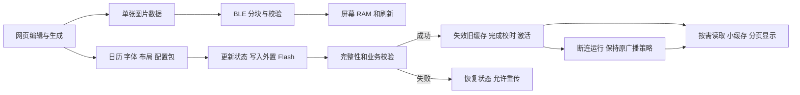

**项目功能设计与 Flash/RAM 评审（2026-09-28）**

结论：保留内置固件逻辑、外置资源数据、单张图片直传屏幕 RAM 的架构，针对更新/运行状态、资源激活和网页生成器做局部重构。当前没有必须重写屏幕驱动、字体渲染或 BLE 基础设施的容量压力。优化按发布 ELF/BIN 的实测结果判断，不能把已有迁移收益再次计入。

本报告前半部分保留实施前的评审基线。后续已按授权完成局部重构和部分体积优化，详见文末 2026-09-29 复审及[实施记录](project-optimization-20260928.md)。原始体积实验位于 `output/project-design-memory-review-20260928/`；仍未烧录设备。

2026-09-29 用户澄清：断开连接后保持原来的间歇广播策略。“离线运行”仅指不依赖网页连接，不能据此停止广播。此前新增的停广播行为已撤回，以下广播设计已按此修正。

同日进一步澄清：网页选定模式后，应保持 BLE 连接立即看到刷新。因此撤回“连接时禁止 GUI 刷新”的限制；资源维护、传图、屏幕初始化和资源就绪检查继续有效。断连运行是一项能力，不是屏幕刷新的前提。

**需求对应关系。** 单张图片的即时传输不要求外置持久化，多张轮播不属于本轮必须实现的范围。

| 需求 | 当前情况 | 建议 |
| --- | --- | --- |
| 内置 Flash 保存驱动、显示逻辑和 BLE | 已实现；资源解析和官方 DFU 接口也在内置 | 保留 |
| 外置 Flash 保存项目数据 | 配置、日期标注、日历、UI、字体均有分区 | 保留；小型固定规则、恢复常量留内置 |
| 网页更新外置数据 | 配置/标注可编辑；资源包可安装 | 补完整的生成、校验、激活链路 |
| 断开蓝牙后独立运行 | 时钟/日历能断连运行，但没有统一运行状态 | 增加更新、校验、运行、恢复状态及唤醒入口 |
| 网页生成设备数据 | 已生成图片/标注；日历/UI/字体包仍依赖 Python | 在网页实现确定格式的二进制打包，复用既有 ABI |

当前主线为 nRF52811、800×480 UC8179 黑白红屏；这里的测量针对 GCC 发布配置，不直接代表 Keil 或调试配置。

**设计上首先要补的闭环。**

1. 资源缓存需要统一失效与重新加载。`font_store_init()`、`calendar_resources_init()`、`ui_resources_init()` 都有初始化缓存；字体读取还持有外置物理区域。`resource_transfer_process()` 在断连时重置协议，但没有统一废弃所有消费者缓存。更新失败退出后存在旧索引指向已修改数据的风险。成功更新目前由网页发重启命令生效，也需要避免离开写会话与重启之间恢复旧缓存读取。
2. 写入成功需要进一步区分“内容可运行”。`resource_store_commit()` 对普通资源做载荷 CRC，对分区表额外做结构校验；普通资源的业务格式检查主要在加载时。建议在激活前校验格式、范围、必要字体、布局和资源组合，设备返回可运行结果后再断连。保留设备侧边界和完整性检查，网页预校验不能替代它们。
3. 重启丢失当前时间。网页资源安装后发送 `0x91` 重启，`main.c` 的 `m_timestamp` 初始值固定为 2025-01-01。优先在保持计时的情况下重新加载资源；若使用重启路径，必须完成重启后的校时再转离线。真正断电后的时间恢复另行定义，保存一个旧时间戳不能推算断电时长。
4. 更新会话的超时覆盖不足。目前仅在 `resource_store_active()` 非零时检查 60 秒超时；已 ENTER 但未 BEGIN、或者 COMMIT 后未 LEAVE 的会话，只要 BLE 还连着，就可能长期阻止周期刷新。超时应覆盖整个更新状态。
5. 独立运行保持原广播策略。启动默认广播，断连后自动恢复广播；未配置唤醒引脚时广播超时后会重启广播。资源应用只断开连接，不停止广播、不禁止自动重播；保留原有超时和唤醒逻辑。图片直传则完成全部图层及刷新后再退出连接。

对应代码：`EPD/resource_transfer.c:34`、`EPD/resource_transfer.c:44`、`EPD/resource_store.c:266`、`EPD/font_store.c:484`、`GUI/calendar_resources.c:26`、`GUI/ui_resources.c:116`、`html/js/resource_installer.js:156`、`main.c:119`、`main.c:501`。

保留单份外置数据的设计。原地更新中断时允许目标资源失效并重新上传；恢复状态保持 BLE 可连接，受影响页面不能继续使用旧索引。单个包的 CRC/提交标志不等于多个资源包整体原子更新；需要运行就绪检查防止混合版本进入正常显示。

**建议的职责边界。**

采用静态模块与小型状态机即可。可将 `EPD_service.c` 中的 BLE 接入、运行模式切换、资源激活、显示调度职责分开，但拆文件本身不会降低代码体积。资源恢复能力不能依赖外置字体或布局是否完整。

网页承担图片处理、资源编辑、字体子集准备、打包和预校验；设备读取版本化二进制资源，不引入 JSON/HTML 解析器、脚本引擎或通用文件系统。网页修改现有布局参数与新增显示行为是两种能力：当前 UI 是固定 19 个组件，新增行为仍需要固件支持。

**当前容量基线。**

工具链为仓库 Windows ARM GCC 9.3.1，`-Os -flto`，关闭发布日志、排除内置字体，固定面板配置，生产链接布局。独立副本重新构建得到：

| 项目 | 实测/分配 |
| --- | ---: |
| 应用 Flash | 49,188 / 57,344 B |
| 应用 Flash 剩余 | 8,156 B |
| `.data` | 212 B |
| `.bss` | 5,760 B |
| 静态 RAM 地址跨度，含 4 B 对齐 | 5,976 B |
| 栈预留 | 2,048 B |
| 堆预留 | 0 B |
| 应用 RAM 区域 | 15,656 B |
| 静态区与预留栈之间的地址空间 | 7,632 B |
| RAM 低地址协议栈等保留区域 | 8,920 B |

RAM 来自 `__data_start__=0x200022d8`、`__bss_end__=0x20003a30`、`__StackLimit=0x20005800` 和 `__StackTop=0x20006000`。未分配地址空间不是实测栈余量，也不是现有配置自动可用的堆；未测设备栈高水位。BLE 断连不会改变这些链接分配。

静态 RAM 的主要对象如下，`m_epd` 已包含命令队列，不能重复相加：

| 对象 | 字节 | 判断 |
| --- | ---: | --- |
| 分页绘图缓冲 `s_gfx_buffer` | 1,536 | 较大；缩小会增加绘图遍数 |
| 日期标注活动副本 `m_live_words` | 1,040 | 已是单个共享活动/接收缓冲，没有第二份同规模快照 |
| BLE/显示服务状态 `m_epd` | 624 | 其中两条完整命令记录共 496 B |
| 时钟 OLD 条带 `s_clock_old_window` | 512 | 与 NEW 绘图同时使用，不能简单共用同一内存 |
| 全部 UI 组件缓存 | 380 | 可研究按当前模式缓存，收益有限 |
| 日历段索引缓存 | 128 | 小而高频使用，暂不优先削减 |

**已经实测的优化候选。** 每行只启用一项改动，收益不能直接相加；组合后需要重新链接。

| 方案 | Flash/B | 静态 RAM 地址跨度/B | 相对基线收益 | 代价/边界 |
| --- | ---: | ---: | --- | --- |
| 基线 | 49,188 | 5,976 | — | 保留原功能 |
| 字体和资源共用 CRC32 实现 | 49,140 | 5,976 | Flash 48 B | 保留原 CRC 算法和校验 |
| 绘图缓冲 1,536 → 1,400 B | 49,188 | 5,840 | RAM 136 B | 三色仍为 7 行/页；单色全屏分页增加 |
| 绘图缓冲 1,536 → 1,024 B | 49,188 | 5,464 | RAM 512 B | 三色 69 → 96 页，重复绘制增加 |
| 仅支持 ERS 字体包，退出 FST2/FST3 | 48,576 | 5,960 | Flash 612 B，RAM 地址跨度 16 B | 不再读取旧格式；必须先解决存量设备迁移 |

三种缓冲配置均通过现有整帧图像 hash、时钟 OLD/NEW 字节对比和故障回退测试。三色日历样例的字体读取次数：基线和 1,400 B 都为 20,658 次；1,024 B 为 28,596 次，增加约 38.4%。这是主机模拟计数，不是实机耗时或功耗测量。1,400 B 下单色全屏从 32 页变为 35 页，不能称所有模式都无代价。

ERS-only 测试明确检查旧格式被拒绝、新格式正常读取、CRC 错误被拒绝。CRC 共用测试保留旧格式与新格式两条读取路径。兼容裁剪没有合入正式源码。

**下一步最值得做的 RAM 结构优化。**

普通控制命令不应全部按 BLE 最大包长配置缓冲。当前 `EPD_CMD_MAX_DATA_LEN` 为 244 B，队列两项各 248 B，出队还复制一项到函数栈。可将小控制命令与图片/原始数据分开，给控制队列分配 20 或 32 B 上限。

以 32 B 载荷估算，两槽记录从 496 B 降为 72 B，记录存储部分可少约 424 B，局部出队副本也更小。这个数是结构体布局估算，不是整体固件实测净收益；新增数据通道若需要缓冲，必须扣除其占用。`WRITE_IMAGE`、`SEND_DATA` 等旧命令仍可能使用长包，不能直接缩小宏而丢弃它们。优先保留两槽容量及原有 INIT/模式切换顺序，改用途而非盲目砍队列深度。

如果后续 RAM 确有压力，再将日期标注改为外置按日期读取、缓存当前可见月。接收缓冲可在互斥状态下与绘图工作区复用，但必须重做 RX 生命周期、保存完成、失败恢复和回读逻辑；这可能增加程序代码和 SPI 访问，不能把整个 1,040 B 当成无成本收益。当前界面渲染仍要访问标注，直接将现有 `m_live_words` 和绘图缓冲声明为 union 不安全。

**内置 Flash 的优化顺序。**

1. 合并重复实现，如已测量的 CRC32；保留既有 `-Os/LTO/gc-sections` 和固定面板裁剪。
2. 明确兼容边界。旧 FST2/FST3 退出可省 612 B，适合已迁移设备的新版本或新设备配置；未迁移设备保留原读取路径。旧图片协议与网页兼容性同样需要独立核对。
3. 保持固定组件及简洁资源 ABI。小型不变的几何、枚举、协议常量、恢复配置留内置；字体、用户数据和按年变化数据留外置。数据外置需要解析、索引、读取和校验代码，并不保证净省 Flash。`ui_resources_init` 当前符号约 932 B，`calendar_resources_init` 约 528 B，说明格式复杂度有实际成本。
4. 按最终 ELF 查看热点再做 A/B。当前 `main` 5,748 B、`epd_gui_update` 4,892 B、`DrawMonthGrid` 2,640 B、`epd_execute_command` 2,104 B；它们含 LTO 内联，不能当成可直接删除的模块成本。仅农历转换函数为 336 B，单为省它而引入逐日大表通常不是优先项；更广泛的网页预计算要比较整个链路的净收益。
5. 需要额外应用容量时，再评估回收内置保留区。配置和标注已外置，当前应用 ELF 未见 FDS/fstorage 函数，但 `[0x27000,0x29000)` 仍保留 8 KiB。回收后理论应用上限可从 56 KiB 增至 64 KiB；这是扩大可用分区，不是减少程序体积。需同步实际 Bootloader 的 `NRF_DFU_APP_DATA_AREA_SIZE`、链接配置、DFU 发布校验、旧数据迁移和回退约束；本轮不改既定布局。

**不建议作为当前首选的做法。**

- 为单张图片增加外置中转，会引入擦写和重读，也偏离即时显示需求。
- 为降低 RAM 把 ATT MTU 从 247 降到 23。会影响直传效率，现有每层最多 512 块约束下，小载荷还可能无法传完整图层。协议栈参数调整必须实测 RAM 要求和链路行为。
- 通过断连直接复用 SoftDevice 预留地址。当前链接和协议栈生命周期并不支持这种推断。
- 未测栈峰值就减少 2 KiB 栈；字体缓存和 SPI 局部缓冲也使用栈。
- 直接合并时钟 OLD 与 NEW 工作区；算法同时需要两份不同内容。
- 去掉 CRC、长度校验、提交顺序或故障恢复来换体积。
- 再次把“字体外置、FDS 移除、关闭日志”等已实施收益计入预算。

资源上传协议目前每包最多 20 B、有效数据只有 13 B，可研究复用既有较大 MTU，但这是速度与 RAM 的另一个权衡。`resource_transfer` 目前保留 request/previous/reply 三个包；直接全部扩为 244 B 会让数组从 60 B 增至 732 B，新增 672 B。设计时宜只扩大必要的数据接收区，ACK 维持小包，重复请求处理也不必无条件保留第二份完整大包。

**建议实施顺序和验收。**

先完成资源更新/校验/激活/离线/恢复状态，保留时间并统一使字体、日历和布局缓存失效；随后补网页生成器；再独立实施 CRC 去重、小控制队列与条件性的旧格式裁剪。1,400 B 绘图缓冲可作为固定三色产品的候选；1,024 B 当前不优先。

每项优化要求同配置重新链接，分别记录 BIN、静态 RAM、栈预算与实际行为。状态和缓冲改动需要覆盖传输中断、损坏包、资源缺失、断连重连、队列满、分钟进位/跨天、OLD/NEW 局刷及保存后的恢复。实机另测刷新耗时、BLE 传输、功耗、栈高水位和断电恢复。

本轮完成 5 组独立发布构建、3 组 GUI 针对性测试、2 组字体针对性测试。未改网页，未重复执行网页测试；未做设备烧录或实机测量。此前评审中已通过的主机回归结果不代替上述新状态机尚未实现的验证。

**后续实施进展（2026-09-28）。** 上述段落记录的是评审阶段，以下为实施后的结果。

资源失效、重载、业务校验、超时恢复和显式离线运行已接通；网页已支持编辑日历/布局、替换兼容字模和生成二进制包。采用 CRC 共用、删除重复字体就绪标志、UI 缓存只保留运行字段、分页缓冲 1,400 B。没有缩短双槽命令队列、减少栈、移除旧字体格式或回收 8 KiB 保留区。

同配置 GCC 构建：实施前 BIN **49,188 B**、静态 RAM **5,976 B**；本轮为 **51,028 B**、**5,780 B**。新增生命周期功能使 BIN 净增加 **1,840 B**；RAM 净减少 **196 B**。与包含相同新功能、但撤销本轮体积优化的对照版相比，优化本身减少 **128 B Flash / 208 B 静态 RAM**。当前应用 Flash 仍余 **6,316 B**，不能将新增功能成本写成“Flash 总量下降”。

C/Python 主机回归与 37 项 Node 测试通过，三色整屏 golden hash、分页次数和字体读取次数保持一致。实机 BLE、刷新时延、功耗、断电恢复及栈峰值仍需设备验证；完整改动边界和产物位置见实施记录。

**计划完成情况与复审（2026-09-29）。**

结论：核心功能链路已实现，不能将全部优化候选和实机验收都标为完成。本次继续复审并修复边界问题，无需推倒现有架构；单张图片仍直接写屏幕 RAM。

| 原计划项目 | 当前状态 | 尚余边界 |
| --- | --- | --- |
| 缓存统一失效、业务校验、无需重启的激活 | 已实现 | 单包校验不等于工程整体原子更新 |
| ENTER/COMMIT 后超时、断连恢复、重复包处理 | 已实现并有主机回归 | 板上中断/掉电重传仍需验收 |
| 断连、保持时间、原广播与唤醒策略 | 已实现并有模拟回归；按用户澄清撤回停广播 | 真实 BLE 时序、功耗尚未测量 |
| 网页生成日历/UI/字体资源包 | 已实现 | 固定 19 组件；字体输入为兼容 `.bin`，未实现浏览器 TTF 子集转换；真实浏览器验收未完成 |
| CRC 共用、UI 缓存压缩、1,400 B 绘图页 | 已合入并测量 | 单色分页有所增加，耗时待实测 |
| 小控制队列、日期标注按月缓存 | 小控制队列已实施；按月缓存未实施 | 旧长包仅保留在网页对旧固件的发送路径；新固件图片/标注直接处理 |
| FST2/FST3 裁剪 | 2026-09-29 已合入；用户确认现存设备全部迁移 ERS | 新固件只读取 ERS 字体包，待实机确认安装状态 |
| 回收内置 8 KiB、缩栈/复用 SoftDevice RAM | 未实施 | 涉及 DFU/链接布局或运行时测量，不作为常规精简 |

本次发现并修复：

1. 旧安装会话的进度、错误或离线完成回调可能覆盖重连后的页面；直接重新绑定还可能保留旧的忙状态。现在每次异步更新都核对会话归属，新连接重新初始化操作状态。
2. 自动寻找 `output` 和慢目录读取可能晚于用户手动选择完成，覆盖当前待上传工程。用资源选择代次丢弃过时结果，并处理目录读取异常。
3. 离线校验期间断连/重连后，旧请求可能留下等待 ACK 的状态；发送时的连接检查与 HVX 之间也有中断窗口。现在原子核对连接并发送，取消旧请求尚未入队的离线状态。网页只在收到成功的离线应用 ACK 后容忍最终 GATT 写入随断连失败，没有成功 ACK 仍报失败。
4. 离线主循环重复执行协议清理会丢弃读取缓存；LEAVE 后 RUN_OFFLINE 还会再次完整重载。现在清理仅在连接变化或确有会话残留时执行；资源未修改且已经验证就绪时复用结果，失败仍会重新验证。

上述复审时的发布构建 BIN **51,076 B**，静态 RAM **5,780 B**，应用 Flash 剩余 **6,268 B**。与上一轮实现相比增加 48 B Flash、RAM 不变；与实施前相比增加 1,888 B Flash、减少 196 B 静态 RAM。新增边界回归后 Node 共 44 项通过；C/Python 回归及 GCC 构建通过。该阶段构建产物在 `output/project-review-20260929/final/`。

进一步的软件优化优先级：先完成板上验收；需要强版本一致性时，补工程清单、包集合校验和统一提交。当前没有工程级 ID，各自合法却来自不同工程的包仍可能通过检查；原地更新被打断时也没有整套回滚，不能声称已有“防混合版本”保证。小控制队列已按新固件协议实施；若主要问题是上传速度，再扩大资源数据包并保持小 ACK，避免直接将三份 20 B 缓冲全部扩成 244 B。

**广播策略澄清后的修正（2026-09-29）。** 撤回资源应用流程中的停止广播、禁止断连后重播和提前设置唤醒脚。`disconnect_for_run()` 只请求断开当前连接，广播模块沿用原有策略；网页按钮改为“应用并断开连接”。断连刷新、热加载和时钟保持继续有效。最新 BIN **50,916 B**，静态 RAM **5,780 B**，Flash 余 **6,428 B**；相比上面的复审版本减少 160 B Flash。产物在 `output/advertising-policy-20260929/final/`，未烧录实机。

**恢复连接期间刷新（2026-09-29）。** 网页 SET_MODE 原已正确发送，但 `epd_gui_update()` 的连接判断丢弃了刷新请求。已移除这一判断，恢复连接状态下的模式切换和周期刷新，保留资源维护、初始化和传图互斥。新增真实服务函数的主机回归先复现旧实现失败，再验证修复后的三个 GUI 模式、同模式请求、周期刷新和互斥行为；网页模式命令回归也已通过。当前 BIN **50,900 B**，静态 RAM **5,780 B**，Flash 余 **6,444 B**；最新产物在 `output/connected-refresh-20260929/final/`。测试覆盖软件刷新链路，未观测实机屏幕。

**MCU 旧传图命令裁剪（2026-09-29）。** 用户明确授权网页保留旧固件兼容，新 MCU 固件移除无 CRC `0x30` 和控制器命令/数据透传 `0x03/0x04`。当前固件报告版本 0x36，图片继续使用 CRC 分块直写屏幕 RAM。普通控制队列从 244 B 收缩为 16 B，图片和标注包绕过队列。当前 BIN **49,704 B**，静态 RAM 地址跨度 **5,312 B**，Flash 余 **7,640 B**；详细测量见 `docs/internal-flash-usage-review-20260929.md`。

**后续协议编号调整。** 用户确认旧固件使用独立旧版网页，当前网页只对应新版固件。固件 `0x37` 将刷新/休眠移至 `0x03/0x04`，CRC 传图三命令移至 `0x30–0x32`；网页同步修改并拒绝连接更低版本。上段的 `0x36` 数字和兼容策略是历史记录。
